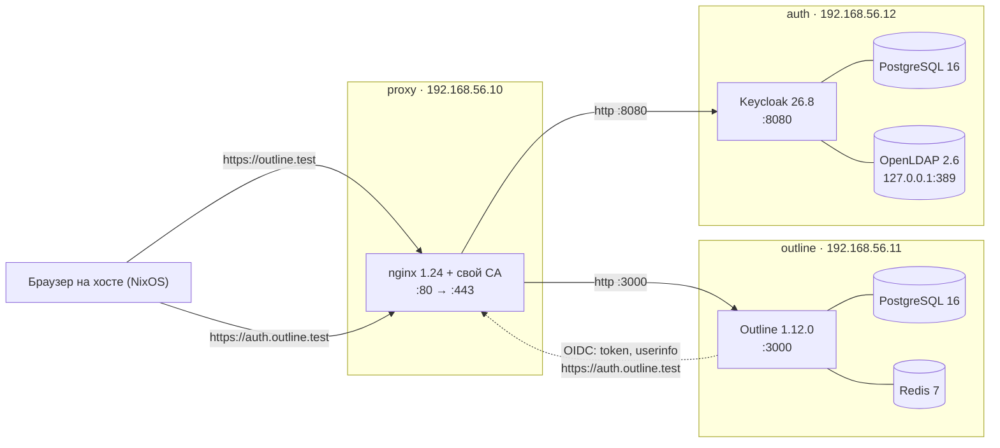

# Outline: ручная установка с LDAP и Keycloak

## Обзор

Стенд из трёх виртуальных машин запускает Outline v1.12.0 без Docker. Пользователи входят под учётками LDAP через Keycloak, весь внешний трафик идёт по HTTPS через nginx на proxy. Всё ниже записано по фактическому состоянию серверов на 31.10.2026 и проверено сквозным входом двух пользователей.



Сплошные стрелки — запросы браузера. Пунктир — обратный канал OIDC: Outline сам ходит в Keycloak через proxy по HTTPS и поэтому доверяет нашему CA. Линии без стрелок — локальные зависимости внутри ВМ. OpenLDAP слушает только 127.0.0.1, его читает один Keycloak.

| ВМ | IP | Ресурсы | Что установлено | Доступ снаружи |
| --- | --- | --- | --- | --- |
| proxy | 192.168.56.10 | 1 CPU, 1 ГБ RAM, swap 1 ГБ, диск 10 ГБ | nginx 1.24.0, свой центр сертификации | 22, 80, 443 |
| outline | 192.168.56.11 | 2 CPU, 4 ГБ RAM, swap 4 ГБ, диск 40 ГБ | Outline 1.12.0, Node.js 24.22.2, Yarn 4.18.0, PostgreSQL 16.15, Redis 7.0.15 | 22; 3000 только с proxy |
| auth | 192.168.56.12 | 2 CPU, 2 ГБ RAM, swap 2 ГБ, диск 20 ГБ | OpenLDAP 2.6.10, Keycloak 26.8.1, OpenJDK 25.0.4, PostgreSQL 16 | 22; 8080 только с proxy; LDAP 389 только на 127.0.0.1 |

Внешние имена `outline.test` и `auth.outline.test` указывают на proxy. Внутри стенда машины видят друг друга по коротким именам `proxy`, `outline`, `auth`. ОС всех машин — Ubuntu 24.04, хост — NixOS с Vagrant и libvirt.

Порядок установки совпадает с порядком разделов:

1. Поднять ВМ через Vagrant.
2. Установить Outline с его базой и Redis.
3. Настроить proxy: свой CA, сертификат, nginx.
4. Настроить OpenLDAP на auth.
5. Установить и настроить Keycloak на auth.
6. Подключить Outline к Keycloak по OIDC.
7. Прописать имена и доверие к CA на хосте.
8. Проверить вход от начала до конца.

## 1. Подготовка стенда (Vagrant)

Vagrant только поднимает чистые Ubuntu 24.04: обновляет систему, ставит базовые утилиты, делает swap и прописывает имена машин. Всё остальное ставится вручную по разделам ниже.

На хосте нужны Vagrant 2.4.9 и плагин vagrant-libvirt 0.12.2. Образ — `cloud-image/ubuntu-24.04`: он работает и с libvirt, и с VirtualBox.

Файлы стенда лежат в `~/Documents/Training/outline`:

| Файл | Что делает |
| --- | --- |
| `Vagrantfile` | Описывает три ВМ: IP, CPU, память, диск, swap. Общая папка `/vagrant` отключена, иначе libvirt требует NFS |
| `provision/common.sh` | Расширяет диск, ставит часовой пояс Europe/Moscow, `apt upgrade`, утилиты (curl, git, jq, openssl, ufw, vim, htop, unzip), swap и `vm.swappiness=10` |
| `provision/hosts.sh` | Дописывает имена стенда в `/etc/hosts` |
| шаг `ghostty-terminfo` в `Vagrantfile` | Переносит с хоста описание терминала Ghostty, иначе `clear`, `vim` и `htop` в ВМ не работают |

Подсеть `192.168.56.0/24` выбрана намеренно: `192.168.121.0/24` vagrant-libvirt занимает под служебную сеть.

Записи, которые `hosts.sh` добавляет на каждую машину:

```
192.168.56.10 proxy outline.test auth.outline.test # outline-lab
192.168.56.11 outline # outline-lab
192.168.56.12 auth # outline-lab
```

Основные команды (из каталога стенда):

```bash
vagrant up                                    # создать и подготовить все три ВМ
vagrant up auth                               # только одну
vagrant ssh outline                           # войти на машину
vagrant provision --provision-with hosts      # повторить только шаг с /etc/hosts
vagrant upload <файл> /tmp/<файл> <машина>    # скопировать файл с хоста на ВМ
vagrant status
```

## 2. Машина outline: установка Outline

Outline собирается из исходников тега v1.12.0 и запускается службой systemd от пользователя `outline`. Все команды — на машине outline (`vagrant ssh outline`).

### 2.1. Node.js и Yarn

v1.12.0 требует Node.js 24.18+ (или 22.23.1+) и Yarn 4.18.0. Yarn подтягивается через corepack по полю `packageManager` в `package.json`.

```bash
curl -fsSL https://deb.nodesource.com/setup_24.x | sudo bash -
sudo apt-get install -y nodejs build-essential python3
node -v                  # v24.18 или новее (на стенде v24.22.2)
sudo corepack enable
```

### 2.2. PostgreSQL и Redis

Обе службы слушают только localhost, менять это не нужно. Пароль базы сразу записываем в файл: в первый раз он потерялся вместе с переменной оболочки, и в `.env` осталась заглушка.

```bash
sudo apt-get install -y postgresql redis-server
sudo systemctl enable --now postgresql redis-server

DB_PASS=$(openssl rand -hex 24)
echo "DB_PASS=$DB_PASS" | sudo tee /root/outline-db.txt >/dev/null && sudo chmod 600 /root/outline-db.txt
sudo -u postgres psql -c "CREATE USER outline WITH PASSWORD '$DB_PASS';"
sudo -u postgres createdb -O outline outline
```

### 2.3. Пользователь, код и сборка

```bash
sudo useradd --system --create-home --shell /bin/bash outline
sudo install -d -o outline -g outline /opt/outline /var/lib/outline/data

sudo -iu outline
git clone --branch v1.12.0 --depth 1 https://github.com/outline/outline.git /opt/outline
cd /opt/outline
export COREPACK_ENABLE_DOWNLOAD_PROMPT=0
yarn install --immutable
yarn build                # долго; при "heap out of memory": NODE_OPTIONS=--max-old-space-size=3072 yarn build
exit
```

### 2.4. Файл `/opt/outline/.env`

Базовая часть, с которой Outline запускается. Блок `OIDC_*` добавляется позже, в разделе 6. `SECRET_KEY` и `UTILS_SECRET` — два разных значения `openssl rand -hex 32`, а `<DB_PASS>` нужно заменить на пароль из `/root/outline-db.txt`.

```ini
NODE_ENV=production
URL=https://outline.test
PORT=3000
SECRET_KEY=<hex 1>
UTILS_SECRET=<hex 2>

DATABASE_URL=postgres://outline:<DB_PASS>@localhost:5432/outline
PGSSLMODE=disable
REDIS_URL=redis://localhost:6379

FILE_STORAGE=local
FILE_STORAGE_LOCAL_ROOT_DIR=/var/lib/outline/data

# HTTPS завершается на nginx (proxy), Outline слушает HTTP
FORCE_HTTPS=false
```

```bash
sudo chown outline:outline /opt/outline/.env
sudo chmod 600 /opt/outline/.env       # в файле секреты; права 664 — ошибка
```

### 2.5. Служба systemd

`/etc/systemd/system/outline.service` — только сам файл, без команд внутри. Строка `NODE_EXTRA_CA_CERTS` добавляется в разделе 6.

```ini
[Unit]
Description=Outline
After=network.target postgresql.service redis-server.service
Requires=postgresql.service redis-server.service

[Service]
User=outline
WorkingDirectory=/opt/outline
EnvironmentFile=/opt/outline/.env
ExecStart=/usr/bin/node build/server/index.js
Restart=always

[Install]
WantedBy=multi-user.target
```

```bash
sudo systemctl daemon-reload
sudo systemctl enable --now outline
journalctl -u outline -f                      # первый запуск: "Running migrations…", затем "Listening on http://localhost:3000"
curl -s -o /dev/null -w '%{http_code}\n' http://localhost:3000/_health    # 200
```

Миграции базы Outline применяет сам при каждом запуске, `yarn db:migrate` вручную не нужен. Предупреждение `Enforced https was disabled with FORCE_HTTPS` ожидаемо.

### 2.6. Firewall

```bash
sudo ufw allow OpenSSH
sudo ufw allow from 192.168.56.10 to any port 3000 proto tcp
sudo ufw enable
```

Не открывай `https://outline.test` в браузере, пока не сделан раздел 6: там описано, как работает форма первого запуска и почему она важна.

## 3. Машина proxy: CA, сертификат и nginx

proxy — единственная точка входа: nginx завершает HTTPS для `outline.test` и `auth.outline.test` и передаёт запросы по HTTP на outline:3000 и auth:8080. Самоподписанный сертификат не подходит: Outline сам ходит в Keycloak по HTTPS и должен доверять сертификату. Поэтому делаем свой CA и раздаём его сертификат там, где нужно доверие.

### 3.1. nginx

```bash
sudo apt-get install -y nginx
# В nginx.conf Ubuntu разрешены устаревшие TLSv1 и TLSv1.1 — оставляем 1.2 и 1.3
sudo sed -i -E 's/^(\s*ssl_protocols ).*;/\1TLSv1.2 TLSv1.3;/' /etc/nginx/nginx.conf
```

### 3.2. Свой CA и сертификат на оба имени

Закрытый ключ CA хранится в `/root/ca`, отдельно от nginx. Сертификат CA действует 10 лет, сертификат сайта — 825 дней (до февраля 2029).

```bash
sudo -i
install -d -m 700 /root/ca
install -d -m 750 /etc/nginx/ssl
cd /root/ca

openssl req -x509 -new -nodes -newkey rsa:4096 -sha256 -days 3650 \
  -subj "/CN=Outline Lab CA" \
  -addext "basicConstraints=critical,CA:TRUE" \
  -addext "keyUsage=critical,keyCertSign,cRLSign" \
  -keyout ca.key -out ca.crt

openssl req -new -nodes -newkey rsa:2048 -subj "/CN=outline.test" \
  -keyout /etc/nginx/ssl/outline.test.key -out outline.test.csr

cat > outline.test.ext <<'EOF'
basicConstraints=CA:FALSE
keyUsage=critical,digitalSignature,keyEncipherment
extendedKeyUsage=serverAuth
subjectAltName=DNS:outline.test,DNS:auth.outline.test
EOF

openssl x509 -req -sha256 -days 825 -in outline.test.csr \
  -CA ca.crt -CAkey ca.key -CAcreateserial \
  -extfile outline.test.ext -out /etc/nginx/ssl/outline.test.crt

chmod 600 ca.key /etc/nginx/ssl/outline.test.key
openssl verify -CAfile ca.crt /etc/nginx/ssl/outline.test.crt    # OK
cp ca.crt /home/vagrant/outline-lab-ca.crt && chown vagrant: /home/vagrant/outline-lab-ca.crt
exit
```

`sudo -i` нужен намеренно: конструкции вида `sudo openssl … -extfile <(…)` не работают, потому что sudo закрывает лишние дескрипторы.

### 3.3. Конфиг сайта `/etc/nginx/sites-available/outline-lab`

```nginx
# WebSocket нужен Outline для совместного редактирования и realtime-обновлений
map $http_upgrade $connection_upgrade {
    default upgrade;
    ''      close;
}

upstream outline_app { server 192.168.56.11:3000; }
upstream keycloak    { server 192.168.56.12:8080; }

ssl_certificate     /etc/nginx/ssl/outline.test.crt;
ssl_certificate_key /etc/nginx/ssl/outline.test.key;
ssl_session_cache   shared:SSL:10m;
ssl_session_timeout 1d;

# Неизвестные имена и обращения по IP — отбрасываем
server {
    listen 80 default_server;
    listen [::]:80 default_server;
    server_name _;
    return 444;
}
server {
    listen 443 ssl http2 default_server;
    listen [::]:443 ssl http2 default_server;
    server_name _;
    ssl_reject_handshake on;
}

server {
    listen 80;
    listen [::]:80;
    server_name outline.test auth.outline.test;
    return 301 https://$host$request_uri;
}

server {
    listen 443 ssl http2;          # в nginx 1.24 директивы "http2 on;" ещё нет
    listen [::]:443 ssl http2;
    server_name outline.test;

    client_max_body_size 250m;     # лимит загрузки Outline по умолчанию 250 МБ

    location / {
        proxy_pass http://outline_app;
        proxy_http_version 1.1;
        proxy_set_header Host              $host;
        proxy_set_header X-Real-IP         $remote_addr;
        proxy_set_header X-Forwarded-For   $proxy_add_x_forwarded_for;
        proxy_set_header X-Forwarded-Proto $scheme;
        proxy_set_header Upgrade           $http_upgrade;
        proxy_set_header Connection        $connection_upgrade;
        proxy_read_timeout 3600s;
        proxy_send_timeout 3600s;
        proxy_buffering    off;
    }
}

server {
    listen 443 ssl http2;
    listen [::]:443 ssl http2;
    server_name auth.outline.test;

    location / {
        proxy_pass http://keycloak;
        proxy_http_version 1.1;
        proxy_set_header Host              $host;
        proxy_set_header X-Real-IP         $remote_addr;
        proxy_set_header X-Forwarded-For   $proxy_add_x_forwarded_for;
        proxy_set_header X-Forwarded-Proto $scheme;
        proxy_set_header X-Forwarded-Host  $host;
        proxy_set_header X-Forwarded-Port  443;
        # Keycloak отдаёт большие заголовки, иначе 502 "upstream sent too big header"
        proxy_buffer_size       128k;
        proxy_buffers           4 256k;
        proxy_busy_buffers_size 256k;
    }
}
```

```bash
sudo ln -sf /etc/nginx/sites-available/outline-lab /etc/nginx/sites-enabled/outline-lab
sudo rm -f /etc/nginx/sites-enabled/default
sudo nginx -t                    # без предупреждений
sudo systemctl reload nginx
```

### 3.4. Firewall

```bash
sudo ufw allow OpenSSH
sudo ufw allow 'Nginx Full'      # 80 и 443
sudo ufw enable
```

Пока Outline или Keycloak не запущены, nginx отвечает на их имена кодом 502 — это нормально.

## 4. Машина auth: OpenLDAP

OpenLDAP хранит пользователей и группы под `dc=outline,dc=test`. Он слушает только 127.0.0.1: читает его только Keycloak на той же машине, и только после входа под учётной записью. Outline с LDAP напрямую не работает.

### 4.1. Установка

```bash
sudo apt-get install -y slapd ldap-utils
sudo dpkg-reconfigure slapd
```

| Вопрос мастера | Ответ |
| --- | --- |
| Omit OpenLDAP server configuration? | No |
| DNS domain name | `outline.test` (даст `dc=outline,dc=test`) |
| Organization name | `Outline Lab` |
| Administrator password | пароль `cn=admin,dc=outline,dc=test`, сразу сохрани его |
| Remove database when slapd is purged? | No |
| Move old database? | Yes |

В `/etc/default/slapd` оставляем только localhost и локальный сокет:

```bash
SLAPD_SERVICES="ldap://127.0.0.1/ ldapi:///"
```

```bash
sudo systemctl restart slapd
sudo ss -ltnp | grep 389          # только 127.0.0.1:389
```

### 4.2. Права доступа

Три изменения в `cn=config`. Они сохраняются при перезапуске.

- root на этой машине управляет данными через `ldapi:///` без пароля (`sudo ldapadd -Q -Y EXTERNAL -H ldapi:/// …`).
- Анонимный вход запрещён (`bind_anon`).
- Без входа каталог не читается (`require authc`).

```bash
sudo ldapmodify -Q -Y EXTERNAL -H ldapi:/// <<'EOF'
dn: olcDatabase={1}mdb,cn=config
changetype: modify
add: olcAccess
olcAccess: {0}to * by dn.exact=gidNumber=0+uidNumber=0,cn=peercred,cn=external,cn=auth manage by * break
EOF

sudo ldapmodify -Q -Y EXTERNAL -H ldapi:/// <<'EOF'
dn: cn=config
changetype: modify
add: olcDisallows
olcDisallows: bind_anon
EOF

sudo ldapmodify -Q -Y EXTERNAL -H ldapi:/// <<'EOF'
dn: olcDatabase={-1}frontend,cn=config
changetype: modify
add: olcRequires
olcRequires: authc
EOF
```

Стандартные правила Ubuntu остаются: хеши `userPassword` никто, кроме владельца, не читает, остальное доступно на чтение любому вошедшему.

### 4.3. Структура каталога

| DN | Назначение |
| --- | --- |
| `ou=people,dc=outline,dc=test` | Пользователи Outline (`inetOrgPerson`) |
| `uid=admin,ou=people,…` | Outline Admin, `admin@mail.local` — администратор Outline |
| `uid=ivan,ou=people,…` | Ivan Petrov, `ivan@outline.test` — тестовый участник |
| `ou=groups,dc=outline,dc=test` | Группы (`groupOfNames`) |
| `cn=outline-users,ou=groups,…` | Группа: admin, ivan |
| `ou=services,dc=outline,dc=test` | Служебные учётные записи |
| `cn=keycloak,ou=services,…` | Учётная запись Keycloak, только чтение |

Хеш пароля для каждой записи делает `slappasswd -s '<пароль>'`, результат `{SSHA}…` идёт в `userPassword`. У каждого пользователя обязателен `mail`: без почты Outline не пускает. Кириллицу в LDIF пишут в base64 (`cn:: …`), поэтому имена латиницей.

Файл `directory.ldif`:

```ldif
dn: ou=people,dc=outline,dc=test
objectClass: organizationalUnit
ou: people

dn: ou=groups,dc=outline,dc=test
objectClass: organizationalUnit
ou: groups

dn: ou=services,dc=outline,dc=test
objectClass: organizationalUnit
ou: services

dn: uid=admin,ou=people,dc=outline,dc=test
objectClass: inetOrgPerson
uid: admin
cn: Outline Admin
givenName: Outline
sn: Admin
mail: admin@mail.local
userPassword: {SSHA}...

dn: uid=ivan,ou=people,dc=outline,dc=test
objectClass: inetOrgPerson
uid: ivan
cn: Ivan Petrov
givenName: Ivan
sn: Petrov
mail: ivan@outline.test
userPassword: {SSHA}...

dn: cn=keycloak,ou=services,dc=outline,dc=test
objectClass: organizationalRole
objectClass: simpleSecurityObject
cn: keycloak
description: Read-only bind account for Keycloak
userPassword: {SSHA}...

dn: cn=outline-users,ou=groups,dc=outline,dc=test
objectClass: groupOfNames
cn: outline-users
member: uid=admin,ou=people,dc=outline,dc=test
member: uid=ivan,ou=people,dc=outline,dc=test
```

```bash
sudo ldapadd -Q -Y EXTERNAL -H ldapi:/// -f directory.ldif
```

### 4.4. Проверка

```bash
ldapwhoami -x -H ldap://127.0.0.1 -D uid=ivan,ou=people,dc=outline,dc=test -W          # dn:uid=ivan,...
ldapsearch -x -LLL -H ldap://127.0.0.1 -D cn=keycloak,ou=services,dc=outline,dc=test -W \
  -b ou=people,dc=outline,dc=test uid mail userPassword                                   # uid и mail видны, userPassword нет
ldapsearch -x -LLL -H ldap://127.0.0.1 -b dc=outline,dc=test                            # отказ: анонимный доступ закрыт
```

## 5. Машина auth: Keycloak

Keycloak 26.8.1 проверяет пароли в LDAP и выдаёт Outline подтверждение входа по OIDC. Он работает за nginx: снаружи `https://auth.outline.test`, внутри обычный HTTP на порту 8080. Свои данные Keycloak хранит в локальном PostgreSQL.

### 5.1. Java и база

Keycloak 26.8 требует OpenJDK 25, он есть в `noble-updates`.

```bash
sudo apt-get install -y openjdk-25-jre-headless postgresql
KC_DB_PASS=$(openssl rand -hex 24); echo "KC_DB_PASS=$KC_DB_PASS" | sudo tee /root/keycloak-db.txt >/dev/null
sudo -u postgres psql -c "CREATE ROLE keycloak WITH LOGIN PASSWORD '$KC_DB_PASS';"
sudo -u postgres createdb -O keycloak keycloak
```

### 5.2. Установка в `/opt/keycloak`

```bash
V=26.8.1
U=https://github.com/keycloak/keycloak/releases/download/$V/keycloak-$V.tar.gz
sudo useradd --system --no-create-home --home-dir /opt/keycloak --shell /usr/sbin/nologin keycloak
curl -fsSL -o /tmp/kc.tar.gz "$U"
echo "$(curl -fsSL "$U.sha1" | awk '{print $1}')  /tmp/kc.tar.gz" | sha1sum -c -     # OK
sudo install -d /opt/keycloak
sudo tar -xzf /tmp/kc.tar.gz -C /opt/keycloak --strip-components=1
sudo chown -R keycloak:keycloak /opt/keycloak
```

`/opt/keycloak/conf/keycloak.conf` (владелец `keycloak`, права 600):

```ini
db=postgres
db-url=jdbc:postgresql://localhost:5432/keycloak
db-username=keycloak
db-password=<KC_DB_PASS>

# Keycloak за nginx на proxy: снаружи HTTPS, внутри HTTP
hostname=https://auth.outline.test
http-enabled=true
http-port=8080
proxy-headers=xforwarded
```

```bash
sudo -u keycloak /opt/keycloak/bin/kc.sh build     # повторять после смены db и других опций сборки
```

### 5.3. Служба и временный администратор

Временный администратор нужен только на первый запуск. `/etc/keycloak-bootstrap.env` (root, права 600):

```ini
KC_BOOTSTRAP_ADMIN_USERNAME=temp-admin
KC_BOOTSTRAP_ADMIN_PASSWORD=<случайный пароль>
```

`/etc/systemd/system/keycloak.service`:

```ini
[Unit]
Description=Keycloak
After=network.target postgresql.service slapd.service
Requires=postgresql.service

[Service]
User=keycloak
EnvironmentFile=-/etc/keycloak-bootstrap.env
ExecStart=/opt/keycloak/bin/kc.sh start --optimized
Restart=on-failure
SuccessExitStatus=143

[Install]
WantedBy=multi-user.target
```

```bash
sudo systemctl daemon-reload && sudo systemctl enable --now keycloak
journalctl -u keycloak -f            # "Keycloak 26.8.1 … started", около 30 с
sudo ufw allow OpenSSH
sudo ufw allow from 192.168.56.10 to any port 8080 proto tcp
sudo ufw enable
```

### 5.4. Настройка в консоли `https://auth.outline.test/admin`

1. Войти под `temp-admin`. В realm **master** создать постоянного `admin`, задать пароль и выдать роль `admin`.
2. Войти под `admin`, удалить `temp-admin`, удалить `/etc/keycloak-bootstrap.env`.
3. **Create realm**: `outline`, Display name `Outline Lab`. В Realm settings → Login выключить User registration и Forgot password.
4. **User federation → Add LDAP provider** — значения в таблице ниже. Test connection и Test authentication должны пройти.
5. В этом провайдере → Mappers → **first name**: LDAP Attribute `givenName` вместо `cn`. Иначе именем станет «Ivan Petrov» целиком.
6. Mappers → **Add mapper** `groups`, тип `group-ldap-mapper` (значения ниже).
7. Action → **Sync all users**, затем в маппере groups — **Sync LDAP groups to Keycloak**.
8. **Clients → Create client** `outline` (значения ниже), затем вкладка Credentials → скопировать **Client secret**.

LDAP-провайдер `ldap`:

| Поле | Значение |
| --- | --- |
| Vendor | Other |
| Connection URL | `ldap://127.0.0.1:389` |
| Bind type / Bind DN | simple / `cn=keycloak,ou=services,dc=outline,dc=test` |
| Edit mode | READ\_ONLY |
| Users DN | `ou=people,dc=outline,dc=test`, Search scope: One Level |
| Username / RDN LDAP attribute | `uid` / `uid` |
| UUID LDAP attribute | `entryUUID` |
| User object classes | `inetOrgPerson` |
| Trust Email | On (Outline привязывает учётную запись по подтверждённой почте) |
| Import users / Sync registrations | On / Off |
| Periodic full / changed sync | 3600 с / 300 с |

Маппер `groups`:

| Поле | Значение |
| --- | --- |
| LDAP Groups DN | `ou=groups,dc=outline,dc=test` |
| Group name LDAP attribute / object classes | `cn` / `groupOfNames` |
| Membership LDAP attribute / type | `member` / DN |
| Membership user LDAP attribute | `uid` |
| Mode | READ\_ONLY |
| User groups retrieve strategy | LOAD\_GROUPS\_BY\_MEMBER\_ATTRIBUTE |

Клиент `outline`:

| Поле | Значение |
| --- | --- |
| Client type / Client ID | OpenID Connect / `outline` |
| Client authentication | On |
| Authentication flow | только Standard flow |
| Root URL / Home URL | `https://outline.test` |
| Valid redirect URIs | `https://outline.test/auth/oidc.callback` |
| Valid post logout redirect URIs / Web origins | `https://outline.test` |

То же самое можно сделать из консоли через `/opt/keycloak/bin/kcadm.sh`: так сделан скрипт `scripts/keycloak-configure.sh`. К `kcadm.sh` подключаются на самой auth: `kcadm.sh config credentials --server http://localhost:8080 --realm master --user admin`.

## 6. Подключение Outline к Keycloak (OIDC)

После этого раздела на странице входа Outline появляется кнопка «Continue with LDAP». Обратные запросы Outline к Keycloak (обмен кода на токен, userinfo) идут по HTTPS через proxy, поэтому машина outline должна доверять нашему CA.

### 6.1. Доверие к CA на outline

Команды с хоста, из каталога стенда:

```bash
vagrant ssh proxy -c 'cat /home/vagrant/outline-lab-ca.crt' > outline-lab-ca.crt
vagrant upload outline-lab-ca.crt /tmp/outline-lab-ca.crt outline
vagrant ssh outline -c 'sudo install -m 644 /tmp/outline-lab-ca.crt /usr/local/share/ca-certificates/ && sudo update-ca-certificates'
```

Предупреждение `rehash: warning: skipping ca-certificates.crt` — обычный шум. Проверка на outline, без флага `-k`:

```bash
curl -s -o /dev/null -w '%{http_code}\n' https://auth.outline.test/realms/outline/.well-known/openid-configuration   # 200
```

Node.js системное хранилище не читает, поэтому в `[Service]` файла `outline.service` после `EnvironmentFile=` добавляем:

```ini
Environment=NODE_EXTRA_CA_CERTS=/usr/local/share/ca-certificates/outline-lab-ca.crt
```

### 6.2. Блок OIDC в `/opt/outline/.env`

`OIDC_CLIENT_SECRET` — Client secret клиента `outline` из Keycloak (на auth он в `/root/keycloak-credentials.txt`).

```ini
OIDC_CLIENT_ID=outline
OIDC_CLIENT_SECRET=<client secret>
OIDC_AUTH_URI=https://auth.outline.test/realms/outline/protocol/openid-connect/auth
OIDC_TOKEN_URI=https://auth.outline.test/realms/outline/protocol/openid-connect/token
OIDC_USERINFO_URI=https://auth.outline.test/realms/outline/protocol/openid-connect/userinfo
OIDC_LOGOUT_URI=https://auth.outline.test/realms/outline/protocol/openid-connect/logout
OIDC_USERNAME_CLAIM=preferred_username
OIDC_DISPLAY_NAME=LDAP
OIDC_SCOPES=openid profile email
```

```bash
sudo systemctl daemon-reload && sudo systemctl restart outline
curl -s -X POST http://localhost:3000/api/auth.config -H 'Content-Type: application/json' -d '{}' | jq -c '[.data.providers[].name]'
# ["LDAP"]
```

### 6.3. Первый вход и администратор

Пока в базе нет рабочего пространства, Outline показывает форму первого запуска: название, имя, почта. Она создаёт администратора и впускает без пароля, сессия живёт 3 месяца или до выхода. Форма срабатывает один раз: потом сервер отвечает `Installation already has existing teams`.

Если формой воспользовались до настройки OIDC, после выхода страница входа останется без кнопок. Доступ возвращается так: в LDAP заводится пользователь с той же почтой. При первом входе через Keycloak Outline находит существующую учётную запись по подтверждённой почте и привязывает к ней вход. Именно так на стенде администратор `admin@mail.local` стал LDAP-пользователем `uid=admin`.

При ручной установке с нуля проще сначала сделать этот раздел и только потом открывать сайт. Тогда первый, кто войдёт через LDAP, создаст пространство и станет его администратором. Все последующие пользователи LDAP при первом входе попадают в пространство участниками (роль member).

## 7. Хост: имена и доверие к CA

Браузер на хосте должен знать, что `outline.test` и `auth.outline.test` — это 192.168.56.10, и доверять `outline-lab-ca.crt` (лежит в каталоге стенда). Для этого нужны имена в hosts и сам сертификат.

### 7.1. NixOS — постоянно, через `configuration.nix`

```nix
networking.hosts."192.168.56.10" = [ "outline.test" "auth.outline.test" ];
security.pki.certificateFiles = [ /home/nellaror/Documents/Training/outline/outline-lab-ca.crt ];
```

Применить: `sudo nixos-rebuild switch`.

### 7.2. NixOS — без пересборки

`/etc/hosts` и `/etc/ssl/certs` на NixOS — ссылки на файлы только для чтения.

```bash
# hosts: работает сразу, сбрасывается при следующем nixos-rebuild switch или перезагрузке
sudo cp --remove-destination "$(readlink -f /etc/hosts)" /etc/hosts
echo '192.168.56.10 outline.test auth.outline.test' | sudo tee -a /etc/hosts

# Chrome / Chromium: CA в своё хранилище профиля
nix-shell -p nssTools --run \
  'certutil -d sql:$HOME/.pki/nssdb -A -t "C,," -n "Outline Lab CA" -i ~/Documents/Training/outline/outline-lab-ca.crt'

# curl и другие консольные утилиты
curl --cacert ~/Documents/Training/outline/outline-lab-ca.crt https://outline.test/_health
```

Firefox держит собственный список: Настройки → Приватность и защита → Сертификаты → Просмотр сертификатов → Центры сертификации → Импортировать, галочка «Доверять при идентификации веб-сайтов». Импорт в браузер сохраняется в профиле и пересборку системы переживает.

### 7.3. Другие ОС

| ОС | hosts | Доверие к CA |
| --- | --- | --- |
| Debian / Ubuntu | `echo '192.168.56.10 outline.test auth.outline.test' \| sudo tee -a /etc/hosts` | `sudo cp outline-lab-ca.crt /usr/local/share/ca-certificates/ && sudo update-ca-certificates` |
| Fedora / RHEL | то же | `sudo cp outline-lab-ca.crt /etc/pki/ca-trust/source/anchors/ && sudo update-ca-trust` |
| Arch | то же | `sudo trust anchor --store outline-lab-ca.crt` |
| macOS | то же, `/etc/hosts` | `sudo security add-trusted-cert -d -r trustRoot -k /Library/Keychains/System.keychain outline-lab-ca.crt` |
| Windows | `C:\Windows\System32\drivers\etc\hosts`, редактор от администратора | `certutil -addstore -f Root outline-lab-ca.crt` от администратора |

## 8. Проверка работоспособности

31.10.2026 все проверки ниже прошли, в том числе сквозной вход под `admin` и `ivan`. Команды с proxy выполняются от root: там в `/root/ca/ca.crt` лежит сертификат CA, как у браузера.

| Что проверяем | Где и чем | Ожидаемо |
| --- | --- | --- |
| Службы запущены | `systemctl is-active outline postgresql redis-server` (outline), `… keycloak slapd postgresql` (auth), `… nginx` (proxy) | `active` везде |
| Outline жив | outline: `curl -s -o /dev/null -w '%{http_code}' http://localhost:3000/_health` | `200` |
| Способ входа есть | outline: `curl -s -X POST http://localhost:3000/api/auth.config -H 'Content-Type: application/json' -d '{}'` | в `providers` есть `oidc` с именем `LDAP` |
| Перенаправление на HTTPS | proxy: `curl -s -o /dev/null -w '%{http_code} %{redirect_url}' http://outline.test/` | `301 https://outline.test/` |
| HTTPS и HTTP/2 | proxy: `curl --cacert /root/ca/ca.crt -s -o /dev/null -w '%{http_code} %{http_version}' https://outline.test/_health` | `200 2` |
| WebSocket через proxy | proxy: `curl --cacert /root/ca/ca.crt -i --http1.1 -H 'Origin: https://outline.test' -H 'Connection: Upgrade' -H 'Upgrade: websocket' -H 'Sec-WebSocket-Version: 13' -H 'Sec-WebSocket-Key: dGhlIHNhbXBsZSBub25jZQ==' 'https://outline.test/realtime/?EIO=4&transport=websocket'` | `HTTP/1.1 101 Switching Protocols` (без `Origin` — 400, это нормально) |
| Издатель токенов Keycloak | proxy: `curl --cacert /root/ca/ca.crt -s https://auth.outline.test/realms/outline/.well-known/openid-configuration \| jq -r .issuer` | `https://auth.outline.test/realms/outline` |
| TLS | proxy: `openssl s_client -connect 127.0.0.1:443 -servername outline.test -tls1_1` | соединение отклонено; без флага — `TLSv1.3` |
| Обращение по IP | с любой машины: `curl -k https://192.168.56.10/` | TLS-рукопожатие отклонено |
| Firewall | outline: `curl -m 5 http://192.168.56.12:8080` | тайм-аут: на Keycloak пускают только с proxy |
| Сквозной вход | proxy: `sudo bash scripts/e2e-login.sh ivan '<пароль>'` (скрипт загрузить через `vagrant upload`) | 5 шагов, в конце `{"user":{"name":"Ivan Petrov",…,"role":"member"},"team":"Lab"}` |

Сквозной вход повторяет действия браузера: Outline перенаправляет на Keycloak → страница входа → пароль из LDAP → возврат на `/auth/oidc.callback` → запрос `auth.info` с полученной сессией. Если он проходит, браузеру нужны только имена и CA из раздела 7.

## 9. Эксплуатация

Пользователи заводятся только в LDAP: Keycloak и Outline подхватывают их сами. Обновления делаются теми же шагами, что и установка.

### 9.1. Новый пользователь

На auth:

```bash
HASH=$(slappasswd -s '<пароль>')
sudo ldapadd -Q -Y EXTERNAL -H ldapi:/// <<EOF
dn: uid=petr,ou=people,dc=outline,dc=test
objectClass: inetOrgPerson
uid: petr
cn: Petr Ivanov
givenName: Petr
sn: Ivanov
mail: petr@outline.test
userPassword: $HASH
EOF

sudo ldapmodify -Q -Y EXTERNAL -H ldapi:/// <<'EOF'
dn: cn=outline-users,ou=groups,dc=outline,dc=test
changetype: modify
add: member
member: uid=petr,ou=people,dc=outline,dc=test
EOF
```

Синхронизировать вручную не нужно: при первом входе Keycloak сам найдёт пользователя в LDAP, а Outline добавит его в пространство Lab участником. Полная синхронизация идёт раз в час, изменений — раз в 5 минут. Сменить роль в Outline можно в Настройки → Участники.

Смена пароля: `ldappasswd -H ldapi:/// -Y EXTERNAL -Q -s '<новый>' uid=petr,ou=people,dc=outline,dc=test` (через `sudo`).

### 9.2. Журналы

| Компонент | Команда |
| --- | --- |
| Outline | `journalctl -u outline -f` (JSON, ошибки — `"level":"error"`) |
| Keycloak | `journalctl -u keycloak -f`; неудачные входы — `grep LOGIN_ERROR` |
| OpenLDAP | `journalctl -u slapd -f` |
| nginx | `/var/log/nginx/access.log`, `/var/log/nginx/error.log` |

### 9.3. Обновление Outline

Перед обновлением сверь требования к Node.js в `package.json` нового тега (`engines.node`).

```bash
sudo -u postgres pg_dump outline > ~/outline-before-update.sql
sudo -iu outline
cd /opt/outline
git fetch --depth 1 origin tag vX.Y.Z
git checkout vX.Y.Z
yarn install --immutable && yarn build
exit
sudo systemctl restart outline        # миграции применятся при запуске
```

### 9.4. Обновление Keycloak

```bash
sudo -u postgres pg_dump keycloak > ~/keycloak-before-update.sql
sudo systemctl stop keycloak
sudo cp -a /opt/keycloak/conf/keycloak.conf /root/
# распаковать новую версию в /opt/keycloak как в 5.2, вернуть keycloak.conf, chown -R keycloak:keycloak /opt/keycloak
sudo -u keycloak /opt/keycloak/bin/kc.sh build
sudo systemctl start keycloak         # базу Keycloak обновит сам при запуске
```

### 9.5. Что копировать для восстановления

| Машина | Данные |
| --- | --- |
| outline | `pg_dump outline`, `/var/lib/outline/data` (вложения), `/opt/outline/.env` |
| auth | `slapcat -n 1` (каталог), `slapcat -n 0` (cn=config), `pg_dump keycloak`, `/opt/keycloak/conf/keycloak.conf` |
| proxy | `/root/ca` (CA и его ключ), `/etc/nginx/ssl`, `/etc/nginx/sites-available/outline-lab` |

Перезапуск стенда целиком: `vagrant halt` и `vagrant up`. Все службы включены в автозапуск, порядок старта машин не важен.

## 10. Проблемы при развёртывании и решения

В таблице 12 проблем. Три реально ломали работу (база, вход, терминал), три учтены заранее при проектировании (подсеть, сертификат, Google), три — предупреждения и дыры в правах, ещё три — ложные тревоги в самих проверках. Все решения уже учтены в разделах выше.

| Симптом | Причина | Решение |
| --- | --- | --- |
| Outline падает через 1,4 с, в журнале `password authentication failed for user "outline"`, systemd сдаётся после 5 перезапусков | В `DATABASE_URL` осталась заглушка `<DB_PASS>`, пароль был только в переменной оболочки | Новый пароль роли (`ALTER ROLE outline WITH PASSWORD …`), тот же в `.env`; пароль сразу сохранять в файл (2.2) |
| `outline.service:15: Missing '=', ignoring line` | В файл службы скопировались команды `sudo systemctl …` | Удалить эти строки, `daemon-reload` |
| `.env` читается всеми (права 664) | Файл создан с umask по умолчанию | `chmod 600 /opt/outline/.env` |
| После выхода страница входа пустая, кнопок нет | Вход был одноразовой сессией формы первого запуска, способов входа не было (`providers: []`) | Настроить OIDC (раздел 6), завести в LDAP пользователя с почтой администратора |
| В ВМ `clear`: `'xterm-ghostty': unknown terminal type` | В Ubuntu 24.04 нет terminfo для Ghostty | Шаг `ghostty-terminfo` в Vagrantfile; вручную: `infocmp -x xterm-ghostty \| ssh <хост> -- tic -x -` |
| Конфликт сетей при адресе из `192.168.121.0/24` | Эту подсеть vagrant-libvirt берёт под служебную сеть | Использовать `192.168.56.0/24` |
| Outline не принимает самоподписанный сертификат Keycloak (`self-signed certificate`) | Node.js проверяет TLS при обмене кода на токен и не читает системное хранилище | Свой CA (3.2) + `NODE_EXTRA_CA_CERTS` (6.1) |
| `nginx -t`: `duplicate value "TLSv1.2"`, `protocol options redefined for 0.0.0.0:443` | `ssl_protocols` уже задан в `nginx.conf` Ubuntu (с TLSv1/1.1); у сервера по умолчанию не было `http2` | Править `ssl_protocols` в `nginx.conf`, `http2` на всех `listen 443` (3.1, 3.3) |
| Google-вход не настраивается на `outline.test` | Google не принимает адреса возврата на домене `.test` | Свой OIDC: Keycloak + LDAP |
| Проверка WebSocket даёт 400 (ложная тревога) | Outline отклоняет подключения без заголовка `Origin`, браузер его всегда присылает | Проверять с `-H 'Origin: https://outline.test'` → 101 |
| `userinfo` возвращает 401 при тесте через `admin-cli` (ложная тревога) | `admin-cli` в Keycloak 26 выдаёт облегчённые токены (`Lightweight access token not allowed for userinfo endpoint`) | Проверять через клиент `outline`; у него такого режима нет |
| Неверный пароль даёт 400, а не 401 (ложная тревога) | По стандарту OAuth ошибка `invalid_grant` идёт с кодом 400 | Проверять поле `error`, а не код |

Быстрая диагностика по симптому:

- **502 на `outline.test`** — Outline не запущен или ufw на outline не пускает proxy: `systemctl status outline`, `curl http://192.168.56.11:3000/_health` с proxy.
- **502 на `auth.outline.test`** — Keycloak не запущен, ufw на auth или не хватает `proxy_buffer_size`.
- **`Invalid parameter: redirect_uri`** — адрес возврата клиента не равен `https://outline.test/auth/oidc.callback`.
- **Вход в Keycloak прошёл, Outline выдал ошибку** — у пользователя нет `mail` или выключен Trust Email.
- **В журнале Outline `unable to verify the first certificate`** — нет `NODE_EXTRA_CA_CERTS` или CA не установлен на outline.

## 11. Секреты и учётные данные

Пароли в этом документе не записаны. Все они лежат на серверах в файлах с доступом только для root или владельца службы.

| Что | Где | Доступ |
| --- | --- | --- |
| Пароли LDAP-пользователей `admin`, `ivan` и учётной записи `cn=keycloak` | auth: `/root/ldap-credentials.txt` | root, 600 |
| Пароль `cn=admin,dc=outline,dc=test` (администратор LDAP) | задан вручную в `dpkg-reconfigure slapd`, на сервере не сохранён | — |
| Администратор Keycloak `admin`, пароль базы `keycloak`, Client secret `outline` | auth: `/root/keycloak-credentials.txt` | root, 600 |
| Настройки Keycloak с паролем базы | auth: `/opt/keycloak/conf/keycloak.conf` | keycloak, 600 |
| `SECRET_KEY`, `UTILS_SECRET`, пароль базы `outline`, `OIDC_CLIENT_SECRET` | outline: `/opt/outline/.env` (копии — `.env.bak-*`) | outline, 600 |
| Закрытый ключ CA | proxy: `/root/ca/ca.key` | root, 600 |
| Ключ сертификата сайта | proxy: `/etc/nginx/ssl/outline.test.key` | root, 600 |
| Сертификат CA (публичный, можно раздавать) | хост: `outline-lab-ca.crt` в каталоге стенда; proxy: `/root/ca/ca.crt`; outline: `/usr/local/share/ca-certificates/` | чтение для всех |

Посмотреть с хоста: `vagrant ssh auth -c 'sudo cat /root/ldap-credentials.txt /root/keycloak-credentials.txt'`.

Скрипты, которыми стенд доводился до рабочего состояния, лежат в `scripts/` каталога стенда. Они повторяют шаги этого документа, их можно запускать повторно, секретов внутри нет: `ldap-setup.sh`, `keycloak-install.sh`, `keycloak-configure.sh`, `proxy-setup.sh`, `outline-oidc.sh`, `e2e-login.sh`.
