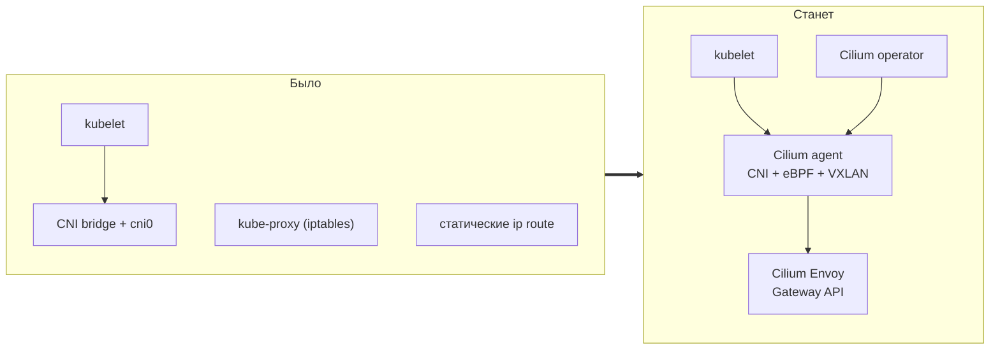
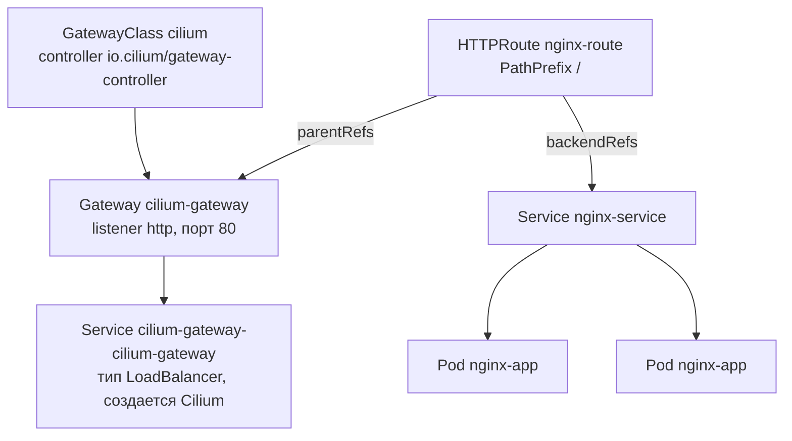
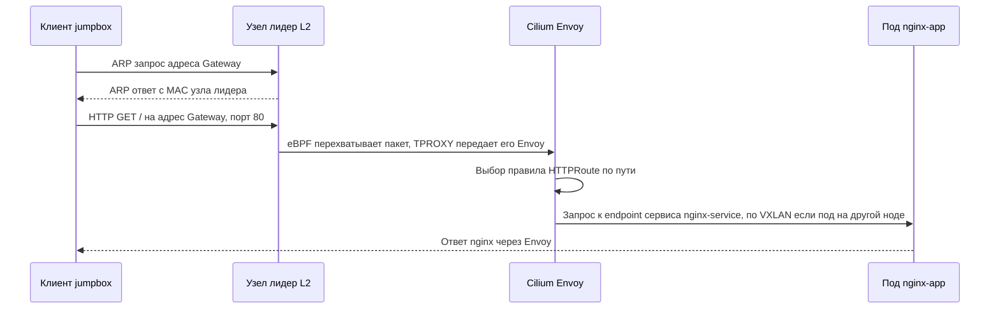

---
tags:
  - kubernetes
  - devops
  - k8s-the-hard-way
  - cilium
  - gateway-api
  - lab
date: 2026-10-18
status: draft
---

# Gateway API на Cilium для Kubernetes The Hard Way

Продолжение заметки [[Kubernetes The Hard Way v1]]. После успешных smoke-тестов классический сетевой стек кластера (CNI `bridge`, `kube-proxy`, статические маршруты) заменяется на Cilium, а для публикации приложений включается Gateway API. Тестовое приложение nginx публикуется через ресурсы `Gateway` и `HTTPRoute`.

> [!abstract] Результат
> - Cilium работает как CNI и полностью заменяет `kube-proxy` (eBPF вместо iptables).
> - Установлены CRD Gateway API, включен контроллер Gateway API в составе Cilium.
> - Gateway получает собственный IP-адрес из локальной сети `192.168.56.0/24` и отвечает на порту 80.
> - nginx доступен по HTTP с jumpbox через `Gateway` и `HTTPRoute`.

> [!warning] Версии связаны между собой
> Каждая версия Cilium рассчитана на конкретную версию CRD Gateway API: для Cilium 1.20.x это v1.6.3. Версии в этой заметке сверены с документацией Cilium 1.20.3 на 2026-10-18. При другой версии Cilium используйте CRD из раздела Gateway API Support документации именно этой версии.

## Содержание

- [[#Обзор и соглашения]]
- [[#1. Проверка исходного состояния]]
- [[#2. CRD Gateway API]]
- [[#3. Cilium CLI]]
- [[#4. Замена kube-proxy и старого CNI на worker-нодах]]
- [[#5. Установка Cilium]]
- [[#6. Адреса для Gateway (LB-IPAM и L2 Announcements)]]
- [[#7. Тестовое приложение, Gateway и HTTPRoute]]
- [[#8. Проверка трафика]]
- [[#9. Диагностика и типичные проблемы]]
- [[#10. Очистка и откат]]
- [[#Темы для ознакомления]]

## Обзор и соглашения

### Что меняется в кластере

| Функция | Было (основная заметка) | Станет (эта заметка) |
| --- | --- | --- |
| CNI | Плагин `bridge`, файл `10-bridge.conf` | Cilium, оверлей VXLAN |
| Адреса подов | `host-local`, подсети из `machines.txt` | `cluster-pool` IPAM: оператор выдает каждой ноде `/24` из пула `10.244.0.0/16` |
| Связь подов между нодами | Статические `ip route` (раздел 9) | Туннели VXLAN, статические маршруты не нужны |
| Сервисы (ClusterIP, NodePort) | `kube-proxy`, правила iptables | Cilium, eBPF (`kubeProxyReplacement=true`) |
| Публикация приложений | Service типа NodePort | Gateway API: `Gateway` и `HTTPRoute`, Envoy в составе Cilium |
| Сервисы типа LoadBalancer | Отсутствуют | LB-IPAM и L2 Announcements, пул `192.168.56.200-210` |



### Как устроен Gateway API

Gateway API описывает входящий трафик набором ресурсов с разделением ролей: `GatewayClass` определяет, какой контроллер обслуживает шлюзы, `Gateway` описывает точки входа (порты и протоколы), `HTTPRoute` задает правила маршрутизации к сервисам. Cilium создает `GatewayClass` с именем `cilium` и для каждого `Gateway` автоматически создает сервис типа LoadBalancer с именем `cilium-gateway-<имя Gateway>`.



Путь одного запроса от клиента до пода:



### Версии

| Компонент | Версия | Примечание |
| --- | --- | --- |
| Cilium | 1.20.3 | Текущая стабильная ветка документации |
| CRD Gateway API (канал standard) | v1.6.3 | Версия, под которую собран Cilium 1.20.3 |
| Cilium CLI | Последняя стабильная | Определяется из `stable.txt` при установке (на момент проверки `v0.20.1`) |
| Ядро Linux на нодах | 6.1 (Debian 12) | Cilium 1.20 требует ядро 5.10 или новее |

### Адресация и порты

| Назначение | Значение |
| --- | --- |
| Сеть нод | `192.168.56.0/24` |
| Пул адресов подов | `10.244.0.0/16`, на каждую ноду выделяется `/24` |
| Пул адресов для LoadBalancer | `192.168.56.200` - `192.168.56.210` (не должен пересекаться с адресами нод) |
| VXLAN между нодами | `8472/udp` |
| Проверка здоровья Cilium между нодами | `4240/tcp` и ICMP |
| Listener Gateway | `80/tcp` |

В Vagrant и VirtualBox трафик между ВМ не фильтруется. Если на нодах включен файрвол, откройте `8472/udp`, `4240/tcp` и ICMP между нодами.

> [!note] Подсети подов изменятся
> Подсети нодам назначает оператор Cilium, поэтому они могут не совпасть с `10.244.1.0/24` и `10.244.2.0/24` из `machines.txt`. Колонка Pod CIDR в `machines.txt` Cilium больше не использует.

> [!note] manager01 не является узлом Cilium
> На `manager01` нет kubelet, а значит нет и агента Cilium. Прямого доступа к IP-адресам подов с `manager01` больше не будет (статические маршруты удаляются в разделе 4). Доступ к приложениям идет через Gateway. Команды `kubectl logs`, `exec` и `port-forward` продолжают работать: они проходят через kubelet.

### Соглашения документа

| Маркер | Где выполнять |
| --- | --- |
| `# [jumpbox]` | На jumpbox под root, команды для worker-нод выполняются по SSH |
| `# [manager01]` | На manager01 под root (вход: `ssh root@manager01`), `kubectl` настроен через `~/.kube/config` |

Манифесты хранятся на `manager01` в каталоге `/root/gateway-lab`.

## 1. Проверка исходного состояния

Перед заменой сетевого стека убедитесь, что кластер из основной заметки здоров, а ноды соответствуют требованиям Cilium.

```bash
# [manager01]
kubectl get nodes -o wide
kubectl get pods -A
```

> [!success] Ожидаемый результат
> Обе ноды в статусе `Ready`, в колонке `INTERNAL-IP` адреса `192.168.56.11` и `192.168.56.12`. Рабочих подов нет (тестовые ресурсы из smoke-тестов удалены). Если в `INTERNAL-IP` указан `10.0.2.15`, исправьте это по таблице диагностики основной заметки: Cilium строит VXLAN-туннели по внутренним адресам нод, и с адресом NAT-интерфейса связь между нодами не заработает.

Проверка ядра, нужных модулей и сетевого интерфейса на воркерах:

```bash
# [jumpbox]
for host in worker01 worker02; do
  echo "== ${host}: ядро $(ssh root@${host} uname -r)"
  ssh root@${host} 'for m in vxlan ip_set xt_set xt_mark xt_CT xt_TPROXY xt_socket; do
    modinfo "$m" > /dev/null 2>&1 && echo "  ok       $m" || echo "  MISSING  $m"
  done
  ip -br addr show eth1'
done
```

> [!info]- Зачем нужны эти модули
> - `vxlan` - оверлейная сеть между нодами.
> - `ip_set`, `xt_set` - правила iptables по наборам адресов (маскарадинг в режиме по умолчанию).
> - `xt_mark`, `xt_CT`, `xt_TPROXY`, `xt_socket` - прозрачная передача трафика в Envoy. Они нужны именно для Gateway API: без них соединения с Gateway завершаются таймаутом, хотя сам Gateway выглядит рабочим.
> - `eth1` - интерфейс host-only сети. Его имя используется в политике L2 Announcements (раздел 6).

> [!success] Ожидаемый результат
> Для всех модулей выводится `ok`, интерфейс `eth1` в состоянии `UP` с адресом `192.168.56.11/24` (или `.12`). Если модуль отсутствует (`MISSING`), используйте ядро с полным набором netfilter (`linux-image-amd64`). Если имя интерфейса отличается от `eth1`, подставьте его в политику раздела 6.

Проверка доступа в интернет: образы Cilium загружаются с `quay.io`, чарт - с `helm.cilium.io`.

```bash
# [jumpbox]
ssh root@manager01 "curl -sI https://helm.cilium.io/index.yaml | head -n 1"
for host in worker01 worker02; do
  ssh root@${host} "curl -sI https://quay.io | head -n 1"
done
```

> [!success] Ожидаемый результат
> Три строки вида `HTTP/2 200` (допустим и редирект `301` или `302` для `quay.io`).

## 2. CRD Gateway API

Gateway API не входит в состав Kubernetes: типы `GatewayClass`, `Gateway`, `HTTPRoute` и другие описываются отдельными CRD, которые нужно установить в кластер. Устанавливаются CRD стандартного канала (`standard`) версии v1.6.3.

> [!danger] Порядок установки
> CRD должны быть установлены до Cilium. Helm-чарт Cilium создает `GatewayClass cilium` только если в кластере уже есть тип `GatewayClass`, а оператор проверяет наличие CRD при запуске. Если CRD поставить после Cilium, `GatewayClass` не появится (см. раздел 9).

```bash
# [manager01]
GW_API_VERSION=v1.6.3
BASE=https://raw.githubusercontent.com/kubernetes-sigs/gateway-api/${GW_API_VERSION}/config/crd/standard

for crd in gatewayclasses gateways httproutes referencegrants grpcroutes backendtlspolicies tlsroutes; do
  kubectl apply --server-side -f ${BASE}/gateway.networking.k8s.io_${crd}.yaml
done
```

> [!info]- Разбор команд
> - Перечислены все CRD, обязательные для Cilium 1.20: `GatewayClass`, `Gateway`, `HTTPRoute`, `ReferenceGrant`, `GRPCRoute`, `BackendTLSPolicy`, `TLSRoute`. Если какого-то из них нет, оператор Cilium не запустит контроллер Gateway API.
> - `--server-side` - серверное применение (server-side apply). Определения этих CRD слишком велики для клиентской аннотации `last-applied-configuration`, и обычный `kubectl apply` на них завершается ошибкой.
> - Адрес репозитория: `kubernetes-sigs/gateway-api`. В исходной заметке использовалась несуществующая организация `kubernetes-gateway-api` (ответ 404).
> - Альтернатива - единый файл `standard-install.yaml` из релиза `v1.6.3`, но по документации Cilium рекомендуется ставить перечисленные CRD по отдельности.
> - Необязательные CRD (`TCPRoute`, `UDPRoute`, `ListenerSet`) здесь не нужны: без них Cilium просто отключает соответствующие возможности. Канал `experimental` нужен только для экспериментальных полей.

Проверка:

```bash
# [manager01]
kubectl get crd | grep gateway.networking.k8s.io
```

> [!success] Ожидаемый результат
> В списке семь CRD: `backendtlspolicies`, `gatewayclasses`, `gateways`, `grpcroutes`, `httproutes`, `referencegrants`, `tlsroutes`, все в домене `gateway.networking.k8s.io`.

## 3. Cilium CLI

Cilium CLI устанавливает Cilium (внутри используется Helm), показывает его состояние и выполняет диагностику. Отдельный Helm на `manager01` не нужен. Утилита работает с кластером через `~/.kube/config` (права администратора).

```bash
# [manager01]
CILIUM_CLI_VERSION=$(curl -s https://raw.githubusercontent.com/cilium/cilium-cli/main/stable.txt)
CLI_ARCH=$(dpkg --print-architecture)

curl -L --fail --remote-name-all \
  https://github.com/cilium/cilium-cli/releases/download/${CILIUM_CLI_VERSION}/cilium-linux-${CLI_ARCH}.tar.gz{,.sha256sum}
sha256sum --check cilium-linux-${CLI_ARCH}.tar.gz.sha256sum
tar xzvfC cilium-linux-${CLI_ARCH}.tar.gz /usr/local/bin
rm cilium-linux-${CLI_ARCH}.tar.gz{,.sha256sum}

cilium version --client
```

> [!info]- Разбор команд
> - `stable.txt` - файл в репозитории cilium-cli с номером последней стабильной версии.
> - `dpkg --print-architecture` - возвращает `amd64` или `arm64`, что совпадает с суффиксами имен архивов.
> - `{,.sha256sum}` - раскрывается в два адреса: архив и файл контрольной суммы.
> - `sha256sum --check` - проверяет целостность скачанного архива.
> - `tar xzvfC <архив> /usr/local/bin` - распаковывает бинарник `cilium` прямо в каталог из `PATH`.

> [!success] Ожидаемый результат
> `sha256sum` выводит `... OK`, а `cilium version --client` показывает версию CLI.

## 4. Замена kube-proxy и старого CNI на worker-нодах

Cilium и `kube-proxy` не должны работать одновременно: оба управляют сервисами, а оставшиеся правила iptables `kube-proxy` мешают eBPF-реализации. Одновременно убираются конфигурация моста `cni0` и статические маршруты к подсетям подов: Cilium строит собственную сеть и сам управляет маршрутами.

### 4.1. Worker-ноды

```bash
# [jumpbox]
for host in worker01 worker02; do
  echo "== ${host}"
  ssh root@${host} bash -s <<'EOF'
# 1. kube-proxy: остановить службу и удалить созданные им правила
systemctl disable --now kube-proxy
/usr/local/bin/kube-proxy --cleanup || echo "WARN: kube-proxy --cleanup завершился с ошибкой"

# 2. Старый CNI: убрать конфигурацию моста (loopback остается)
mkdir -p /root/cni-backup
[ -f /etc/cni/net.d/10-bridge.conf ] && mv /etc/cni/net.d/10-bridge.conf /root/cni-backup/

# 3. Старый мост и статические маршруты к подсетям подов
ip link delete cni0 2>/dev/null || true
ip route show | awk '$1 ~ /^10\.244\./ && $2 == "via" {print $1}' | while read -r net; do
  ip route del "${net}"
done

# 4. Остатки правил kube-proxy (вывод должен быть пустым)
iptables-save -t nat | grep -E 'KUBE-(SERVICES|NODEPORTS|SVC|SEP)' || echo "правил kube-proxy не осталось"
EOF
done
```

> [!info]- Разбор команд
> - `systemctl disable --now kube-proxy` - останавливает службу и убирает ее из автозапуска. Unit-файл и бинарник остаются на месте, что упрощает откат.
> - `kube-proxy --cleanup` - штатный способ удалить правила iptables и IPVS, созданные `kube-proxy`, после чего процесс завершается. Исходный вариант `iptables -F && iptables -t nat -F` оставляет пустые пользовательские цепочки `KUBE-*` и заодно сбрасывает все остальные правила этих таблиц, а не только правила `kube-proxy`.
> - `10-bridge.conf` переносится в `/root/cni-backup`, а не удаляется. `99-loopback.conf` остается: он безвреден. Cilium по умолчанию и сам переименовывает чужие CNI-конфигурации (`cni.exclusive=true`), но явное удаление исключает ситуацию, когда containerd использует старый конфиг до запуска Cilium.
> - `ip link delete cni0` - удаляет мост старого CNI.
> - Фильтр `awk` отбирает только маршруты вида `10.244.x.0/24 via <адрес соседа>` (статические, добавленные в разделе 9 основной заметки) и не трогает локальные маршруты.

> [!tip] Если остатки правил не удалились
> Если последняя проверка вывела строки `KUBE-...`, удалите все правила `KUBE-*` вручную на этой ноде: `iptables-save | grep -v 'KUBE-' | iptables-restore`. Цепочки `KUBE-IPTABLES-HINT`, `KUBE-KUBELET-CANARY` и `KUBE-PROXY-CANARY` служебные (их создает kubelet) и проверкой не затрагиваются.

### 4.2. Статические маршруты на manager01

На `manager01` также были добавлены маршруты к подсетям подов. После перехода на Cilium они указывают в никуда.

```bash
# [jumpbox]
ssh root@manager01 bash -s <<'EOF'
ip route show | awk '$1 ~ /^10\.244\./ && $2 == "via" {print $1}' | while read -r net; do
  ip route del "${net}"
done
ip route show | grep '10\.244\.' || echo "статических маршрутов к подам нет"
EOF
```

> [!note] Ноды станут NotReady
> После удаления конфигурации старого CNI kubelet сообщит `NotReady` (CNI не инициализирован). Это ожидаемо: статус вернется в `Ready` после установки Cilium в следующем разделе.

## 5. Установка Cilium

Cilium устанавливается одной командой. Версия чарта фиксируется явно, чтобы она соответствовала CRD Gateway API из раздела 2.

```bash
# [manager01]
cilium install --version 1.20.3 \
  --set kubeProxyReplacement=true \
  --set k8sServiceHost=192.168.56.10 \
  --set k8sServicePort=6443 \
  --set ipam.mode=cluster-pool \
  --set ipam.operator.clusterPoolIPv4PodCIDRList=10.244.0.0/16 \
  --set ipam.operator.clusterPoolIPv4MaskSize=24 \
  --set operator.replicas=1 \
  --set gatewayAPI.enabled=true \
  --set l2announcements.enabled=true \
  --set k8sClientRateLimit.qps=10 \
  --set k8sClientRateLimit.burst=20
```

| Параметр | Значение | Зачем |
| --- | --- | --- |
| `--version` | `1.20.3` | Фиксирует версию Cilium, согласованную с CRD v1.6.3 |
| `kubeProxyReplacement` | `true` | Cilium берет на себя сервисы (ClusterIP, NodePort, LoadBalancer). Обязательное условие для Gateway API. По умолчанию выключено |
| `k8sServiceHost`, `k8sServicePort` | `192.168.56.10`, `6443` | Без `kube-proxy` виртуальный адрес сервиса `kubernetes` (`10.32.0.1`) недоступен в момент старта Cilium, поэтому агент подключается к API-серверу напрямую. Адрес входит в SAN сертификата API-сервера (пункт 3.4 основной заметки) |
| `ipam.mode` | `cluster-pool` | Оператор Cilium выдает каждой ноде собственную подсеть из общего пула. Режим `kubernetes` не подходит: он берет подсети из `node.spec.podCIDR`, а `kube-controller-manager` в этом кластере запущен без `--allocate-node-cidrs`, поэтому узлам подсети не назначаются |
| `clusterPoolIPv4PodCIDRList` | `10.244.0.0/16` | Пул адресов подов. Значение по умолчанию (`10.0.0.0/8`) не соответствует адресации стенда |
| `clusterPoolIPv4MaskSize` | `24` | Размер подсети, выдаваемой каждой ноде |
| `operator.replicas` | `1` | По умолчанию запускаются две реплики оператора. Для лаборатории с двумя воркерами по 2 ГБ ОЗУ достаточно одной |
| `gatewayAPI.enabled` | `true` | Включает контроллер Gateway API и создание `GatewayClass cilium` |
| `l2announcements.enabled` | `true` | Включает ответы на ARP-запросы для адресов LoadBalancer (раздел 6) |
| `k8sClientRateLimit.qps`, `.burst` | `10`, `20` | Выбор лидера для L2 Announcements создает постоянную нагрузку на API-сервер, а лимит по умолчанию (5 и 10) быстро исчерпывается |

Другие параметры остаются по умолчанию: режим маршрутизации `tunnel` (VXLAN), L7-прокси включен, Envoy работает отдельным DaemonSet.

> [!note] Первый запуск
> При первом запуске ноды скачивают образы Cilium и Envoy, это занимает несколько минут. Фиксированное «ожидание 15 минут» из исходной заметки не нужно: дождаться готовности можно командой `cilium status --wait`.

Проверка:

```bash
# [manager01]
cilium status --wait

kubectl -n kube-system get pods -l k8s-app=cilium -o wide
kubectl get nodes
kubectl get ciliumnodes -o custom-columns=NAME:.metadata.name,PODCIDR:.spec.ipam.podCIDRs
kubectl get gatewayclass
kubectl -n kube-system exec ds/cilium -- cilium-dbg status | grep KubeProxyReplacement
```

> [!success] Ожидаемый результат
> - `cilium status` показывает `Cilium`, `Operator` и `Envoy DaemonSet` в состоянии `OK`.
> - Два пода `cilium-...` в статусе `Running` на `worker01` и `worker02`.
> - Обе ноды вернулись в `Ready`.
> - `ciliumnodes` показывает по одной подсети `/24` из `10.244.0.0/16` на каждую ноду.
> - `gatewayclass` содержит класс `cilium` с контроллером `io.cilium/gateway-controller` и статусом `ACCEPTED True`.
> - `KubeProxyReplacement` равно `True`.

## 6. Адреса для Gateway (LB-IPAM и L2 Announcements)

Контроллер Gateway API создает для каждого `Gateway` сервис типа LoadBalancer. В облаке IP-адрес выдает облачный балансировщик, а в стенде на Vagrant такого компонента нет, и без дополнительной настройки у Gateway не появится адрес (`<pending>`). Эту роль берет на себя Cilium из двух частей:

- **LB-IPAM** выдает адреса сервисам типа LoadBalancer из заданного пула.
- **L2 Announcements** объявляет эти адреса в локальной сети: одна из нод отвечает на ARP-запросы адреса своим MAC-адресом, и клиенты из сети `192.168.56.0/24` (jumpbox, хостовая машина) могут обращаться к Gateway.

```bash
# [manager01]
mkdir -p /root/gateway-lab/nginx

cat > /root/gateway-lab/cilium-lb.yaml <<EOF
apiVersion: cilium.io/v2
kind: CiliumLoadBalancerIPPool
metadata:
  name: lab-pool
spec:
  blocks:
    - start: 192.168.56.200
      stop: 192.168.56.210
---
apiVersion: cilium.io/v2alpha1
kind: CiliumL2AnnouncementPolicy
metadata:
  name: lab-l2
spec:
  interfaces:
    - ^eth1$
  loadBalancerIPs: true
EOF

kubectl apply -f /root/gateway-lab/cilium-lb.yaml
```

> [!info]- Разбор манифеста
> - `CiliumLoadBalancerIPPool` - пул адресов для LB-IPAM. Диапазон `192.168.56.200-210` лежит в сети нод, но не пересекается с адресами ВМ (`.9` - `.12`).
> - `CiliumL2AnnouncementPolicy` - политика объявления адресов. Без нее (хотя бы одной) L2 Announcements не работает.
> - `interfaces: ["^eth1$"]` - регулярное выражение с именами интерфейсов, через которые отвечать на ARP. `eth1` - host-only интерфейс (`eth0` - NAT VirtualBox, до которого клиенты из `192.168.56.0/24` не достучатся).
> - `loadBalancerIPs: true` - объявлять адреса из статуса сервисов LoadBalancer (выданные LB-IPAM). По умолчанию флаг выключен.
> - Выбор узла-отвечающего происходит через Kubernetes Lease: объекты `cilium-l2announce-<namespace>-<service>` в `kube-system`. Отвечает один узел, при его отказе лидер меняется (в среднем за 10-20 секунд).
> - Селекторы узлов и сервисов не заданы, поэтому политика действует на все сервисы LoadBalancer и все ноды Cilium.

Проверка:

```bash
# [manager01]
kubectl get ippools
kubectl get ciliuml2announcementpolicy
```

> [!success] Ожидаемый результат
> `lab-pool` с `DISABLED false`, `CONFLICTING False` и 11 доступными адресами в `IPS AVAILABLE`. Политика `lab-l2` присутствует в списке.

> [!tip]- Вариант без LoadBalancer: host network mode
> Если LB-IPAM и L2 Announcements не нужны, Gateway можно опубликовать прямо на сетевом пространстве нод. Вместо `l2announcements` и `k8sClientRateLimit` в команду установки добавляется `--set gatewayAPI.hostNetwork.enabled=true`. Режим взаимоисключающий с сервисом LoadBalancer: адреса из пула не выдаются, а listener доступен на порту каждой ноды (`http://192.168.56.11:<порт>`, `http://192.168.56.12:<порт>`).
>
> Порт listener в `Gateway` должен быть выше 1023 (например, `8080` вместо `80`). Для привилегированных портов Envoy нужны дополнительные права (`envoy.securityContext.capabilities.keepCapNetBindService=true` и `NET_BIND_SERVICE` в списке `envoy.securityContext.capabilities.envoy`), это описано в разделе Host network mode документации Cilium. Режим доступен с Cilium 1.16.

## 7. Тестовое приложение, Gateway и HTTPRoute

Четыре манифеста создают приложение и публикуют его: `Deployment` с двумя репликами nginx, `Service`, `Gateway` и `HTTPRoute`. Файл с `Gateway` назван `gateway.yaml` (в исходной заметке он ошибочно назывался `gatewayclass.yaml`, хотя описывает `Gateway`, а не `GatewayClass`).

```bash
# [manager01]
cd /root/gateway-lab/nginx

cat > deployment.yaml <<EOF
apiVersion: apps/v1
kind: Deployment
metadata:
  name: nginx-app
spec:
  replicas: 2
  selector:
    matchLabels:
      app: nginx-app
  template:
    metadata:
      labels:
        app: nginx-app
    spec:
      containers:
        - name: nginx
          image: nginx:alpine
          ports:
            - containerPort: 80
EOF

cat > service.yaml <<EOF
apiVersion: v1
kind: Service
metadata:
  name: nginx-service
spec:
  type: ClusterIP
  selector:
    app: nginx-app
  ports:
    - port: 80
      targetPort: 80
EOF

cat > gateway.yaml <<EOF
apiVersion: gateway.networking.k8s.io/v1
kind: Gateway
metadata:
  name: cilium-gateway
spec:
  gatewayClassName: cilium
  listeners:
    - name: http
      protocol: HTTP
      port: 80
      allowedRoutes:
        namespaces:
          from: All
EOF

cat > httproute.yaml <<EOF
apiVersion: gateway.networking.k8s.io/v1
kind: HTTPRoute
metadata:
  name: nginx-route
spec:
  parentRefs:
    - name: cilium-gateway
  rules:
    - matches:
        - path:
            type: PathPrefix
            value: /
      backendRefs:
        - name: nginx-service
          port: 80
EOF
```

> [!info]- Что описывают манифесты
> - `Deployment nginx-app` - две реплики `nginx:alpine`. Две реплики нужны, чтобы увидеть работу балансировки и трафик между нодами через VXLAN.
> - `Service nginx-service` - внутренний виртуальный адрес приложения. Gateway обращается к нему через `backendRefs`, а Cilium берет из него список endpoint-ов.
> - `Gateway cilium-gateway` - точка входа. `gatewayClassName: cilium` передает его контроллеру Cilium, listener `http` слушает порт 80.
> - `allowedRoutes.namespaces.from: All` - к этому Gateway могут привязываться маршруты из любых пространств имен. Значение по умолчанию `Same` ограничивает их пространством имен Gateway; для лаборатории `All` удобнее.
> - `HTTPRoute nginx-route` - правило маршрутизации. `parentRefs` привязывает его к Gateway, `PathPrefix /` отправляет все запросы в `nginx-service` на порт 80.

Применение и ожидание готовности:

```bash
# [manager01]
kubectl apply -f /root/gateway-lab/nginx/

kubectl rollout status deployment/nginx-app --timeout=180s
kubectl wait --for=condition=Programmed gateway/cilium-gateway --timeout=120s
```

Проверка ресурсов (в исходной заметке использовалось имя `echo-route`, такого маршрута не создавалось, правильное имя - `nginx-route`):

```bash
# [manager01]
kubectl get gateway cilium-gateway
kubectl get httproute nginx-route
kubectl get httproute nginx-route \
  -o jsonpath='{range .status.parents[0].conditions[*]}{.type}={.status}{"\n"}{end}'

kubectl get svc cilium-gateway-cilium-gateway
kubectl -n kube-system get lease | grep l2announce
kubectl get pods -l app=nginx-app -o wide
```

> [!success] Ожидаемый результат
> - `Gateway` в классе `cilium` с адресом из пула (например, `192.168.56.200`) и `PROGRAMMED True`.
> - Условия маршрута: `Accepted=True` и `ResolvedRefs=True` (маршрут принят, сервис найден).
> - Сервис `cilium-gateway-cilium-gateway` типа `LoadBalancer` с тем же `EXTERNAL-IP`.
> - Lease `cilium-l2announce-default-cilium-gateway-cilium-gateway` с именем ноды-лидера в колонке `HOLDER`: именно эта нода отвечает на ARP-запросы.
> - Два пода `nginx-app` в статусе `Running`, адреса из подсетей `10.244.x.0/24`.

## 8. Проверка трафика

Запрос отправляется с jumpbox, то есть из той же сети `192.168.56.0/24`, где Gateway объявлен через ARP.

```bash
# [jumpbox]
GW_IP=$(ssh root@manager01 "kubectl get gateway cilium-gateway -o jsonpath='{.status.addresses[0].value}'")
echo "Адрес Gateway: ${GW_IP}"

curl -sI http://${GW_IP}/ | head -n 5
curl -s http://${GW_IP}/ | grep -i '<title>'
```

> [!success] Ожидаемый результат
> Первая команда выводит `HTTP/1.1 200 OK`; обычно в заголовках присутствует `server: envoy`, что подтверждает прохождение трафика через Envoy. Вторая команда выводит `<title>Welcome to nginx!</title>`.

Проверка балансировки между репликами:

```bash
# [jumpbox]
for i in $(seq 1 10); do
  curl -s -o /dev/null http://${GW_IP}/
done

ssh root@manager01 "kubectl logs -l app=nginx-app --prefix --tail=5"
```

> [!success] Ожидаемый результат
> В журналах, как правило, есть записи `GET /` у обеих реплик (в префиксе строки указано имя пода). Если поды запущены на разных нодах, часть запросов прошла между нодами по VXLAN. Источником запросов в журнале nginx будет адрес Envoy, а не клиента: реальный адрес клиента Envoy передает в заголовках `X-Forwarded-For` и `X-Envoy-External-Address`.

Дополнительно с хостовой машины (если она подключена к host-only сети и в ней есть адрес `192.168.56.1`): `curl http://192.168.56.200/`, подставив адрес Gateway.

## 9. Диагностика и типичные проблемы

Общие команды для разбора проблем:

```bash
# [manager01]
cilium status
kubectl describe gateway cilium-gateway
kubectl describe httproute nginx-route
kubectl -n kube-system logs deployment/cilium-operator | grep -i gateway
kubectl -n kube-system logs ds/cilium -c cilium-agent --tail=50
```

| Симптом | Вероятная причина | Что сделать |
| --- | --- | --- |
| `kubectl get gatewayclass` пуст | CRD Gateway API были установлены после Cilium, и чарт не создал `GatewayClass` | Проверить CRD (раздел 2), создать класс вручную (манифест под таблицей) и перезапустить оператор и агенты |
| В логах оператора `Required GatewayAPI resources are not found` | Не хватает одного из обязательных CRD | Установить недостающие CRD (раздел 2) и перезапустить оператор |
| `Gateway` без адреса (`<pending>`), `PROGRAMMED False` | Нет пула LB-IPAM или он исчерпан | `kubectl get ippools`, `kubectl describe gateway cilium-gateway` |
| Адрес есть, но `curl` не отвечает и ARP-запрос без ответа | Не создана политика L2 или в ней неверное имя интерфейса | `kubectl get ciliuml2announcementpolicy`, проверить имя интерфейса (`ip -br addr`), убедиться, что есть lease `cilium-l2announce-*` |
| Адрес отвечает на ARP, но соединение зависает по таймауту | Не загружены модули netfilter для TPROXY (`xt_TPROXY`, `xt_socket`) либо нет `iptables` на ноде | Выполнить проверку из раздела 1 и установить недостающие модули и пакет `iptables` |
| `HTTPRoute` не в статусе `Accepted=True` | Неверное имя или пространство имен в `parentRefs`, либо Gateway в другом классе | `kubectl describe httproute nginx-route`, сверить `parentRefs` с именем Gateway |
| `ResolvedRefs=False` или ответ `503` | Сервис не найден или у него нет endpoint-ов | `kubectl get endpointslices -l kubernetes.io/service-name=nginx-service`, сверить `selector` с метками подов |
| Поды зависают в `ContainerCreating` | Остались поды, созданные до смены CNI, либо агент Cilium на ноде не запущен | Удалить старые поды (`kubectl delete pod ...`), `kubectl -n kube-system get pods -o wide` |
| Агент Cilium перезапускается, в логах ошибки подключения к API | Неверный `k8sServiceHost` или порт, API-сервер недоступен с воркера | Проверить `curl -k https://192.168.56.10:6443/healthz` с воркера, значения параметров установки |
| Поды на разных нодах не видят друг друга | Туннели VXLAN не поднялись: внутренний IP нод `10.0.2.15` либо закрыт `8472/udp` | `kubectl get nodes -o wide` (должен быть `192.168.56.x`), проверить файрвол |

Ручное создание `GatewayClass` и перезапуск компонентов Cilium (если класс не появился сам):

```bash
# [manager01]
kubectl apply -f - <<EOF
apiVersion: gateway.networking.k8s.io/v1
kind: GatewayClass
metadata:
  name: cilium
spec:
  controllerName: io.cilium/gateway-controller
  description: The default Cilium GatewayClass
EOF

kubectl -n kube-system rollout restart deployment/cilium-operator
kubectl -n kube-system rollout restart ds/cilium
```

## 10. Очистка и откат

Удаление тестового приложения и Gateway (пул адресов и политика остаются в кластере):

```bash
# [manager01]
kubectl delete -f /root/gateway-lab/nginx/
```

> [!warning] Откат на bridge и kube-proxy
> Откат нужен, если требуется вернуться к конфигурации основной заметки. Порядок:
> 1. На `manager01` выполнить `cilium uninstall`.
> 2. На воркерах проверить содержимое `/etc/cni/net.d`: должны остаться `99-loopback.conf` и `10-bridge.conf` (верните его из `/root/cni-backup`). Файлы вида `*.cilium_bak` переименуйте обратно, а файлы `*cilium*` без суффикса `_bak` удалите.
> 3. На воркерах включить службу `systemctl enable --now kube-proxy`.
> 4. Перезагрузить воркеры (`reboot`): так исчезают интерфейсы `cilium_*` и загруженные eBPF-программы.
> 5. Заново добавить статические маршруты из раздела 9 основной заметки (они не сохраняются после перезагрузки).
>
> CRD Gateway API при откате можно оставить: они ничему не мешают.

## Темы для ознакомления

- [Gateway API Support - документация Cilium](https://docs.cilium.io/en/stable/network/servicemesh/gateway-api/gateway-api/)
- [LoadBalancer IP Address Management (LB IPAM)](https://docs.cilium.io/en/stable/network/lb-ipam/)
- [L2 Announcements](https://docs.cilium.io/en/stable/network/l2-announcements/)
- [Системные требования Cilium](https://docs.cilium.io/en/stable/operations/system_requirements/)
- [Gateway API - официальный сайт](https://gateway-api.sigs.k8s.io/)
- [[Kubernetes The Hard Way v2]]
- [[Cilium]], [[Gateway API]], [[eBPF]], [[Envoy]], [[CNI]]
- [[Kubeproxy]]