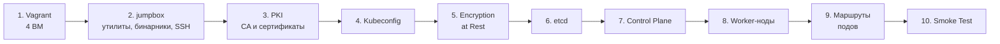
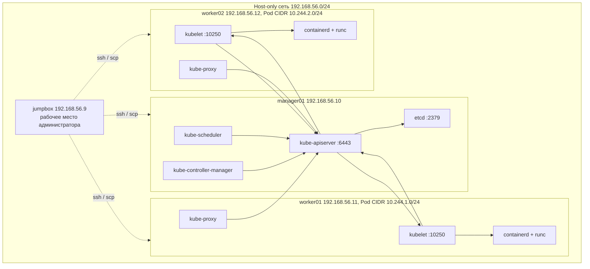
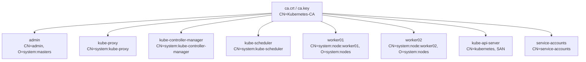
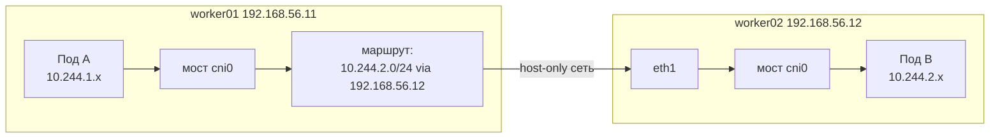
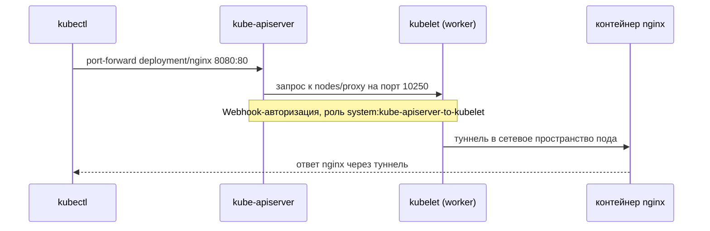

---
tags:
  - kubernetes
  - devops
  - k8s-the-hard-way
  - lab
date: 2026-07-05
updated: 2026-10-17
status: completed
---

# Kubernetes: The Hard Way (полное руководство по сборке)

Пошаговая ручная сборка кластера Kubernetes без инсталляторов: четыре виртуальные машины Debian, собственный центр сертификации, вручную настроенные etcd, компоненты control plane и рабочие ноды. За основу взят репозиторий [kubernetes-the-hard-way](https://github.com/kelseyhightower/kubernetes-the-hard-way), адаптированный под Vagrant и VirtualBox. Раздел про jumpbox сверен с официальной главой [02-jumpbox](https://github.com/kelseyhightower/kubernetes-the-hard-way/blob/master/docs/02-jumpbox.md).

> [!abstract] Результат
> - Кластер из одной управляющей ноды (`manager01`) и двух рабочих (`worker01`, `worker02`).
> - Взаимная TLS-аутентификация всех компонентов, авторизация Node и RBAC.
> - Шифрование объектов Secret в etcd (провайдер `aescbc`).
> - Сеть подов на CNI-плагине `bridge` со статической маршрутизацией между нодами.
> - Набор smoke-тестов, подтверждающих работоспособность кластера.

## Содержание

- [[#Обзор стенда и соглашения]]
- [[#1. Подготовка инфраструктуры (Vagrant)]]
- [[#2. Настройка jumpbox]]
- [[#3. TLS-сертификаты (PKI)]]
- [[#4. Kubeconfig-файлы]]
- [[#5. Шифрование секретов (Encryption at Rest)]]
- [[#6. База данных etcd]]
- [[#7. Control Plane на manager01]]
- [[#8. Worker-ноды]]
- [[#9. Маршрутизация подов между нодами]]
- [[#10. Smoke Test кластера]]
- [[#11. Диагностика и типичные проблемы]]
- [[#Темы для ознакомления]]

## Обзор стенда и соглашения

### Дорожная карта

Этапы выполняются строго по порядку: каждый следующий опирается на артефакты предыдущего (сертификаты нужны kubeconfig-файлам, kubeconfig-файлы нужны компонентам, компоненты нужны тестам).



### Топология

Все ноды находятся в одной host-only сети VirtualBox. Администрирование выполняется с `jumpbox`: оттуда по SSH раздаются файлы и запускаются команды на остальных машинах. Компоненты control plane обращаются к API-серверу по loopback, рабочие ноды (kubelet и kube-proxy) - по адресу `192.168.56.10`.



### Адресация

| Сеть | CIDR | Назначение |
| --- | --- | --- |
| Сеть нод | `192.168.56.0/24` | Host-only сеть VirtualBox, связь между ВМ |
| Pod CIDR (весь кластер) | `10.244.0.0/16` | Адреса подов, значение `clusterCIDR` для kube-proxy |
| Pod CIDR worker01 | `10.244.1.0/24` | Подсеть подов первой рабочей ноды |
| Pod CIDR worker02 | `10.244.2.0/24` | Подсеть подов второй рабочей ноды |
| Service CIDR | `10.32.0.0/24` | Виртуальные адреса сервисов (ClusterIP). `10.32.0.1` занимает сервис `kubernetes`, `10.32.0.10` зарезервирован под DNS |

### Версии компонентов

Версии определяются файлом `downloads-amd64.txt` из репозитория.

| Компонент | Версия |
| --- | --- |
| Kubernetes (kubectl, apiserver, controller-manager, scheduler, kubelet, kube-proxy) | v1.32.3 |
| etcd | v3.6.0-rc.3 |
| containerd | 2.1.0-beta.0 |
| runc | v1.3.0-rc.1 |
| CNI plugins | v1.6.2 |
| crictl | v1.32.0 |

### Используемые порты

| Порт | Компонент | Назначение |
| --- | --- | --- |
| `6443/tcp` | kube-apiserver | Единая точка входа в API кластера |
| `2379/tcp`, `2380/tcp` | etcd | Клиентские и пировые соединения (в стенде слушает только `127.0.0.1`) |
| `10250/tcp` | kubelet | API kubelet: логи, exec, port-forward, метрики |
| `30000-32767/tcp` | kube-proxy | Диапазон портов для сервисов типа NodePort |

### Соглашения документа

Первая строка каждого блока кода - комментарий-маркер, который показывает, где выполнять команды.

| Маркер | Где выполнять |
| --- | --- |
| `# [host]` | На хостовой машине, где установлен Vagrant |
| `# [jumpbox]` | На jumpbox под пользователем root, из каталога `/root/kubernetes-the-hard-way` |
| `# [manager01]` | На manager01 под root (вход: `ssh root@manager01` с jumpbox) |

Рабочий каталог jumpbox - `/root/kubernetes-the-hard-way`. В нем накапливаются все сгенерированные файлы: сертификаты, ключи и kubeconfig. Команды раздела 2 и далее выполняются именно из этого каталога, если не указано иное.

> [!warning] Учебный стенд
> Вход root по SSH с паролем `root`, закрытый ключ CA на `manager01`, etcd без TLS и ключ шифрования в открытом файле допустимы только в лабораторной среде. В промышленной эксплуатации так делать нельзя.

## 1. Подготовка инфраструктуры (Vagrant)

Стенд состоит из четырех виртуальных машин на базе образа `debian/bookworm64`. Каждая машина получает адрес в host-only сети (`private_network`), по которой ноды общаются между собой. Кроме того, VirtualBox автоматически создает NAT-интерфейс: через него ноды выходят в интернет (установка пакетов, скачивание образов контейнеров).

| Узел | Роль | IP | ОЗУ | vCPU |
| --- | --- | --- | --- | --- |
| `jumpbox` | Рабочее место администратора | `192.168.56.9` | 1,5 ГБ | 1 |
| `manager01` | Control plane и etcd | `192.168.56.10` | 4 ГБ | 2 |
| `worker01` | Рабочая нода | `192.168.56.11` | 2 ГБ | 2 |
| `worker02` | Рабочая нода | `192.168.56.12` | 2 ГБ | 2 |

Суммарно стенд потребляет около 9,5 ГБ оперативной памяти хостовой машины.

### Vagrantfile

```ruby
Vagrant.configure("2") do |config|
  config.vm.box = "debian/bookworm64"

  nodes = [
    { name: "jumpbox",   ip: "192.168.56.9",  memory: 1536, cpus: 1 },
    { name: "manager01", ip: "192.168.56.10", memory: 4096, cpus: 2 },
    { name: "worker01",  ip: "192.168.56.11", memory: 2048, cpus: 2 },
    { name: "worker02",  ip: "192.168.56.12", memory: 2048, cpus: 2 }
  ]

  nodes.each do |node|
    config.vm.define node[:name] do |vm|
      vm.vm.hostname = node[:name]
      vm.vm.network "private_network", ip: node[:ip]
      vm.vm.synced_folder ".", "/vagrant", disabled: true

      vm.vm.provider "virtualbox" do |vb|
        vb.name = node[:name]
        vb.memory = node[:memory]
        vb.cpus = node[:cpus]
        vb.customize ["modifyvm", :id, "--ioapic", "on"]
      end

      vm.vm.provision "shell", inline: <<-'SHELL'
        set -e

        # Вход root по паролю (только для лаборатории)
        printf '%s\n' 'PermitRootLogin yes' 'PasswordAuthentication yes' \
          > /etc/ssh/sshd_config.d/10-lab.conf
        echo "root:root" | chpasswd
        systemctl restart ssh

        # Имена всех нод в /etc/hosts (повторный запуск ничего не дублирует)
        grep -q 'k8s-the-hard-way' /etc/hosts || printf '%s\n' \
          '# k8s-the-hard-way' \
          '192.168.56.9  jumpbox' \
          '192.168.56.10 manager01' \
          '192.168.56.11 worker01' \
          '192.168.56.12 worker02' >> /etc/hosts
      SHELL
    end
  end
end
```

> [!info]- Разбор Vagrantfile
> - `nodes.each` - единый список узлов, из которого создаются все четыре ВМ; параметры каждой задаются в одном месте.
> - `synced_folder ... disabled: true` - отключает общую папку `/vagrant`. Файлы между машинами передаются только по `scp`, как на реальных серверах.
> - `--ioapic on` - включает виртуальный контроллер прерываний IO-APIC, необходимый для работы нескольких vCPU в VirtualBox.
> - `/etc/ssh/sshd_config.d/10-lab.conf` - drop-in файл с настройками SSH. Директивы из каталога `sshd_config.d` читаются раньше основного файла, а OpenSSH использует первое найденное значение, поэтому настройка срабатывает независимо от того, как закомментированы строки в основном `sshd_config`.
> - `chpasswd` - задает пароль `root` для первичной раздачи SSH-ключей (раздел 2).
> - Блок с `/etc/hosts` - прописывает имена нод, чтобы обращаться к ним по hostname. Проверка `grep -q` делает блок идемпотентным.

Запуск стенда:

```bash
# [host]
vagrant up
vagrant status
```

> [!success] Ожидаемый результат
> `vagrant status` показывает четыре машины (`jumpbox`, `manager01`, `worker01`, `worker02`) в состоянии `running`.

## 2. Настройка jumpbox

`jumpbox` - административная машина, «домашняя база» для сборки кластера. С нее скачиваются все бинарники (один раз, чтобы не качать их повторно для каждой ноды), генерируются сертификаты и конфигурации, и отсюда же все это раздается по SSH на остальные машины. Теоретически команды можно выполнять с любой машины с Linux или macOS, но выделенная ВМ обеспечивает одинаковое окружение.

### 2.1. Вход и установка утилит

Войдите на jumpbox и переключитесь на root. Вся дальнейшая работа ведется от имени root: так нужно меньше команд, и не требуется `sudo` в каждой строке.

```bash
# [host]
vagrant ssh jumpbox
```

```bash
# [jumpbox]
sudo -i
apt-get update
apt-get -y install wget curl vim openssl git sshpass gettext-base
```

> [!info]- Зачем нужны пакеты
> - `wget`, `curl` - загрузка бинарников и проверка HTTP-ответов.
> - `openssl` - генерация ключей и сертификатов.
> - `git` - клонирование репозитория с шаблонами конфигураций.
> - `vim` - редактор для правки файлов.
> - `sshpass` - неинтерактивная передача пароля при первичной раздаче SSH-ключей (пункт 2.6).
> - `gettext-base` - содержит утилиту `envsubst`, которая подставляет переменные окружения в шаблон `encryption-config.yaml` (раздел 5).

### 2.2. Клонирование репозитория

Репозиторий содержит шаблоны конфигураций, unit-файлы systemd и списки загрузки. Флаг `--depth 1` скачивает только последний коммит без истории, что быстрее и занимает меньше места.

```bash
# [jumpbox]
git clone --depth 1 https://github.com/kelseyhightower/kubernetes-the-hard-way.git
cd kubernetes-the-hard-way
pwd
```

> [!success] Ожидаемый результат
> `pwd` выводит `/root/kubernetes-the-hard-way`. Это рабочий каталог на весь остальной процесс. Если вы потерялись, команда `pwd` покажет, в нужном ли вы каталоге.

### 2.3. Загрузка бинарников

Список ссылок хранится в `downloads-amd64.txt` или `downloads-arm64.txt` - в зависимости от архитектуры. Утилита `dpkg --print-architecture` определяет архитектуру автоматически, поэтому команды ниже работают на обеих.

```bash
# [jumpbox]
cat downloads-$(dpkg --print-architecture).txt

wget -q --show-progress \
  --https-only \
  --timestamping \
  -P downloads \
  -i downloads-$(dpkg --print-architecture).txt

ls -oh downloads
```

> [!info]- Параметры wget
> - `-q --show-progress` - тихий режим с индикатором прогресса вместо подробного лога.
> - `--https-only` - запрещает загрузку по незащищенному HTTP, в том числе при редиректах.
> - `--timestamping` - не скачивает файл повторно, если локальная копия не старше удаленной.
> - `-P downloads` - каталог назначения.
> - `-i <файл>` - читает список URL из файла.

Объем загрузки превышает 500 МБ, время зависит от скорости соединения.

### 2.4. Распаковка и раскладка бинарников

Архивы нужно распаковать и разложить по каталогам в соответствии с ролью, чтобы потом копировать на ноды целыми группами.

```bash
# [jumpbox]
{
  ARCH=$(dpkg --print-architecture)
  mkdir -p downloads/{client,cni-plugins,controller,worker}
  tar -xvf downloads/crictl-v1.32.0-linux-${ARCH}.tar.gz \
    -C downloads/worker/
  tar -xvf downloads/containerd-2.1.0-beta.0-linux-${ARCH}.tar.gz \
    --strip-components 1 \
    -C downloads/worker/
  tar -xvf downloads/cni-plugins-linux-${ARCH}-v1.6.2.tgz \
    -C downloads/cni-plugins/
  tar -xvf downloads/etcd-v3.6.0-rc.3-linux-${ARCH}.tar.gz \
    -C downloads/ \
    --strip-components 1 \
    etcd-v3.6.0-rc.3-linux-${ARCH}/etcdctl \
    etcd-v3.6.0-rc.3-linux-${ARCH}/etcd
  mv downloads/{etcdctl,kubectl} downloads/client/
  mv downloads/{etcd,kube-apiserver,kube-controller-manager,kube-scheduler} \
    downloads/controller/
  mv downloads/{kubelet,kube-proxy} downloads/worker/
  mv downloads/runc.${ARCH} downloads/worker/runc
}

rm -rf downloads/*gz

chmod +x downloads/{client,cni-plugins,controller,worker}/*
```

> [!info]- Разбор команд
> - `ARCH=$(dpkg --print-architecture)` - определяет архитектуру (`amd64` или `arm64`), и она подставляется в имена архивов.
> - `mkdir -p downloads/{client,cni-plugins,controller,worker}` - создает четыре каталога по ролям.
> - `tar -xvf ... -C <каталог>` - распаковывает архив в указанный каталог.
> - `--strip-components 1` - отбрасывает верхний уровень каталогов внутри архива, и файлы попадают прямо в целевой каталог. Для etcd дополнительно перечислены только два нужных файла (`etcd` и `etcdctl`).
> - `mv` - раскладывает бинарники по ролям; `runc.${ARCH}` переименовывается в `runc`.
> - `rm -rf downloads/*gz` - удаляет все архивы (маска `*gz` покрывает `.tar.gz` и `.tgz`). Бинарники уже извлечены, поэтому повторно распаковывать архивы на следующих этапах не нужно.
> - `chmod +x` - делает бинарники исполняемыми. При копировании через `scp` права сохраняются.

Итоговая структура каталога:

```text
downloads/
  client/        etcdctl, kubectl
  controller/    etcd, kube-apiserver, kube-controller-manager, kube-scheduler
  worker/        containerd, containerd-shim-runc-v2, containerd-stress, ctr,
                 crictl, kubelet, kube-proxy, runc
  cni-plugins/   bridge, host-local, loopback и другие плагины
```

### 2.5. Установка kubectl

`kubectl` - официальный клиент командной строки Kubernetes. На jumpbox он нужен для генерации kubeconfig-файлов (раздел 4), поэтому устанавливается до начала работы с сертификатами.

```bash
# [jumpbox]
cp downloads/client/kubectl /usr/local/bin/
kubectl version --client
```

> [!success] Ожидаемый результат
> Вывод содержит строку `Client Version: v1.32.3`.

### 2.6. Реестр машин и SSH-доступ

Файл `machines.txt` - единый источник данных об узлах. Формат строки: IP-адрес, имя хоста и, только для рабочих нод, подсеть подов. Из этого файла дальнейшие команды берут адреса и подсети.

```bash
# [jumpbox]
cat > machines.txt <<EOF
192.168.56.9  jumpbox
192.168.56.10 manager01
192.168.56.11 worker01  10.244.1.0/24
192.168.56.12 worker02  10.244.2.0/24
EOF
```

Затем создается пара SSH-ключей и публичный ключ раздается на все ноды. Благодаря этому дальнейшие `ssh` и `scp` выполняются без запроса пароля.

```bash
# [jumpbox]
[ -f ~/.ssh/id_rsa ] || ssh-keygen -t rsa -b 4096 -N "" -f ~/.ssh/id_rsa

for node in jumpbox manager01 worker01 worker02; do
  sshpass -p root ssh-copy-id -o StrictHostKeyChecking=accept-new root@${node}
done
```

> [!info]- Разбор команд
> - `[ -f ~/.ssh/id_rsa ] || ssh-keygen ...` - ключ создается только если его еще нет, чтобы повторный запуск не затирал существующий.
> - `-t rsa -b 4096` - RSA-ключ длиной 4096 бит; `-N ""` - без парольной фразы, что необходимо для автоматизации.
> - `sshpass -p root` - подставляет пароль `root`, заданный при создании ВМ.
> - `ssh-copy-id` - дописывает публичный ключ в `~/.ssh/authorized_keys` пользователя root на целевой ноде и сам создает каталог `.ssh` с корректными правами.
> - `StrictHostKeyChecking=accept-new` - автоматически принимает отпечаток хоста при первом подключении, но отклоняет подключение, если отпечаток известного хоста изменился. Это безопаснее, чем полное отключение проверки (`no`).

Проверка доступа и имен:

```bash
# [jumpbox]
for node in jumpbox manager01 worker01 worker02; do
  ssh root@${node} hostname
done
```

> [!success] Ожидаемый результат
> Выводятся четыре имени хостов (`jumpbox`, `manager01`, `worker01`, `worker02`) без запроса пароля.

> [!note] Имена хостов важны
> Имя хоста рабочей ноды становится именем узла в Kubernetes, и оно должно совпадать с `CN=system:node:<имя>` в сертификате kubelet (раздел 3). Vagrant задает hostname в соответствии с именем ВМ, поэтому дополнительная настройка не требуется.

## 3. TLS-сертификаты (PKI)

Компоненты кластера общаются по защищенным соединениям с взаимной аутентификацией (mTLS): каждая сторона предъявляет сертификат, подписанный общим центром сертификации (CA). Личность клиента в Kubernetes определяется полями сертификата: `CN` (Common Name) становится именем пользователя, `O` (Organization) - группой. Именно по ним работает RBAC.



| Файлы | CN | O | Назначение |
| --- | --- | --- | --- |
| `ca.crt`, `ca.key` | `Kubernetes-CA` | - | Корневой центр сертификации: подписывает все остальные сертификаты, `ca.crt` используется для их проверки |
| `admin` | `admin` | `system:masters` | Администратор кластера; группа `system:masters` имеет полный доступ через RBAC |
| `kube-proxy` | `system:kube-proxy` | - | Клиентская аутентификация kube-proxy |
| `kube-controller-manager` | `system:kube-controller-manager` | - | Клиентская аутентификация controller-manager |
| `kube-scheduler` | `system:kube-scheduler` | - | Клиентская аутентификация scheduler |
| `worker01`, `worker02` | `system:node:<имя>` | `system:nodes` | Сертификат kubelet: клиентский (к API) и серверный (порт 10250); основа Node Authorizer |
| `kube-api-server` | `kubernetes` | - | Серверный сертификат API-сервера и клиентский при обращении API к kubelet |
| `service-accounts` | `service-accounts` | - | Пара ключей для подписи и проверки токенов ServiceAccount |

### 3.1. Корневой центр сертификации (CA)

Создается закрытый ключ CA и самоподписанный сертификат. Срок действия CA - 10 лет, заметно больше, чем у выпускаемых им сертификатов (1 год): иначе CA истек бы раньше собственных сертификатов.

```bash
# [jumpbox]
openssl genrsa -out ca.key 2048

openssl req -x509 -new -key ca.key -sha256 -days 3650 \
  -subj "/CN=Kubernetes-CA" \
  -addext "basicConstraints=critical,CA:TRUE" \
  -addext "keyUsage=critical,keyCertSign,cRLSign" \
  -out ca.crt
```

> [!info]- Разбор команд
> - `openssl genrsa -out ca.key 2048` - генерирует закрытый RSA-ключ длиной 2048 бит.
> - `openssl req -x509` - создает самоподписанный сертификат одной командой (вместо цепочки `req -new` и `x509 -signkey`).
> - `-subj "/CN=Kubernetes-CA"` - задает имя субъекта без интерактивных вопросов.
> - `basicConstraints=critical,CA:TRUE` - помечает сертификат как сертификат центра сертификации.
> - `keyUsage=critical,keyCertSign,cRLSign` - разрешает использовать ключ только для подписи сертификатов и списков отзыва.

### 3.2. Клиентские сертификаты компонентов

Для администратора, kube-proxy, controller-manager и scheduler процедура одинакова: ключ, запрос на подпись (CSR), подпись нашим CA. Различаются только поля субъекта, поэтому используется цикл по списку.

```bash
# [jumpbox]
for entry in \
  "admin|/CN=admin/O=system:masters" \
  "kube-proxy|/CN=system:kube-proxy" \
  "kube-controller-manager|/CN=system:kube-controller-manager" \
  "kube-scheduler|/CN=system:kube-scheduler"
do
  name="${entry%%|*}"
  subj="${entry#*|}"

  openssl genrsa -out ${name}.key 2048
  openssl req -new -key ${name}.key -subj "${subj}" -out ${name}.csr
  openssl x509 -req -in ${name}.csr \
    -CA ca.crt -CAkey ca.key -CAcreateserial \
    -extfile <(printf 'basicConstraints=CA:FALSE\nkeyUsage=critical,digitalSignature,keyEncipherment\nextendedKeyUsage=clientAuth\n') \
    -out ${name}.crt -days 365
done
```

> [!info]- Разбор команд
> - `"${entry%%|*}"` и `"${entry#*|}"` - средства bash для разделения строки `имя|субъект` на две части.
> - `openssl req -new` - формирует CSR (запрос на подпись) для созданного ключа.
> - `openssl x509 -req -CA ca.crt -CAkey ca.key` - подписывает CSR ключом нашего CA.
> - `-CAcreateserial` - автоматически ведет серийные номера в файле `ca.srl`.
> - `-extfile <(printf ...)` - передает расширения сертификата во временный файл: сертификат не является CA, ключ предназначен для цифровой подписи и шифрования ключей, а применение ограничено клиентской аутентификацией (`clientAuth`).
> - `O=system:masters` - группа с полными правами в RBAC; именно поэтому сертификат `admin` дает полный доступ к кластеру.

### 3.3. Сертификаты рабочих нод (Node Authorizer)

Kubernetes использует специальный режим авторизации Node: kubelet должен предъявить сертификат с `CN=system:node:<имя узла>` и группой `system:nodes`. Кроме того, kubelet выступает HTTPS-сервером на порту 10250, а API-сервер проверяет его сертификат, поэтому в сертификат необходимо внести расширение `subjectAltName` (SAN) с DNS-именем и IP-адресом ноды. Конфигурация с расширениями создается на лету, адрес берется из `machines.txt`.

```bash
# [jumpbox]
for host in worker01 worker02; do
  ip=$(awk -v h="${host}" '$2==h {print $1}' machines.txt)

  cat > ${host}-openssl.cnf <<EOF
[req]
req_extensions = v3_req
distinguished_name = req_distinguished_name
[req_distinguished_name]
[v3_req]
basicConstraints = CA:FALSE
extendedKeyUsage = clientAuth, serverAuth
keyUsage = critical, digitalSignature, keyEncipherment
subjectAltName = @alt_names
[alt_names]
DNS.1 = ${host}
IP.1 = ${ip}
EOF

  openssl genrsa -out ${host}.key 2048
  openssl req -new -key ${host}.key \
    -subj "/CN=system:node:${host}/O=system:nodes" \
    -config ${host}-openssl.cnf -out ${host}.csr
  openssl x509 -req -in ${host}.csr \
    -CA ca.crt -CAkey ca.key -CAcreateserial \
    -extfile ${host}-openssl.cnf -extensions v3_req \
    -out ${host}.crt -days 365

  rm ${host}-openssl.cnf
done
```

> [!info]- Разбор команд
> - `awk -v h=... '$2==h {print $1}' machines.txt` - находит в `machines.txt` строку с нужным именем хоста и выводит ее IP-адрес.
> - `extendedKeyUsage = clientAuth, serverAuth` - сертификат используется и как клиентский (kubelet обращается к API), и как серверный (API обращается к kubelet).
> - `subjectAltName` - список допустимых имен и адресов узла; без него проверка сертификата kubelet со стороны API-сервера завершится ошибкой.
> - `-config ... -extfile ... -extensions v3_req` - расширения нужно передавать повторно при подписи: команда `x509 -req` по умолчанию не копирует расширения из CSR.
> - `rm ${host}-openssl.cnf` - временный конфиг больше не нужен.

### 3.4. Сертификаты API-сервера и Service Accounts

Сертификат API-сервера должен быть валиден для всех адресов, по которым к нему обращаются, иначе клиенты откажутся устанавливать соединение. Отдельная пара ключей `service-accounts` нужна для подписи и проверки токенов ServiceAccount.

```bash
# [jumpbox]
openssl genrsa -out service-accounts.key 2048
openssl req -new -key service-accounts.key \
  -subj "/CN=service-accounts" -out service-accounts.csr
openssl x509 -req -in service-accounts.csr \
  -CA ca.crt -CAkey ca.key -CAcreateserial \
  -out service-accounts.crt -days 365

cat > kube-apiserver.cnf <<EOF
[req]
req_extensions = v3_req
distinguished_name = req_distinguished_name
[req_distinguished_name]
[v3_req]
basicConstraints = CA:FALSE
extendedKeyUsage = clientAuth, serverAuth
keyUsage = critical, digitalSignature, keyEncipherment
subjectAltName = @alt_names
[alt_names]
DNS.1 = kubernetes
DNS.2 = kubernetes.default
DNS.3 = kubernetes.default.svc
DNS.4 = kubernetes.default.svc.cluster.local
DNS.5 = manager01
IP.1 = 127.0.0.1
IP.2 = 192.168.56.10
IP.3 = 10.32.0.1
EOF

openssl genrsa -out kube-api-server.key 2048
openssl req -new -key kube-api-server.key \
  -subj "/CN=kubernetes" -config kube-apiserver.cnf -out kube-api-server.csr
openssl x509 -req -in kube-api-server.csr \
  -CA ca.crt -CAkey ca.key -CAcreateserial \
  -extfile kube-apiserver.cnf -extensions v3_req \
  -out kube-api-server.crt -days 365

rm kube-apiserver.cnf
```

> [!info]- Что означают адреса в SAN
> - `kubernetes`, `kubernetes.default`, `kubernetes.default.svc`, `kubernetes.default.svc.cluster.local` - внутрикластерные DNS-имена API-сервера, по которым к нему обращаются поды.
> - `manager01`, `192.168.56.10` - имя и адрес управляющей ноды, по которым подключаются рабочие ноды и администратор.
> - `127.0.0.1` - локальные обращения controller-manager, scheduler и kubectl на самой manager01.
> - `10.32.0.1` - ClusterIP сервиса `kubernetes`: первый адрес диапазона `10.32.0.0/24`.

> [!note] Имена файлов
> Файлы называются `kube-api-server.*` (с дефисом), потому что именно эти пути указаны в unit-файле `kube-apiserver.service` из репозитория.

### 3.5. Проверка сертификатов

Перед раздачей убедитесь, что все сертификаты подписаны нашим CA, а в сертификате API-сервера присутствуют нужные адреса.

```bash
# [jumpbox]
for c in admin kube-proxy kube-controller-manager kube-scheduler \
         worker01 worker02 kube-api-server service-accounts; do
  printf '%-26s' "${c}"
  openssl verify -CAfile ca.crt ${c}.crt
done

openssl x509 -in kube-api-server.crt -noout -ext subjectAltName
```

> [!success] Ожидаемый результат
> Для каждого сертификата выводится `<имя>.crt: OK`. В SAN сертификата API-сервера перечислены все DNS-имена и три IP-адреса.

### 3.6. Подготовка каталогов и доставка сертификатов

Каталоги назначения создаются заранее: `scp` не создает отсутствующие каталоги и завершится ошибкой `No such file or directory`. Здесь же создаются каталоги, которые понадобятся на следующих этапах.

```bash
# [jumpbox]
ssh root@manager01 "mkdir -p /var/lib/kubernetes /etc/kubernetes/config"

for host in worker01 worker02; do
  ssh root@${host} "mkdir -p /var/lib/kubelet /var/lib/kube-proxy /etc/cni/net.d /opt/cni/bin /etc/containerd"
done
```

Затем сертификаты копируются в каталоги соответствующих компонентов:

```bash
# [jumpbox]
for host in worker01 worker02; do
  scp ca.crt ${host}.crt ${host}.key root@${host}:/var/lib/kubelet/
done

scp ca.crt ca.key \
  kube-api-server.crt kube-api-server.key \
  service-accounts.crt service-accounts.key \
  root@manager01:/var/lib/kubernetes/
```

> [!info]- Что куда попадает
> - На рабочие ноды: `ca.crt` (проверка API-сервера и клиентов) и пара ключей kubelet в `/var/lib/kubelet/`.
> - На manager01: `ca.crt` и `ca.key` (controller-manager подписывает ими запросы на сертификаты и использует `ca.crt` как корневой), пара ключей API-сервера и пара ключей `service-accounts`.
> - Сертификаты kube-proxy, controller-manager, scheduler и admin отдельно не копируются: они встроены в соответствующие kubeconfig-файлы (раздел 4).

## 4. Kubeconfig-файлы

Kubeconfig - файл, в котором собрано все необходимое клиенту для подключения к кластеру: адрес API-сервера с корневым сертификатом (раздел `cluster`), клиентский сертификат и ключ (раздел `user`) и связка между ними (раздел `context`). Для каждого компонента создается собственный файл. Сертификаты встраиваются внутрь файла (`--embed-certs=true`), поэтому отдельно хранить `.crt` и `.key` на нодах не нужно.

Адрес API-сервера зависит от того, где работает компонент:

| Kubeconfig | Пользователь | Адрес API-сервера | Почему |
| --- | --- | --- | --- |
| `worker01`, `worker02` | `system:node:<имя>` | `https://192.168.56.10:6443` | kubelet работает на другой машине |
| `kube-proxy` | `system:kube-proxy` | `https://192.168.56.10:6443` | kube-proxy работает на рабочих нодах |
| `kube-controller-manager` | `system:kube-controller-manager` | `https://127.0.0.1:6443` | работает на manager01 вместе с API-сервером |
| `kube-scheduler` | `system:kube-scheduler` | `https://127.0.0.1:6443` | работает на manager01 вместе с API-сервером |
| `admin` | `admin` | `https://127.0.0.1:6443` | используется на manager01 |

### 4.1. Генерация

Четыре команды `kubectl config` повторяются для каждого файла, поэтому оформлены в виде функции. Она принимает имя итогового файла, имя пользователя, префикс файлов сертификата и адрес API-сервера.

```bash
# [jumpbox]
make_kubeconfig() {
  local out="$1" user="$2" cert="$3" server="$4"

  kubectl config set-cluster kubernetes-the-hard-way \
    --certificate-authority=ca.crt \
    --embed-certs=true \
    --server="${server}" \
    --kubeconfig="${out}"

  kubectl config set-credentials "${user}" \
    --client-certificate="${cert}.crt" \
    --client-key="${cert}.key" \
    --embed-certs=true \
    --kubeconfig="${out}"

  kubectl config set-context default \
    --cluster=kubernetes-the-hard-way \
    --user="${user}" \
    --kubeconfig="${out}"

  kubectl config use-context default --kubeconfig="${out}"
}

# Рабочие ноды: обращаются к API по адресу manager01
for host in worker01 worker02; do
  make_kubeconfig ${host}.kubeconfig system:node:${host} ${host} https://192.168.56.10:6443
done
make_kubeconfig kube-proxy.kubeconfig system:kube-proxy kube-proxy https://192.168.56.10:6443

# Компоненты manager01: обращаются к API по loopback
make_kubeconfig kube-controller-manager.kubeconfig system:kube-controller-manager kube-controller-manager https://127.0.0.1:6443
make_kubeconfig kube-scheduler.kubeconfig system:kube-scheduler kube-scheduler https://127.0.0.1:6443
make_kubeconfig admin.kubeconfig admin admin https://127.0.0.1:6443
```

> [!info]- Разбор команд kubectl config
> - `set-cluster` - регистрирует кластер: корневой сертификат CA и адрес API-сервера.
> - `set-credentials` - добавляет пользователя с клиентским сертификатом и ключом; `--embed-certs=true` упаковывает их содержимое прямо в файл.
> - `set-context` - связывает кластер и пользователя в контекст с именем `default`.
> - `use-context` - делает этот контекст активным по умолчанию.
> - `--kubeconfig=<файл>` - все изменения записываются в указанный файл, а не в `~/.kube/config`.

Проверка (секретные данные при выводе скрываются автоматически):

```bash
# [jumpbox]
kubectl config view --kubeconfig=worker01.kubeconfig --minify
```

> [!success] Ожидаемый результат
> В выводе `server: https://192.168.56.10:6443`, пользователь `system:node:worker01`, а поля сертификатов показаны как `DATA+OMITTED` или `REDACTED`.

### 4.2. Доставка kubeconfig-файлов

Каталоги на нодах уже созданы в пункте 3.6. Файлы копируются под именами, которые ожидают unit-файлы и конфигурации компонентов (`kubeconfig` для kubelet и kube-proxy).

```bash
# [jumpbox]
for host in worker01 worker02; do
  scp ${host}.kubeconfig root@${host}:/var/lib/kubelet/kubeconfig
  scp kube-proxy.kubeconfig root@${host}:/var/lib/kube-proxy/kubeconfig
done

scp kube-controller-manager.kubeconfig kube-scheduler.kubeconfig admin.kubeconfig \
  root@manager01:/var/lib/kubernetes/
```

## 5. Шифрование секретов (Encryption at Rest)

По умолчанию объекты Secret хранятся в etcd в открытом виде (в кодировке base64, которая не является шифрованием). Чтобы защитить их на диске, API-сервер настраивается на шифрование данных перед записью в etcd. Конфигурация шифрования описывается файлом `EncryptionConfiguration`.

Шаблон `configs/encryption-config.yaml` из репозитория:

```yaml
kind: EncryptionConfiguration
apiVersion: apiserver.config.k8s.io/v1
resources:
  - resources:
      - secrets
    providers:
      - aescbc:
          keys:
            - name: key1
              secret: ${ENCRYPTION_KEY}
      - identity: {}
```

Порядок провайдеров важен: первым стоит `aescbc` - им шифруются новые записи. `identity` (без шифрования) идет вторым, чтобы API-сервер мог прочитать данные, записанные до включения шифрования. Переменная `${ENCRYPTION_KEY}` подставляется при генерации.

```bash
# [jumpbox]
export ENCRYPTION_KEY=$(head -c 32 /dev/urandom | base64)
envsubst < configs/encryption-config.yaml > encryption-config.yaml
chmod 600 encryption-config.yaml
scp encryption-config.yaml root@manager01:/var/lib/kubernetes/
```

> [!info]- Разбор команд
> - `head -c 32 /dev/urandom | base64` - берет 32 случайных байта из криптографического генератора ядра (256 бит, длина ключа AES-256) и кодирует их в Base64.
> - `envsubst < шаблон > файл` - подставляет значение переменной окружения `ENCRYPTION_KEY` вместо `${ENCRYPTION_KEY}` в шаблоне.
> - `chmod 600` - файл с ключом доступен только владельцу.

> [!warning] Ключ шифрования
> Потеря ключа означает потерю доступа ко всем зашифрованным секретам, а утечка ключа - возможность их расшифровать. Конфигурация нужна на manager01 до запуска API-сервера: путь к ней указан в `kube-apiserver.service` (параметр `--encryption-provider-config`).

## 6. База данных etcd

etcd - распределенное хранилище «ключ-значение», в котором Kubernetes хранит все состояние кластера. Единственный клиент etcd - API-сервер. В стенде используется один экземпляр etcd на manager01, работающий по протоколу HTTP на `127.0.0.1` (параметры `--listen-client-urls` и `--advertise-client-urls` в unit-файле), поэтому TLS между API-сервером и etcd не используется.

Сначала бинарники и unit-файл копируются с jumpbox:

```bash
# [jumpbox]
scp downloads/controller/etcd downloads/client/etcdctl units/etcd.service root@manager01:~/
```

Затем установка и запуск на manager01:

```bash
# [manager01]
mkdir -p /var/lib/etcd
chmod 700 /var/lib/etcd
install -m 0755 etcd etcdctl /usr/local/bin/
cp etcd.service /etc/systemd/system/

systemctl daemon-reload
systemctl enable --now etcd
```

> [!info]- Разбор команд
> - `mkdir -p /var/lib/etcd` и `chmod 700` - каталог данных etcd; права ограничены владельцем, так как в нем лежит вся информация о кластере, включая секреты.
> - `install -m 0755` - копирует файлы и выставляет права на исполнение.
> - `systemctl daemon-reload` - заставляет systemd перечитать unit-файлы с диска и зарегистрировать новую службу `etcd`.
> - `systemctl enable --now` - добавляет службу в автозапуск и сразу запускает ее. Для `Type=notify` команда завершается после того, как etcd сообщит о готовности.

Проверка:

```bash
# [manager01]
systemctl is-active etcd
etcdctl member list --endpoints=http://127.0.0.1:2379
```

> [!success] Ожидаемый результат
> `is-active` выводит `active`. В списке участников один член с именем `controller` в состоянии `started`; адреса - `http://127.0.0.1:2380` (peer) и `http://127.0.0.1:2379` (client).

> [!note] Версия API etcdctl
> В прежних версиях перед `etcdctl` приходилось указывать `ETCDCTL_API=3`. В etcd 3.6 протокол v3 используется по умолчанию, поэтому переменная не нужна.

## 7. Control Plane на manager01

Control plane (плоскость управления) состоит из трех компонентов:

- **kube-apiserver** - единая точка входа: принимает запросы, проверяет аутентификацию и авторизацию, хранит состояние в etcd.
- **kube-controller-manager** - запускает контроллеры, которые приводят фактическое состояние кластера к желаемому (реплики, узлы, токены ServiceAccount и т.д.).
- **kube-scheduler** - выбирает ноду для каждого нового пода.

### 7.1. Согласование диапазона подов

В unit-файле `kube-controller-manager.service` из репозитория указан диапазон подов `10.200.0.0/16`. В этом стенде поды живут в `10.244.0.0/16`, поэтому значение заменяется до копирования, чтобы конфигурация компонентов была согласованной.

```bash
# [jumpbox]
sed -i 's|10.200.0.0/16|10.244.0.0/16|' units/kube-controller-manager.service
grep -n 'cluster-cidr' units/kube-controller-manager.service
```

### 7.2. Копирование файлов

```bash
# [jumpbox]
scp downloads/controller/kube-apiserver \
    downloads/controller/kube-controller-manager \
    downloads/controller/kube-scheduler \
    downloads/client/kubectl \
    units/kube-apiserver.service \
    units/kube-controller-manager.service \
    units/kube-scheduler.service \
    configs/kube-apiserver-to-kubelet.yaml \
    root@manager01:~/
```

### 7.3. Установка, конфигурация и запуск

```bash
# [manager01]
install -m 0755 kube-apiserver kube-controller-manager kube-scheduler kubectl /usr/local/bin/
cp kube-apiserver.service kube-controller-manager.service kube-scheduler.service /etc/systemd/system/
```

> [!danger] Обязательный файл конфигурации kube-scheduler
> Unit-файл `kube-scheduler.service` запускает планировщик с параметром `--config=/etc/kubernetes/config/kube-scheduler.yaml`. Если файла нет, служба завершается со статусом `status=1/FAILURE`. Файл создается вручную.

```bash
# [manager01]
mkdir -p /etc/kubernetes/config

cat > /etc/kubernetes/config/kube-scheduler.yaml <<EOF
apiVersion: kubescheduler.config.k8s.io/v1
kind: KubeSchedulerConfiguration
clientConnection:
  kubeconfig: /var/lib/kubernetes/kube-scheduler.kubeconfig
leaderElection:
  leaderElect: true
EOF
```

Запуск служб и настройка локального `kubectl`:

```bash
# [manager01]
systemctl daemon-reload
systemctl enable --now kube-apiserver kube-controller-manager kube-scheduler

mkdir -p ~/.kube
cp /var/lib/kubernetes/admin.kubeconfig ~/.kube/config
chmod 600 ~/.kube/config
```

API-серверу нужно несколько секунд на полную инициализацию. После этого проверяется состояние служб и доступность API:

```bash
# [manager01]
sleep 10
systemctl is-active kube-apiserver kube-controller-manager kube-scheduler
kubectl cluster-info
```

> [!success] Ожидаемый результат
> Три раза `active`, а `kubectl cluster-info` сообщает `Kubernetes control plane is running at https://127.0.0.1:6443`. Если служба не запустилась, причину покажет `journalctl -u <служба> -e --no-pager`.

### 7.4. RBAC для доступа API-сервера к kubelet

Когда пользователь выполняет `kubectl logs`, `kubectl exec` или `kubectl port-forward`, API-сервер обращается к kubelet на рабочей ноде от имени пользователя `kubernetes` (это `CN` его сертификата). Kubelet настроен на авторизацию через Webhook: он спрашивает у API-сервера, разрешено ли действие. Без явной роли у пользователя `kubernetes` такие запросы отклоняются с ошибкой `Forbidden`. Манифест создает `ClusterRole` с доступом к `nodes/proxy`, `nodes/stats`, `nodes/log`, `nodes/spec`, `nodes/metrics` и привязывает ее к пользователю `kubernetes`.

```bash
# [manager01]
kubectl apply -f kube-apiserver-to-kubelet.yaml
```

> [!success] Ожидаемый результат
> `clusterrole.rbac.authorization.k8s.io/system:kube-apiserver-to-kubelet created` и `clusterrolebinding.rbac.authorization.k8s.io/system:kube-apiserver created`.

## 8. Worker-ноды

На каждой рабочей ноде работают три службы:

- **containerd** - среда исполнения контейнеров; для запуска контейнеров использует низкоуровневый рантайм `runc`.
- **kubelet** - агент ноды: регистрирует ее в кластере и по указаниям API-сервера запускает и контролирует поды через containerd.
- **kube-proxy** - реализует сервисы Kubernetes: настраивает правила iptables, которые направляют трафик с виртуальных адресов сервисов на поды.

Все команды этого раздела выполняются с jumpbox: повторяющиеся действия оформлены циклами по обеим рабочим нодам, а конфигурации генерируются локально (с учетом подсети каждой ноды из `machines.txt`) и копируются на ноды. Это исключает ошибки при ручном дублировании конфигов для `worker01` и `worker02`.

### 8.1. Подготовка операционной системы

Устанавливаются зависимости, отключается swap и настраивается ядро для работы сетевого моста и kube-proxy.

```bash
# [jumpbox]
for host in worker01 worker02; do
  ssh root@${host} bash -s <<'EOF'
set -e
export DEBIAN_FRONTEND=noninteractive
apt-get update
apt-get -y install socat conntrack ipset iptables kmod

# Kubelet по умолчанию не запускается при включенном swap
swapoff -a
sed -i '/\sswap\s/ s/^/#/' /etc/fstab

# Модуль ядра и параметры сети для CNI bridge и kube-proxy (iptables)
modprobe br_netfilter
echo br_netfilter > /etc/modules-load.d/br_netfilter.conf
cat > /etc/sysctl.d/99-kubernetes.conf <<SYSCTL
net.bridge.bridge-nf-call-iptables = 1
net.bridge.bridge-nf-call-ip6tables = 1
net.ipv4.ip_forward = 1
SYSCTL
sysctl --system > /dev/null
EOF
done
```

> [!info]- Разбор команд
> - `socat` - обеспечивает поддержку `kubectl port-forward`.
> - `conntrack` и `ipset` - нужны kube-proxy для отслеживания соединений и работы с наборами адресов.
> - `iptables` - kube-proxy в режиме `iptables` создает правила сервисов через эти утилиты; в образе Debian они обычно уже есть, пакет указан для надежности.
> - `kmod` - предоставляет `modprobe`, который вызывает unit-файл containerd (`ExecStartPre=/sbin/modprobe overlay`).
> - `swapoff -a` и правка `/etc/fstab` - отключают swap сейчас и после перезагрузки.
> - `br_netfilter` - модуль ядра, благодаря которому трафик через сетевой мост проходит через правила iptables; без него сервисы работают некорректно для подов на одной ноде.
> - `net.ipv4.ip_forward = 1` - разрешает ядру пересылать пакеты между интерфейсами: основа сетевой связности подов.
> - `ssh ... bash -s <<'EOF'` - выполняет блок команд на удаленной ноде; кавычки вокруг `EOF` запрещают локальную подстановку переменных.

Проверка:

```bash
# [jumpbox]
for host in worker01 worker02; do
  ssh root@${host} "swapon --show; lsmod | grep br_netfilter; sysctl net.ipv4.ip_forward"
done
```

> [!success] Ожидаемый результат
> Вывод `swapon --show` пустой (swap выключен), модуль `br_netfilter` загружен, `net.ipv4.ip_forward = 1`.

### 8.2. Доставка бинарников и unit-файлов

Бинарники kubelet, kube-proxy и `runc` (а также `crictl`) устанавливаются в `/usr/local/bin/`. Бинарники containerd - в `/bin/`: именно этот путь указан в `ExecStart` unit-файла `containerd.service`. Все файлы уже лежат в `downloads/worker/`, повторно распаковывать архив containerd не нужно.

```bash
# [jumpbox]
for host in worker01 worker02; do
  scp downloads/worker/{kubelet,kube-proxy,runc,crictl} root@${host}:/usr/local/bin/
  scp downloads/worker/{containerd,containerd-shim-runc-v2,ctr} root@${host}:/bin/
  scp downloads/cni-plugins/* root@${host}:/opt/cni/bin/
  scp units/containerd.service units/kubelet.service units/kube-proxy.service \
    root@${host}:/etc/systemd/system/
done
```

> [!warning] Права исполнения runc
> Бинарник `runc` должен быть исполняемым. Права выставлены еще на jumpbox (пункт 2.4) и сохраняются при `scp`, но на случай потери флага они дополнительно назначаются на ноде. Кроме того, создается симлинк в `/usr/bin`, чтобы `containerd` гарантированно находил рантайм независимо от значения `PATH` службы.

```bash
# [jumpbox]
for host in worker01 worker02; do
  ssh root@${host} "chmod +x /usr/local/bin/{kubelet,kube-proxy,runc,crictl} /bin/{containerd,containerd-shim-runc-v2,ctr} \
    && ln -sf /usr/local/bin/runc /usr/bin/runc"
done
```

### 8.3. Сетевые плагины (CNI)

Плагины уже скопированы в `/opt/cni/bin/`. Теперь создаются их конфигурации в `/etc/cni/net.d/`:

- `10-bridge.conf` - плагин `bridge`: создает на ноде мост `cni0`, подключает к нему поды и выдает им адреса из подсети ноды через `host-local`. `isGateway` назначает мосту адрес шлюза, `ipMasq` включает NAT для исходящего трафика подов, правило `0.0.0.0/0` добавляет в под маршрут по умолчанию.
- `99-loopback.conf` - плагин `loopback`: поднимает интерфейс `lo` внутри каждого пода.

Подсеть берется из `machines.txt`, поэтому каждая нода получает свой диапазон адресов.

```bash
# [jumpbox]
for host in worker01 worker02; do
  subnet=$(awk -v h="${host}" '$2==h {print $3}' machines.txt)

  cat > 10-bridge.conf <<EOF
{
  "cniVersion": "1.0.0",
  "name": "bridge",
  "type": "bridge",
  "bridge": "cni0",
  "isGateway": true,
  "ipMasq": true,
  "ipam": {
    "type": "host-local",
    "ranges": [[{"subnet": "${subnet}"}]],
    "routes": [{"dst": "0.0.0.0/0"}]
  }
}
EOF

  scp 10-bridge.conf configs/99-loopback.conf root@${host}:/etc/cni/net.d/
done
```

### 8.4. Конфигурация containerd

Конфигурация генерируется командой `containerd config default`, после чего в секцию рантайма `runc` добавляется параметр `SystemdCgroup = true`. Он обязателен: kubelet настроен на драйвер cgroup `systemd` (`cgroupDriver: systemd`), и containerd должен использовать тот же драйвер, иначе поды не запустятся.

```bash
# [jumpbox]
for host in worker01 worker02; do
  ssh root@${host} bash -s <<'EOF'
set -e
mkdir -p /etc/containerd
containerd config default > /etc/containerd/config.toml
sed -i '/runtimes.runc.options\]/a\            SystemdCgroup = true' /etc/containerd/config.toml
grep -n -B1 SystemdCgroup /etc/containerd/config.toml
EOF
done
```

> [!info]- Почему вставка строки, а не замена
> В конфигурации по умолчанию containerd 2.1 строки `SystemdCgroup` нет вообще, поэтому замена `false` на `true` командой `sed 's/SystemdCgroup = false/SystemdCgroup = true/'` ничего не меняет. Команда `sed '/шаблон/a\текст'` вставляет строку сразу после заголовка секции `[...runtimes.runc.options]`. Готовый файл `configs/containerd-config.toml` из репозитория написан в формате `version = 2`, и containerd 2.1 при его разборе выдает предупреждения об игнорируемых ключах, поэтому используется генерация конфигурации по умолчанию.

> [!success] Ожидаемый результат
> `grep` выводит заголовок секции `...runtimes.runc.options]` и сразу под ним строку `SystemdCgroup = true`.

### 8.5. Конфигурация kubelet

Для каждой ноды формируется собственный файл: различаются диапазон `podCIDR` и пути к сертификатам.

```bash
# [jumpbox]
for host in worker01 worker02; do
  subnet=$(awk -v h="${host}" '$2==h {print $3}' machines.txt)

  cat > kubelet-config.yaml <<EOF
kind: KubeletConfiguration
apiVersion: kubelet.config.k8s.io/v1beta1
authentication:
  anonymous:
    enabled: false
  webhook:
    enabled: true
  x509:
    clientCAFile: /var/lib/kubelet/ca.crt
authorization:
  mode: Webhook
cgroupDriver: systemd
clusterDomain: cluster.local
clusterDNS:
  - 10.32.0.10
containerRuntimeEndpoint: unix:///run/containerd/containerd.sock
podCIDR: ${subnet}
resolvConf: /etc/resolv.conf
runtimeRequestTimeout: "15m"
tlsCertFile: /var/lib/kubelet/${host}.crt
tlsPrivateKeyFile: /var/lib/kubelet/${host}.key
EOF

  scp kubelet-config.yaml root@${host}:/var/lib/kubelet/kubelet-config.yaml
done
```

> [!info]- Назначение параметров
> - `authentication.anonymous.enabled: false` - анонимные запросы к API kubelet запрещены.
> - `authentication.webhook.enabled: true` и `authorization.mode: Webhook` - kubelet проверяет токены и права у API-сервера.
> - `authentication.x509.clientCAFile` - клиентские сертификаты проверяются по нашему CA (так аутентифицируется API-сервер).
> - `cgroupDriver: systemd` - драйвер cgroup должен совпадать с настройкой containerd.
> - `containerRuntimeEndpoint` - сокет containerd.
> - `podCIDR` - подсеть подов этой ноды.
> - `tlsCertFile`, `tlsPrivateKeyFile` - сертификат, которым kubelet обслуживает HTTPS на порту 10250.
> - `resolvConf` - файл с адресами DNS-серверов, на основе которого формируется `resolv.conf` подов.
> - `clusterDNS` и `clusterDomain` - адрес и домен будущего DNS кластера.

> [!warning] DNS внутри подов
> `clusterDNS` указывает на `10.32.0.10`, но CoreDNS в этом стенде не устанавливается. До его установки имена внутри подов не резолвятся, а `resolv.conf` пода указывает на несуществующий DNS-сервис. На smoke-тесты это не влияет (используются IP-адреса). Если поды должны выходить во внешние имена, удалите параметры `clusterDNS` и `clusterDomain`.

> [!note] Параметр resolvConf
> Значение по умолчанию для `resolvConf` в kubelet - `/etc/resolv.conf`. Менять его на `/run/systemd/resolve/resolv.conf` нужно только на системах с `systemd-resolved`, где `/etc/resolv.conf` указывает на локальную заглушку `127.0.0.53`: поды не смогут использовать такой адрес как внешний DNS. В Debian bookworm из образа Vagrant `systemd-resolved` не используется, поэтому в `/etc/resolv.conf` лежат реальные адреса DNS-серверов.

### 8.6. Конфигурация kube-proxy

Одинакова для обеих нод. `clusterCIDR` задает диапазон адресов подов: трафик из этого диапазона kube-proxy считает внутренним. Режим `iptables` - реализация сервисов через правила iptables.

```bash
# [jumpbox]
cat > kube-proxy-config.yaml <<EOF
kind: KubeProxyConfiguration
apiVersion: kubeproxy.config.k8s.io/v1alpha1
clientConnection:
  kubeconfig: /var/lib/kube-proxy/kubeconfig
mode: iptables
clusterCIDR: 10.244.0.0/16
EOF

for host in worker01 worker02; do
  scp kube-proxy-config.yaml root@${host}:/var/lib/kube-proxy/
done
```

### 8.7. Запуск служб и проверка

```bash
# [jumpbox]
for host in worker01 worker02; do
  ssh root@${host} "systemctl daemon-reload && systemctl enable --now containerd kubelet kube-proxy"
done

sleep 20
for host in worker01 worker02; do
  echo "== ${host}"
  ssh root@${host} "systemctl is-active containerd kubelet kube-proxy"
done

ssh root@manager01 kubectl get nodes
```

> [!success] Ожидаемый результат
> Для каждой ноды три раза `active`, а `kubectl get nodes` показывает `worker01` и `worker02` в статусе `Ready` (роль отображается как `<none>`). Регистрация может занять до 30 секунд. Если нода остается `NotReady`, см. раздел 11.

## 9. Маршрутизация подов между нодами

Каждая рабочая нода обслуживает свою подсеть подов (`10.244.1.0/24` и `10.244.2.0/24`). Поды `worker01` ничего не знают о подсети `worker02`: пакет к адресу `10.244.2.x` по умолчанию уйдет на шлюз по умолчанию и пропадет. Чтобы связь работала, на нодах добавляются статические маршруты: «чтобы попасть в подсеть подов соседа, отправляй пакет на адрес этого соседа в сети нод».



```bash
# [jumpbox]
# manager01: маршруты к подсетям обеих рабочих нод
ssh root@manager01 "ip route replace 10.244.1.0/24 via 192.168.56.11 && ip route replace 10.244.2.0/24 via 192.168.56.12"

# worker01: маршрут к подсети соседа
ssh root@worker01 "ip route replace 10.244.2.0/24 via 192.168.56.12"

# worker02: маршрут к подсети соседа
ssh root@worker02 "ip route replace 10.244.1.0/24 via 192.168.56.11"
```

> [!info]- Разбор команды
> - `ip route replace <подсеть> via <шлюз>` - добавляет запись в таблицу маршрутизации ядра Linux. В отличие от `ip route add`, команда не падает, если такой маршрут уже есть, и ее можно безопасно запускать повторно.
> - `via 192.168.56.X` - адрес соседней ноды в host-only сети, который будет следующим «прыжком» для пакета.
> - Маршруты на `manager01` нужны, чтобы control plane мог обращаться к адресам подов напрямую.

Проверка:

```bash
# [jumpbox]
ssh root@worker01 "ip route | grep 10.244"
```

> [!success] Ожидаемый результат
> Выводятся маршрут к подсети `10.244.2.0/24` через `192.168.56.12` и локальная подсеть `10.244.1.0/24` на мосту `cni0` (она появляется после запуска первого пода).

> [!warning] Маршруты не сохраняются
> Записи, добавленные командой `ip route`, действуют до перезагрузки ВМ. После `vagrant reload` или перезапуска машины выполните команды раздела заново.

## 10. Smoke Test кластера

Smoke-тесты проверяют не отдельные службы, а сквозную работоспособность кластера: регистрацию нод, шифрование, запуск нагрузки, сеть подов, проксирование через API-сервер и сервисы.

| № | Проверка | Что подтверждает | Критерий успеха |
| --- | --- | --- | --- |
| 1 | Статус нод | Ноды зарегистрировались и готовы | `Ready` у обеих рабочих нод |
| 2 | Encryption at Rest | Секреты шифруются в etcd | В etcd есть префикс `k8s:enc:aescbc:v1:key1` |
| 3 | Deployment | Работают scheduler, kubelet и containerd | Под в статусе `1/1 Running` |
| 4 | Связность подов | Работает CNI и маршрутизация (раздел 9) | `ping` между подами на разных нодах проходит |
| 5 | Port-forward | API-сервер достучался до kubelet (RBAC из пункта 7.4) | `curl` возвращает `HTTP/1.1 200 OK` |
| 6 | Service NodePort | Работает kube-proxy | Приложение отвечает на порту любой ноды |

Все тесты выполняются на **manager01**: на ней настроен `kubectl` (`~/.kube/config`) и работает etcd на `127.0.0.1`.

```bash
# [jumpbox]
ssh root@manager01
```

### Тест 1. Статус нод

`kubectl get nodes -o wide` показывает зарегистрированные ноды, их статус, версии ОС и рантайма и внутренние IP-адреса.

```bash
# [manager01]
kubectl get nodes -o wide
```

> [!success] Критерий успеха
> Обе ноды в статусе `Ready`. В колонке `INTERNAL-IP` должны быть адреса `192.168.56.11` и `192.168.56.12`. Если там `10.0.2.15` (адрес NAT-интерфейса VirtualBox), см. раздел 11.

### Тест 2. Шифрование секретов в etcd

Создается тестовый секрет, после чего его запись читается напрямую из etcd в обход API-сервера.

```bash
# [manager01]
kubectl create secret generic kubernetes-the-hard-way --from-literal=mykey=mydata

etcdctl get /registry/secrets/default/kubernetes-the-hard-way \
  --endpoints=http://127.0.0.1:2379 | hexdump -C
```

> [!info]- Разбор команд
> - `kubectl create secret generic` - создает объект Secret из переданных пар `ключ=значение`.
> - `etcdctl get /registry/...` - читает значение по ключу, под которым Kubernetes хранит секрет.
> - `hexdump -C` - выводит бинарные данные в шестнадцатеричном виде с ASCII-колонкой, что позволяет увидеть заголовок алгоритма шифрования.

> [!success] Критерий успеха
> В ASCII-колонке виден префикс `k8s:enc:aescbc:v1:key1`, а строка `mydata` в открытом виде отсутствует.

### Тест 3. Запуск Deployment

`kubectl create deployment` создает объект более высокого уровня, который запускает и поддерживает нужное число реплик контейнера.

```bash
# [manager01]
kubectl create deployment nginx --image=nginx
kubectl rollout status deployment/nginx --timeout=120s
kubectl get pods -l app=nginx -o wide
```

> [!success] Критерий успеха
> Под в статусе `1/1 Running`, ему назначен адрес из подсети одной из рабочих нод (`10.244.1.x` или `10.244.2.x`), в колонке `NODE` указана нода, на которую он запущен. Первый запуск может занять время из-за скачивания образа.

### Тест 4. Связность подов между нодами

Два тестовых пода принудительно запускаются на разных нодах. Параметр `spec.nodeName` в `--overrides` назначает ноду напрямую, минуя планировщик. Затем с первого пода выполняется `ping` на адрес второго.

```bash
# [manager01]
kubectl run test-pod-1 --image=alpine --restart=Never \
  --overrides='{"spec": {"nodeName": "worker01"}}' -- sleep 3600
kubectl run test-pod-2 --image=alpine --restart=Never \
  --overrides='{"spec": {"nodeName": "worker02"}}' -- sleep 3600

kubectl wait --for=condition=Ready pod/test-pod-1 pod/test-pod-2 --timeout=120s

POD2_IP=$(kubectl get pod test-pod-2 -o jsonpath='{.status.podIP}')
echo "IP test-pod-2: ${POD2_IP}"
kubectl exec test-pod-1 -- ping -c 3 ${POD2_IP}
```

> [!success] Критерий успеха
> `ping` завершается без потерь (`0% packet loss`). Если пакеты теряются, проверьте маршруты из раздела 9.

### Тест 5. Port-forward (kubectl, API-сервер, kubelet)

`kubectl port-forward` создает туннель между локальным портом `8080` и портом `80` пода. Запрос проходит всю цепочку компонентов, поэтому тест подтверждает и работу API-сервера, и доступ API к kubelet (RBAC из пункта 7.4).



```bash
# [manager01]
kubectl port-forward deployment/nginx 8080:80 > /tmp/port-forward.log 2>&1 &
PF_PID=$!
sleep 3

curl -sI http://127.0.0.1:8080 | head -n 1

kill ${PF_PID}
```

> [!success] Критерий успеха
> Выводится строка `HTTP/1.1 200 OK`. Ошибка `Forbidden` в `/tmp/port-forward.log` означает, что не применен манифест `kube-apiserver-to-kubelet.yaml` (пункт 7.4).

> [!tip] Два терминала
> Туннель можно оставить в первом терминале (`kubectl port-forward deployment/nginx 8080:80`), а `curl http://127.0.0.1:8080` выполнить во втором.

### Тест 6. Сервис типа NodePort

`kubectl expose` создает Service типа NodePort: kube-proxy открывает на каждой ноде порт из диапазона `30000-32767` и направляет трафик на поды `nginx`. Порт назначается автоматически.

```bash
# [manager01]
kubectl expose deployment nginx --port 80 --type NodePort
kubectl get svc nginx

NODE_PORT=$(kubectl get svc nginx -o jsonpath='{.spec.ports[0].nodePort}')
echo "NodePort: ${NODE_PORT}"

curl -sI http://192.168.56.11:${NODE_PORT} | head -n 1
curl -sI http://192.168.56.12:${NODE_PORT} | head -n 1
```

> [!success] Критерий успеха
> Оба запроса возвращают `HTTP/1.1 200 OK`: приложение доступно на порту любой ноды, независимо от того, на какой ноде фактически запущен под.

### Очистка тестовых ресурсов

```bash
# [manager01]
kubectl delete service nginx
kubectl delete deployment nginx
kubectl delete pod test-pod-1 test-pod-2
kubectl delete secret kubernetes-the-hard-way
```

## 11. Диагностика и типичные проблемы

Универсальные команды для поиска причины сбоя любой службы:

```bash
# [любой узел]
systemctl status <служба> --no-pager
journalctl -u <служба> -e --no-pager
```

| Симптом | Вероятная причина | Что сделать |
| --- | --- | --- |
| `scp: ... No such file or directory` | Каталог назначения не создан | Выполнить создание каталогов (пункт 3.6) |
| `kube-scheduler.service` завершается с `status=1/FAILURE` | Нет файла `/etc/kubernetes/config/kube-scheduler.yaml` | Создать файл (пункт 7.3) и выполнить `systemctl restart kube-scheduler` |
| Нода остается `NotReady` | Не созданы CNI-конфигурации, нет плагинов или не запущен containerd | Проверить `/etc/cni/net.d`, `/opt/cni/bin`, `systemctl status containerd`, `journalctl -u kubelet` |
| `FailedCreatePodSandBox` в `kubectl describe pod` | Ошибка CNI (нет плагинов `bridge` или `host-local`, неверная подсеть) либо containerd не находит `runc` | `journalctl -u containerd -e`; проверить `/opt/cni/bin` и наличие `runc` в `/usr/local/bin` и `/usr/bin` |
| Поды зависают в `ContainerCreating` или контейнеры сразу падают, в логах ошибки cgroup | Драйверы cgroup у kubelet и containerd не совпадают | Проверить `SystemdCgroup = true` (пункт 8.4), перезапустить `containerd` и `kubelet` |
| В `INTERNAL-IP` адрес `10.0.2.15` | Kubelet выбрал адрес NAT-интерфейса VirtualBox | Добавить в `ExecStart` файла `kubelet.service` параметр `--node-ip=192.168.56.X`, выполнить `systemctl daemon-reload` и `systemctl restart kubelet` |
| `ping` между подами на разных нодах не проходит | Не добавлены маршруты или ВМ перезагружалась | Повторить раздел 9 |
| `kubectl logs`, `exec`, `port-forward` возвращают `Forbidden` | Не применен RBAC для доступа API к kubelet | `kubectl apply -f kube-apiserver-to-kubelet.yaml` (пункт 7.4) |
| Имена внутри подов не резолвятся | CoreDNS не установлен, а `clusterDNS` указывает на `10.32.0.10` | Установить CoreDNS либо убрать `clusterDNS` и `clusterDomain` (пункт 8.5) |
| Секрет в etcd читается открытым текстом | Секрет создан до включения шифрования либо API-сервер запущен без `--encryption-provider-config` | Проверить конфигурацию API-сервера и пересоздать секрет |

## Темы для ознакомления

- [Устанавливаю кубер | Kubernetes The Hard Way](https://youtu.be/HqRKOz1UBXA)
- [Репозиторий kubernetes-the-hard-way](https://github.com/kelseyhightower/kubernetes-the-hard-way)
- [[ETCD]], [[Kube-controller-manager]], [[Kube-scheduler]], [[Kubeapi]], [[Kubelet]], [[MTLS]], [[RBAC]], [[TLS]], [[SSL]]
