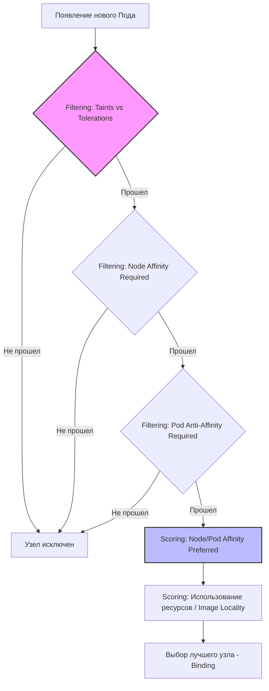

# Механизмы продвинутого планирования в Kubernetes: Техническая заметка

> [!abstract] Краткое содержание
> Глубокий разбор внутренних алгоритмов работы `kube-scheduler`, а также практическое применение инструментов управления размещением нагрузок: `Taints`/`Tolerations`, `Node Affinity` и `Pod Affinity/Anti-Affinity` для построения отказоустойчивых Cloud Native систем.

---

## 1. Архитектура и логика работы Kubernetes Scheduler

В экосистеме Kubernetes компонент `kube-scheduler` является критическим звеном Control Plane. Его стратегическая задача — обеспечить распределение ресурсов между управляющей логикой и Data Plane (рабочими узлами). Без эффективного планировщика распределенная система превращается в хаотичный набор изолированных серверов. Именно планировщик гарантирует, что ваше приложение не просто «развернуто», а размещено там, где оно может функционировать оптимально.

### Процесс принятия решения: Предзаданная логика
Когда API-сервер регистрирует новый Pod, планировщик ищет для него *«best fit»*. Важнейший нюанс, который часто упускают: планировщик оперирует значениями `resources.requests`, а не `limits`. Он резервирует место на основе гарантированного минимума, необходимого контейнеру. Процесс выбора узла проходит через два этапа:

1. **Filtering (Predicates):** На этом этапе отсеиваются узлы, которые физически не могут принять Pod. Проверяются доступные ресурсы (CPU/RAM), наличие необходимых портов и соответствие селекторам. Если у узла недостаточно `requests` для размещения, он исключается.
2. **Scoring (Priorities):** Оставшиеся узлы ранжируются. Планировщик использует такие алгоритмы, как `ImageLocalityPriority` (предпочтение узлам, где образ уже скачан) или `LeastRequestedPriority` (балансировка нагрузки для равномерной утилизации кластера). Узел с наивысшим баллом получает задачу.

> [!note] Слой «So What?»: Конец эпохи ручного управления
> Автоматизация планирования избавляет индустрию от «ручного бин-пакинга» (*manual bin packing*) — изнурительного процесса из 2010-х, когда системные администраторы вручную высчитывали, сколько виртуальных машин нужно для стека приложений. Kubernetes превращает инфраструктуру в единый пул ресурсов, позволяя оператору мыслить декларативно.

Однако стандартных метрик CPU/RAM часто недостаточно для специфических нагрузок, что подводит нас к механизмам `Taints` и `Tolerations`.

---

## 2. Taints и Tolerations: Изоляция и ограничение доступа к нодам

Если стандартное планирование основано на притяжении, то `Taints` — это механизм «отталкивания». Мы помечаем узел «пятном», которое запрещает размещение подов, если у них нет соответствующего «допуска» (`Toleration`). Это фундаментально для изоляции: выделения нод под GPU-вычисления, защиты Control Plane от пользовательских нагрузок или выделения узлов под критические базы данных (например, в стеке Cloud Native PG).

### Механика и эффекты:
* **`NoSchedule`:** Жесткий запрет. Поды без допуска никогда не попадут на узел.
* **`PreferNoSchedule`:** Мягкий запрет. Система постарается избежать размещения, но при отсутствии альтернатив поддастся.
* **`NoExecute`:** Самый строгий эффект. При наложении на работающий узел он не только запрещает новые поды, но и выселяет (*eviction*) уже запущенные, если у них нет `Toleration`.

### Практическая реализация (YAML)
Пример пода, предназначенного для работы на выделенных узлах баз данных:

```yaml
apiVersion: v1
kind: Pod
metadata:
  name: db-workload
spec:
  containers:
  - name: postgres-client
    image: postgres:16
  tolerations:
  - key: "dedicated"
    operator: "Equal"
    value: "database"
    effect: "NoSchedule"

```

Этот подход гарантирует стабильность критических систем, изолируя их от менее приоритетных веб-приложений, которые могут вызвать нестабильность узла.

---

## 3. Node Affinity: Гибкое управление размещением на нодах

`Node Affinity` — это эволюция `nodeSelector`. Это гибкий механизм, позволяющий подам выбирать узлы на основе их меток (`labels`). Это критично для мультизональных облачных архитектур (GKE, AWS), где стоимость трафика и задержки зависят от расположения нод.

### Типы правил и веса:

* **`requiredDuringSchedulingIgnoredDuringExecution`:** Жесткое условие (*Hard affinity*). Если подходящей ноды нет, под останется в статусе `Pending`.
* **`preferredDuringSchedulingIgnoredDuringExecution`:** Мягкое условие (*Soft affinity*). Здесь вступает в игру параметр `weight` (от 1 до 100). Чем выше вес, тем приоритетнее условие для Scoring-фазы планировщика.

### Пример для GKE (зона us-central1-a)

```yaml
apiVersion: apps/v1
kind: Deployment
metadata:
  name: web-app-us-central
spec:
  replicas: 2
  template:
    spec:
      affinity:
        nodeAffinity:
          preferredDuringSchedulingIgnoredDuringExecution:
          - weight: 80
            preference:
              matchExpressions:
              - key: topology.kubernetes.io/zone
                operator: In
                values:
                - us-central1-a
      containers:
      - name: nginx
        image: nginx:stable

```

Использование мягких правил позволяет системе оставаться доступной: если в зоне `us-central1-a` закончатся ресурсы, планировщик выберет другую зону, сохранив работоспособность приложения.

---

## 4. Pod Affinity и Anti-Affinity: Взаимодействие между нагрузками

Этот механизм настраивает правила размещения подов относительно других подов.

* **Pod Affinity:** Совместное размещение. Например, микросервис фронтенда должен быть «ближе» к кэшу Redis для минимизации сетевых задержек (*latency*).
* **Pod Anti-Affinity:** Разнесение по разным доменам отказа. Реплики одного сервиса должны быть на разных нодах или в разных зонах для обеспечения High Availability (HA).

> [!important] TopologyKey — фундамент отказоустойчивости
> Ключ `topologyKey` определяет границы: `kubernetes.io/hostname` разносит поды по серверам, а `topology.kubernetes.io/zone` — по дата-центрам.

> [!warning] Слой «So What?»: Риски планирования
> Как архитектор, я предостерегаю от избыточного использования жесткого `Pod Anti-Affinity`. Каждое такое правило заставляет планировщик вычислять соответствие по всем существующим подам в кластере. В крупных кластерах это приводит к значительным задержкам планирования (*Scheduling Latency*), замедляя реакцию системы на аварии или масштабирование.

---

## 5. Сводная шпаргалка по механизмам планирования

| Механизм | Где настраивается | Цель | Обязательность |
| --- | --- | --- | --- |
| **Taints** | Node | Отталкивание неподходящих подов | Жесткая (`NoSchedule`) / Мягкая |
| **Node Affinity** | Pod | Притяжение к конкретным узлам (GKE зоны и т.д.) | Жесткая или Мягкая (Weight 1-100) |
| **Pod Affinity** | Pod | Совместное размещение (снижение Latency) | Жесткая или Мягкая |
| **Pod Anti-Affinity** | Pod | Разнесение нагрузок (High Availability) | Жесткая или Мягкая |

---

## 6. Визуализация логики Scheduler

Ниже представлена блок-схема прохождения фаз фильтрации и оценки узлов планировщиком Kubernetes.



---

## 7. Заключение

Механизмы планирования — это мост между декларативным описанием в Git и физической реальностью кластера. В парадигме GitOps такие инструменты, как ArgoCD, обеспечивают доставку манифеста в кластер (с интервалом синхронизации по умолчанию в 3 минуты). Однако именно `kube-scheduler`, используя `Taints` и `Affinity`, гарантирует физическую жизнеспособность этого манифеста на Data Plane. Правильная настройка этих инструментов превращает ваш кластер из простого оркестратора контейнеров в самодостаточную, отказоустойчивую Cloud Native платформу.
