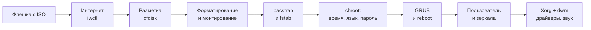
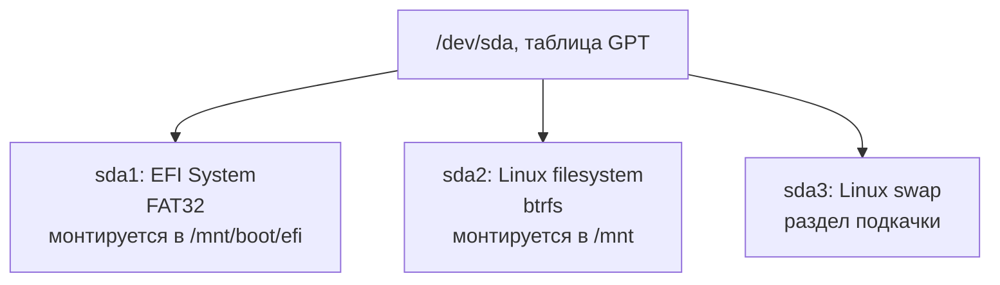

---
tags:
  - linux
  - arch
  - install
  - dwm
date: 2026-10-18
status: draft
---

# Установка Arch Linux

Пошаговая установка Arch Linux на компьютер с UEFI вручную, без `archinstall`: диск размечается в GPT, корневой раздел форматируется в btrfs, ядро `linux-zen`, загрузчик GRUB, сеть через NetworkManager. После установки настраивается графическая среда на dwm (и запасной вариант awesome), драйвер NVIDIA и звук через PipeWire.

> [!abstract] Что получится
> - Система в режиме UEFI на GPT-диске: раздел EFI, раздел btrfs и раздел подкачки.
> - Ядро `linux-zen` с микрокодом процессора, загрузчик GRUB.
> - Рабочий интернет после перезагрузки (NetworkManager).
> - Обычный пользователь с правами `sudo`.
> - Окружение на dwm с вашим конфигом из репозитория `dwm-dotfiles`, звук через PipeWire.

> [!warning] Все данные на диске будут удалены
> Разметка в `cfdisk` уничтожает содержимое выбранного диска. Перед началом убедитесь, что вы выбрали нужное устройство (`lsblk`) и сохранили важные файлы.

## Содержание

- [[#Обзор]]
- [[#Подготовка к установке]]
- [[#Установка]]
- [[#Запуск и настройка]]
- [[#Графическая среда]]
- [[#NVIDIA]]
- [[#Звук]]
- [[#Диагностика и типичные проблемы]]

## Обзор



### Схема разделов

Диск `/dev/sda` разбивается на три раздела. Корневой раздел монтируется первым, раздел EFI - внутрь него.



| Раздел | Тип в cfdisk | Файловая система | Точка монтирования | Рекомендуемый размер |
| --- | --- | --- | --- | --- |
| `/dev/sda1` | EFI System | FAT32 | `/boot/efi` | 512 МБ - 1 ГБ |
| `/dev/sda2` | Linux filesystem | btrfs | `/` | Все оставшееся место |
| `/dev/sda3` | Linux swap | swap | - | 2-8 ГБ (по объему ОЗУ; для гибернации не меньше объема ОЗУ) |

### Как загружается система

GRUB устанавливается в раздел EFI, а ядро и образ initramfs лежат в `/boot` на корневом разделе btrfs.


### Где выполняются команды

| Контекст | Описание |
| --- | --- |
| live | Загруженная с флешки установочная среда, вы работаете под `root` |
| chroot | Среда установленной системы, в которую вы вошли командой `arch-chroot /mnt` |
| root | Установленная система после перезагрузки, вход под `root` |
| user | Установленная система, вход под обычным пользователем |

В начале каждого раздела указано, где выполнять команды.

## Подготовка к установке

1. **Создайте установочную флешку.** Скачайте образ ISO с [официального сайта](https://archlinux.org/download/) и запишите его на флешку (Rufus, balenaEtcher, Ventoy или `dd`). Содержимое флешки при записи будет стерто.
2. **Загрузитесь с флешки.** В прошивке (клавиша входа зависит от производителя: F2, F12, Del, Esc) выберите флешку в меню загрузки. Режим UEFI должен быть включен, а Secure Boot лучше отключить: образ Arch не подписан для Secure Boot.

> [!tip] Проверка режима UEFI
> После загрузки с флешки выполните `cat /sys/firmware/efi/fw_platform_size`. Вывод `64` означает, что система загружена в режиме UEFI (64-разрядном). Если файла нет, вы загрузились в режиме BIOS, и эта инструкция (раздел EFI и `grub-install --target=x86_64-efi`) не подойдет.

## Установка

### Подключение к интернету

*Выполняется: live.*

Пакеты скачиваются из интернета, поэтому соединение нужно до начала установки. При проводном подключении (Ethernet) оно обычно поднимается само. Для Wi-Fi используется `iwctl` (клиент iwd, входит в установочный образ).

```
iwctl
```

Внутри интерактивной оболочки `iwctl` (имя адаптера, как правило, `wlan0`; его покажет первая команда):

```
device list
station wlan0 scan
station wlan0 get-networks
station wlan0 connect ИМЯ_СЕТИ
exit
```

Проверка соединения:

```
ping -c 3 archlinux.org
```

> [!info]- Что делают команды iwctl
> - `device list` - список беспроводных адаптеров и их имена.
> - `station wlan0 scan` - запускает поиск сетей.
> - `station wlan0 get-networks` - показывает найденные сети.
> - `station wlan0 connect ИМЯ_СЕТИ` - подключается к сети, пароль запрашивается в диалоге.

### Разметка дисков

*Выполняется: live.*

Сначала посмотрите, какие диски есть, и найдите нужный по размеру:

```
lsblk

cfdisk /dev/sda
```

> [!note] Имя диска
> Здесь и далее используется `/dev/sda`. У NVMe-накопителей имена другие: диск называется `/dev/nvme0n1`, а разделы - `/dev/nvme0n1p1`, `/dev/nvme0n1p2` и так далее. Подставьте свои имена во все команды.

В `cfdisk`:

- **Выберите разметку `gpt`.** Это современная таблица разделов, необходимая для загрузки в режиме UEFI.
- **Создайте три раздела** (пункт `New`, затем для каждого пункт `Type`):

```
/dev/sda1   UEFI
/dev/sda2   Linux filesystem
/dev/sda3   SWAP
```

В списке типов `cfdisk` эти разделы называются так: для `sda1` выберите **EFI System**, для `sda2` - **Linux filesystem**, для `sda3` - **Linux swap**. Размеры - по таблице из раздела [[#Схема разделов]].

- **Write and exit.** Пункт `Write` записывает таблицу на диск (нужно подтвердить словом `yes`), после чего выйдите (`Quit`). Пока вы не выбрали `Write`, диск не изменяется.

### Форматирование

*Выполняется: live.*

Разделы получают файловые системы. Раздел EFI обязан быть FAT32, корень - btrfs, третий раздел готовится как раздел подкачки.

```
mkfs.fat -F 32 /dev/sda1

mkfs.btrfs /dev/sda2

mkswap /dev/sda3
```

> [!info]- Разбор команд
> - `mkfs.fat -F 32` - создает файловую систему FAT32, которую понимает прошивка UEFI.
> - `mkfs.btrfs` - создает файловую систему btrfs (со снимками, сжатием и контрольными суммами) для корня.
> - `mkswap` - записывает на раздел служебную подпись области подкачки.

### Монтирование

*Выполняется: live.*

Корневой раздел монтируется в `/mnt` первым: все остальное будет располагаться внутри него. Ключ `--mkdir` сам создает каталог `/mnt/boot/efi`, так как на свежесмонтированной файловой системе его еще нет.

```
mount /dev/sda2 /mnt

mount --mkdir /dev/sda1 /mnt/boot/efi

swapon /dev/sda3
```

> [!success] Проверка
> Команда `lsblk` показывает `sda1` в `/mnt/boot/efi`, `sda2` в `/mnt` и `sda3` с пометкой `[SWAP]`.

### Установка базовой системы

*Выполняется: live.*

Сначала обновляется набор ключей, которыми подписаны пакеты. Если образ ISO старый, без этого установка может завершиться ошибками подписи.

```
pacman -Sy archlinux-keyring
```

> [!note] О ключе -Sy
> Команда обновляет базы пакетов и пакет ключей. В live-окружении это допустимо. В установленной системе одиночный `-Sy` не используйте: он приводит к частичному обновлению, вместо него применяйте `pacman -Syu`.

Затем `pacstrap` устанавливает базовую систему в `/mnt`. Вся команда записывается в **одну строку** (в исходной заметке она была разорвана переносом, и `networkmanager` запускался бы как отдельная команда).

```
pacstrap /mnt base linux-zen linux-firmware intel-ucode grub efibootmgr sudo vim networkmanager
```

| Пакет | Назначение |
| --- | --- |
| `base` | Минимальный набор системных утилит |
| `linux-zen` | Ядро Zen с оптимизациями под десктоп |
| `linux-firmware` | Прошивки для оборудования (Wi-Fi, видеокарты и т.д.) |
| `intel-ucode` | Обновления микрокода процессоров Intel (для AMD нужен `amd-ucode`) |
| `grub` | Загрузчик |
| `efibootmgr` | Утилита записи загрузочной записи в UEFI, нужна для `grub-install` |
| `sudo` | Выполнение команд с правами администратора |
| `vim` | Текстовый редактор |
| `networkmanager` | Управление сетью (Ethernet и Wi-Fi) |

> [!tip] Дополнительно: btrfs-progs
> Пакет `btrfs-progs` (утилиты для работы с btrfs: `btrfs`, проверка и обслуживание файловой системы) в список не входит. Его можно добавить в команду `pacstrap` или установить позже: `pacman -S btrfs-progs`.

### Генерация fstab

*Выполняется: live.*

Файл `/etc/fstab` описывает, какие разделы монтировать при загрузке. Его создает `genfstab` по текущему состоянию `/mnt`.

```
genfstab -U /mnt > /mnt/etc/fstab
```

> [!info]- Почему -U, а не -L
> В исходной заметке использовался ключ `-L` (идентификация по меткам разделов). Метки вы при форматировании не задавали, поэтому записи в fstab получаются ненадежными. Ключ `-U` записывает UUID разделов - уникальные идентификаторы, которые не меняются при смене порядка дисков.

Проверьте результат:

```
cat /mnt/etc/fstab
```

> [!success] Ожидаемый результат
> В файле три записи (для `/`, `/boot/efi` и swap), источники указаны в виде `UUID=...`.

### Настройка языка и времени

*Выполняется: chroot (первая команда входит в chroot).*

`arch-chroot` «переносит» вас внутрь установленной системы: дальнейшие команды настраивают именно ее, а не live-среду.

```
arch-chroot /mnt

ln -sf /usr/share/zoneinfo/Continent/Country /etc/localtime

echo "en_US.UTF-8 UTF-8" >> /etc/locale.gen

locale-gen

echo "LANG=en_US.UTF-8" > /etc/locale.conf

passwd
```

> [!info]- Разбор команд
> - `ln -sf /usr/share/zoneinfo/... /etc/localtime` - задает часовой пояс. Вместо `Continent/Country` подставьте свой пояс в формате `Регион/Город`, например `Europe/Moscow` или `Asia/Tashkent`. Список доступных значений: `ls /usr/share/zoneinfo`.
> - `echo "en_US.UTF-8 UTF-8" >> /etc/locale.gen` - добавляет локаль в список для генерации.
> - `locale-gen` - генерирует локали из этого списка.
> - `echo "LANG=en_US.UTF-8" > /etc/locale.conf` - задает язык системы по умолчанию.
> - `passwd` - задает пароль пользователя `root`.

Дополнительно (в исходной заметке этого не было) нужны еще две команды в chroot:

```
hwclock --systohc

systemctl enable NetworkManager
```

- `hwclock --systohc` записывает системное время в аппаратные часы компьютера.
- `systemctl enable NetworkManager` включает службу сети при загрузке. **Без этого после перезагрузки в системе не будет интернета**, а он нужен уже на следующем шаге.

> [!tip] Wi-Fi после установки
> Настройки `iwctl` из live-среды в установленную систему не переносятся. Для подключения к Wi-Fi в новой системе запустите `nmtui` (текстовое меню NetworkManager) и выберите пункт Activate a connection.

### GRUB

*Выполняется: chroot.*

GRUB записывается в раздел EFI (каталог указан параметром `--efi-directory`), затем создается его конфигурационный файл. Он автоматически находит ядро `linux-zen` и микрокод.

```
grub-install --target=x86_64-efi --efi-directory=/boot/efi

grub-mkconfig -o /boot/grub/grub.cfg

exit

reboot
```

> [!info]- Разбор команд
> - `grub-install --target=x86_64-efi --efi-directory=/boot/efi` - устанавливает загрузчик для 64-разрядного UEFI и регистрирует запись `GRUB` в прошивке (через `efibootmgr`). Каталог должен совпадать с точкой монтирования раздела EFI.
> - `grub-mkconfig -o /boot/grub/grub.cfg` - генерирует меню загрузки.
> - `exit` - выход из chroot обратно в live-среду.
> - `reboot` - перезагрузка. Вытащите флешку, когда компьютер выключится.

> [!tip] Перед перезагрузкой
> Рекомендуется после `exit` выполнить `umount -R /mnt`: он корректно отмонтирует все разделы, и данные гарантированно будут записаны на диск.

## Запуск и настройка

После перезагрузки в меню GRUB выберите Arch Linux и войдите под `root` с паролем, заданным в chroot.

*Выполняется: root.*

Первым делом проверьте интернет: все дальнейшие шаги скачивают пакеты.

```
ping -c 3 archlinux.org
```

> [!tip] Если интернета нет
> Служба сети включается командой `systemctl enable NetworkManager` в chroot (см. раздел [[#Настройка языка и времени]]). Если шаг был пропущен, выполните `systemctl enable --now NetworkManager`. Для Wi-Fi запустите `nmtui`.

### Pacman и зеркала

Зеркала - серверы, с которых pacman скачивает пакеты. Он перебирает их сверху вниз, поэтому ближайшие и быстрые зеркала нужно держать в начале списка. Файл со списком: `/etc/pacman.d/mirrorlist`. Сформировать актуальный список для своей страны можно на сайте [Mirrorlist Generator](https://archlinux.org/mirrorlist/): выберите страну, протокол `https`, скопируйте результат и раскомментируйте строки `Server`.

```
vim /etc/pacman.d/mirrorlist
```

После правки обновляется база пакетов и система:

```
pacman -Syyu
```

> [!info]- Разбор команды
> - `-S` - синхронизация и установка пакетов, `-y` - обновление баз пакетов, `-u` - обновление установленных пакетов.
> - Двойное `-yy` принудительно перекачивает базы, даже если pacman считает их свежими. Это полезно сразу после смены зеркал; в обычной жизни хватает `pacman -Syu`.

### Создание нового пользователя

*Выполняется: root.*

Работать под `root` постоянно небезопасно, поэтому создается обычный пользователь, который получает права администратора через `sudo`. Вместо `NAME` подставьте желаемое имя.

```
pacman -S vi

useradd --create-home NAME

passwd NAME

usermod -aG wheel NAME

visudo
```

> [!info]- Разбор команд
> - `pacman -S vi` - редактор `vi`, который по умолчанию использует `visudo`.
> - `useradd --create-home NAME` - создает пользователя и его домашний каталог `/home/NAME`.
> - `passwd NAME` - задает пароль пользователя.
> - `usermod -aG wheel NAME` - добавляет пользователя в группу `wheel` (ключ `-a` добавляет в группу, не удаляя из остальных). Членам этой группы разрешено использовать `sudo`, если это включено в настройках.
> - `visudo` - безопасно открывает файл `/etc/sudoers` для правки и проверяет синтаксис перед сохранением. Напрямую файл править нельзя: ошибка в нем может лишить вас доступа к `sudo`.

В открывшемся файле раскомментируйте строку `%wheel` (уберите `#` в начале), а под строкой `root` допишите:

```
NAME ALL=(ALL:ALL) ALL
```

> [!note] Два способа дать права
> Строка `%wheel ALL=(ALL:ALL) ALL` дает права всей группе `wheel`, строка `NAME ALL=(ALL:ALL) ALL` - конкретному пользователю. Для работы достаточно любой из двух, обе вместе не вредят.

> [!tip] Подсказка по vi
> Поиск строки: `/%wheel` и Enter. Удалить символ под курсором: `x`. Сохранить и выйти: `:wq` и Enter. Выйти без сохранения: `:q!`.

Выйдите из сессии `root` и войдите уже под созданным пользователем:

```
exit
```

## Графическая среда

*Выполняется: user (с `sudo`).*

### Установка пакетов

Устанавливается графический сервер Xorg, все для сборки dwm и набор повседневных программ.

```shell
sudo pacman -S base-devel git libx11 libxft libxinerama xorg-server xorg-xinit make alacritty noto-fonts zsh fastfetch firefox obsidian nvim ntfs-3g pcmanfm numlockx nitrogen lxappearance xorg-setxkbmap xorg-xrandr lxrandr picom
```

| Группа | Пакеты | Назначение |
| --- | --- | --- |
| Сборка | `base-devel`, `git`, `make` | Компилятор и инструменты сборки dwm и slstatus, клонирование репозитория |
| Графический сервер | `xorg-server`, `xorg-xinit` | Xorg и `startx` с поддержкой файла `.xinitrc` |
| Библиотеки | `libx11`, `libxft`, `libxinerama` | Нужны для сборки dwm и slstatus |
| Терминал и шрифты | `alacritty`, `noto-fonts` | Терминал и основной набор шрифтов |
| Консоль | `zsh`, `fastfetch`, `nvim`, `ntfs-3g` | Оболочка, вывод сведений о системе, редактор, чтение дисков NTFS |
| Приложения | `firefox`, `obsidian`, `pcmanfm` | Браузер, заметки, файловый менеджер |
| Рабочий стол | `nitrogen`, `lxappearance`, `numlockx` | Обои, выбор тем GTK, включение NumLock |
| Экран и раскладка | `xorg-setxkbmap`, `xorg-xrandr`, `lxrandr` | Раскладка клавиатуры, настройка мониторов (консоль и графический интерфейс) |
| Композитор | `picom` | Тени, прозрачность и анимации окон |

> [!warning] Что изменено в списке пакетов
> - **`neofetch` заменен на `fastfetch`.** Проект neofetch заброшен, и пакет удален из официальных репозиториев Arch (остался в AUR). Одно несуществующее имя прерывает всю команду `pacman -S`, и ни один пакет не устанавливается. `fastfetch` - совместимая замена. Если вам нужен именно neofetch (конфиги лежат в папке `neofetch` вашего репозитория), установите его из AUR.
> - **Добавлен `picom`.** Он запускается в `.xinitrc` (см. ниже), но в исходном списке его не было.
> - Имя `nvim` оставлено как есть: пакет `neovim` предоставляет это имя (`provides`), поэтому pacman находит его.

### Конфиг dwm

Ваш конфиг лежит в репозитории `dwm-dotfiles`:

```shell 
git clone https://github.com/ZeroNiki/dwm-dotfiles.git
```

В репозитории находятся:

| Каталог или файл | Содержимое |
| --- | --- |
| `dwm-flexipatch` | Исходный код dwm с набором патчей и вашим `config.h` |
| `slstatus` | Исходный код строки состояния |
| `picom/config.conf` | Конфигурация композитора |
| `alacritty`, `nvim`, `neofetch` | Конфигурации терминала, редактора и neofetch |
| `Wallpaper` | Обои для `nitrogen` |
| `.xinitrc`, `.vimrc` | Примеры стартового скрипта и настроек vim |

Перед запуском замените `st` на `alacritty` - терминал, который будет открываться по горячей клавише. Терминал задается в `dwm-flexipatch/config.h`.

> [!note] Где искать `st` в config.h
> В текущей версии репозитория переменная `termcmd` (запуск терминала по сочетанию клавиш) уже указывает на `alacritty`. Значение `st` остается в настройках scratchpad (`scratchpadcmd`, `spcmd1`) и в нескольких других местах. Если вы пользуетесь scratchpad, замените его тоже, иначе dwm будет пытаться запускать терминал `st`, которого нет в системе.

> [!warning] Формат конфига Alacritty
> Файл `alacritty/alacritty.yml` написан в формате YAML. Современные версии Alacritty используют формат TOML (`~/.config/alacritty/alacritty.toml`). Если настройки из `.yml` не применяются, преобразуйте файл командой `alacritty migrate`.

### Сборка и установка dwm и slstatus

dwm и slstatus собираются из исходников, как это принято в проектах suckless: любое изменение `config.h` требует повторной сборки. В исходной заметке этот шаг отсутствовал, но без него команды `dwm` и `slstatus` в `.xinitrc` работать не будут. Каталог `slstatus` содержит уже скомпилированные файлы (`.o`), поэтому сборка начинается с `clean`.

```shell
cd ~/dwm-dotfiles/dwm-flexipatch
sudo make clean install

cd ~/dwm-dotfiles/slstatus
sudo make clean install
```

Файлы из репозитория, на которые ссылается `.xinitrc` (композитор и обои), нужно положить на свои места:

```shell
mkdir -p ~/.config/picom ~/Pictures
cp ~/dwm-dotfiles/picom/config.conf ~/.config/picom/config.conf
cp -r ~/dwm-dotfiles/Wallpaper ~/Pictures/Wallpaper
```

### Запасной вариант: awesome wm

Если dwm по какой-то причине не заработал, на этот случай можно установить awesome - оконный менеджер, который настраивается на языке Lua и не требует сборки.

```bash
sudo pacman -S awesome
```

> [!warning] Что изменено
> В исходной заметке команда содержала еще `awesome-extra` и `awesome-doc`. Это названия пакетов из Debian и Ubuntu, в репозиториях Arch их нет, и команда завершилась бы ошибкой `target not found`. Дополнительные виджеты в Arch ставятся пакетом `vicious`.

Настройки по умолчанию лежат в `/etc/xdg/awesome/rc.lua`; чтобы их менять, скопируйте файл в `~/.config/awesome/rc.lua`. Для запуска awesome в `.xinitrc` вместо `exec dwm` укажите `exec awesome`.

### Xorg: файл .xinitrc

Файл `~/.xinitrc` - сценарий, который `startx` выполняет при запуске графической сессии. Добавьте в него:

```
numlockx &
slstatus &
setxkbmap -layout us,ru -option "grp:win_space_toggle" &
nitrogen --set-zoom-fill --random ~/Pictures/Wallpaper/ &
picom -b --config ~/.config/picom/config.conf &
exec dwm 
```

> [!info]- Разбор строк
> - `numlockx &` - включает NumLock. Знак `&` запускает программу в фоне, чтобы сценарий шел дальше.
> - `slstatus &` - запускает строку состояния dwm.
> - `setxkbmap -layout us,ru -option "grp:win_space_toggle" &` - раскладки английская и русская, переключение сочетанием Win+Space.
> - `nitrogen --set-zoom-fill --random ~/Pictures/Wallpaper/ &` - ставит случайные обои из каталога с масштабированием по размеру экрана.
> - `picom -b --config ~/.config/picom/config.conf &` - запускает композитор с вашим конфигом. Ключ `-b` уже переводит его в фон, завершающий `&` избыточен, но не мешает.
> - `exec dwm` - запускает оконный менеджер. Эта строка **должна быть последней**: когда dwm завершится, закончится и вся графическая сессия.

> [!warning] Что изменено в строке picom
> - Убран ключ `--experimental-backends`. Новые бэкенды включены по умолчанию начиная с picom 10, и ключ больше не нужен (в новых версиях неизвестный ключ может привести к ошибке запуска).
> - Относительный путь `.config/picom/config.conf` заменен на `~/.config/picom/config.conf`: относительный путь работает только если `startx` запущен из домашнего каталога.

> [!warning] Если копируете .xinitrc из репозитория
> В файле `.xinitrc` из `dwm-dotfiles` есть строка `twm &`, которая запускает лишний оконный менеджер twm. Закомментируйте или удалите ее, если берете файл целиком.

Запуск графической сессии: после входа в консоль под пользователем выполните `startx`.

## NVIDIA

> [!warning] Раздел не проверен
> Как и в исходной заметке, шаги этого раздела на практике не проверялись. Сверяйтесь со страницей [NVIDIA в Arch Wiki](https://wiki.archlinux.org/title/NVIDIA).

Сначала определите видеокарту:

```shell
lspci -k | grep -A 2 -E "(VGA|3D)"
```

Подходящую версию драйвера можно посмотреть на [сайте NVIDIA](https://www.nvidia.com/Download/index.aspx). Установка:

```shell
sudo pacman -S nvidia-dkms nvidia-settings nvidia-utils linux-zen-headers
```

> [!warning] Что изменено
> Добавлен пакет `linux-zen-headers`. Ядро `linux-zen` - не стандартное, поэтому готовый пакет `nvidia` (он собран только под ядро `linux`) не подходит, и нужен `nvidia-dkms`. DKMS компилирует модуль драйвера под конкретное ядро прямо на вашем компьютере и для этого требует заголовки именно этого ядра. Без `linux-zen-headers` модуль не соберется, и графика не заработает.

> [!tip] Открытые модули
> Для видеокарт поколения Turing (GTX 16xx, RTX 20xx) и новее существует пакет `nvidia-open-dkms` с открытыми модулями ядра. Выбирайте один из пакетов (`nvidia-dkms` или `nvidia-open-dkms`), не оба.

Настройка:

```shell
sudo nvidia-settings
```

`nvidia-settings` - графическая утилита, ее нужно запускать внутри работающей X-сессии. Запуск через `sudo` нужен, чтобы можно было сохранить конфигурацию в системный каталог `/etc/X11` (кнопка Save to X Configuration File).

**Сохранить и перезагрузиться.**

Проверка после перезагрузки (внутри X-сессии или в консоли):

```shell
nvidia-smi
```

> [!success] Ожидаемый результат
> `nvidia-smi` выводит таблицу с названием видеокарты и версией драйвера. Сообщение об ошибке связи с драйвером означает, что модуль не загружен: проверьте `dkms status`.

## Звук

*Выполняется: user (с `sudo`).*

PipeWire - современный звуковой сервер, который заменяет PulseAudio и JACK.

```
sudo pacman -S pipewire pipewire-pulse wireplumber
```

| Пакет | Назначение |
| --- | --- |
| `pipewire` | Сам звуковой сервер |
| `pipewire-pulse` | Совместимость с приложениями, рассчитанными на PulseAudio |
| `wireplumber` | Менеджер сессий: следит за появлением устройств и подключает потоки звука к выходам |

> [!warning] Что изменено
> В исходной заметке использовался `pipewire-media-session`. Он признан устаревшим, и Arch Wiki рекомендует `wireplumber`. Поэтому в установку добавлен `wireplumber`, а запуск `pipewire-media-session` из `.xinitrc` больше не нужен.

В `.xinitrc` добавлять ничего не нужно: PipeWire управляется пользовательскими службами systemd и запускается автоматически при первом обращении (socket activation). Проверка:

```
systemctl --user status pipewire pipewire-pulse wireplumber
```

Если службы не активны, включите их:

```
systemctl --user enable --now pipewire pipewire-pulse wireplumber
```

> [!info]- Исходный вариант: запуск из .xinitrc
> Раньше в `.xinitrc` добавлялись такие строки:
>
> ```
> /usr/bin/pipewire &
> /usr/bin/pipewire-pulse &
> /usr/bin/pipewire-media-session &
> ```
>
> Они нужны только если пользовательские службы systemd не используются. В обычной установке Arch они лишние, а последняя строка ссылается на устаревший `pipewire-media-session` (вместо него используется `wireplumber`). Запуск одновременно из `.xinitrc` и через systemd приводит к дублирующимся процессам.

## Диагностика и типичные проблемы

| Симптом | Вероятная причина | Что сделать |
| --- | --- | --- |
| После перезагрузки нет интернета | Не включена служба NetworkManager | `systemctl enable --now NetworkManager`, для Wi-Fi `nmtui` |
| Компьютер не загружает систему, меню GRUB не появляется | Установка выполнена не в режиме UEFI, либо в меню загрузки прошивки выбрана не та запись | Проверить режим (`/sys/firmware/efi`), в меню загрузки прошивки выбрать запись `GRUB`, вытащить флешку |
| `error: target not found: <пакет>` | Пакета нет в официальных репозиториях (удален или имя из другого дистрибутива). Одна такая ошибка прерывает всю команду | Проверить имя поиском `pacman -Ss <имя>`. Примеры: `neofetch` (теперь в AUR), `awesome-extra` (пакет Debian) |
| Ошибки подписи пакетов (`invalid or corrupted package`) | Устаревшие ключи в старом образе ISO | Выполнить `pacman -Sy archlinux-keyring` и повторить установку |
| `startx: command not found` | Не установлен `xorg-xinit` | `sudo pacman -S xorg-xinit` |
| X-сессия сразу закрывается, dwm не запускается | dwm не собран или `exec dwm` не последняя строка `.xinitrc` | Собрать dwm (`sudo make clean install` в `dwm-flexipatch`), проверить порядок строк |
| Черный экран после установки NVIDIA | Модуль драйвера не собран: нет `linux-zen-headers` | `sudo pacman -S linux-zen-headers`, затем `sudo dkms autoinstall`, проверить `dkms status` |
| Нет звука | Не запущены службы PipeWire или не установлен `wireplumber` | `systemctl --user status pipewire pipewire-pulse wireplumber`, при необходимости включить их |

## Полезные ссылки

- [Installation guide - Arch Wiki](https://wiki.archlinux.org/title/Installation_guide)
- [Mirrorlist Generator](https://archlinux.org/mirrorlist/)
- [NVIDIA - Arch Wiki](https://wiki.archlinux.org/title/NVIDIA)
- [PipeWire - Arch Wiki](https://wiki.archlinux.org/title/PipeWire)
- [Репозиторий dwm-dotfiles](https://github.com/ZeroNiki/dwm-dotfiles)
