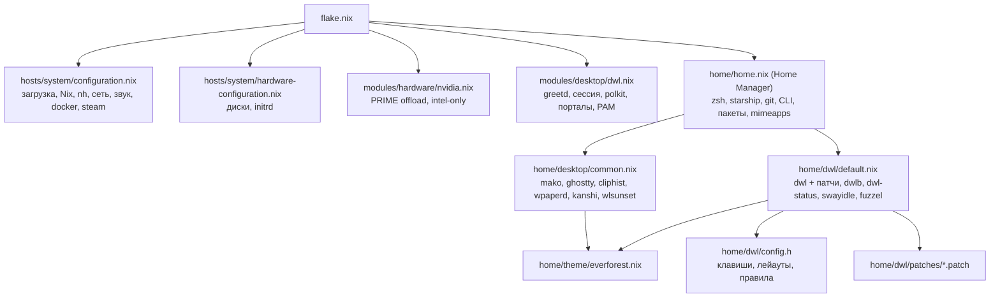
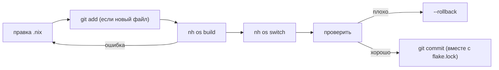
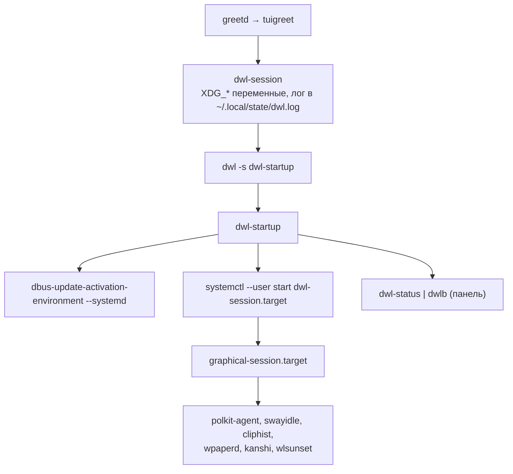

# Моя система NixOS

> [!abstract] Кратко
> Ноутбук **Gigabyte** (Intel Raptor Lake + Iris Xe, NVIDIA RTX 4060 Mobile) на **NixOS unstable**. Вся система — один flake в `/etc/nixos` (git-репозиторий, владелец `nellaror`, правки без sudo). Пользовательская часть идёт через **Home Manager** модулем NixOS: одна команда пересобирает всё сразу.
> Рабочий стол — минималистичный Wayland на **dwl 0.9** с патчами, панель **dwlb**, тема **Everforest Dark Medium**. Терминал — **ghostty**, shell — **zsh + starship**.
>
> Теория про Nix как таковой — в [[NixOS]]. Здесь — как устроена **моя** система и как с ней жить.

> [!tip] Самое нужное
> ```bash
> nh os switch            # собрать и применить
> nh os switch --update   # обновить flake.lock и применить
> sudo nixos-rebuild switch --rollback   # откатиться на прошлое поколение
> , <команда>             # запустить что угодно из nixpkgs без установки
> ```
> Выйти из dwl: `Win+Shift+Q`. Сломалась графика — в меню загрузки пункт `intel-only` или `Ctrl+Alt+F2`.

---

## Железо и основа

| Что | Как |
|---|---|
| CPU / GPU | Intel Raptor Lake, Iris Xe рисует всё; RTX 4060 Max-Q просыпается только по `nvidia-offload` (PRIME offload) |
| Экран | `eDP-1` 1920×1200@165 |
| Ядро | `linuxPackages_zen`, микрокод Intel |
| Загрузчик | systemd-boot, ESP в `/boot/efi`, до 10 поколений в меню |
| Диск | один NVMe: FAT32 `EFI` + btrfs `nixos` с сабвольюмами, `compress=zstd,noatime` |
| Swap | zram, раздела подкачки нет |
| Вход | greetd + tuigreet |
| Звук | PipeWire (alsa, pulse, jack) + WirePlumber |
| Сеть | NetworkManager (`nmtui`, клик по блоку сети на панели) |
| Часовой пояс | `Asia/Tashkent`, локали `en_US.UTF-8` + `ru_RU.UTF-8` (русские man) |
| `stateVersion` | `24.11` — **не трогать** |

> [!info] Почему диски по меткам, а не по UUID
> UUID появляется только после форматирования, его пришлось бы вписывать в репо после каждой разметки. Метки задаются при `mkfs` (`-n EFI`, `-L nixos`), поэтому `hardware-configuration.nix` верен сразу и тот же конфиг подходит для переустановки без правок.

### Сабвольюмы btrfs

| Точка | Сабвольюм |
|---|---|
| `/` | `@` |
| `/home` | `@home` |
| `/nix` | `@nix` |
| `/.snapshots` | `@snapshots` (инструмент снапшотов пока не настроен) |
| `/boot/efi` | раздел `EFI` (vfat) |

---

## Устройство flake

**inputs** (версии зафиксированы в `flake.lock`):
- `nixpkgs` — `nixos-unstable`;
- `home-manager` — `follows = "nixpkgs"`;
- `nix-index-database` — готовая база для `,` и command-not-found, тоже `follows`.

**outputs:** `nixosConfigurations.gigabyte-nixos` (и псевдоним `default`). Имя совпадает с hostname, поэтому `#gigabyte-nixos` в командах можно не писать.



> [!info] Как подключён Home Manager
> Модулем NixOS, а не отдельной командой `home-manager switch`:
> - `useGlobalPkgs` — тот же `pkgs`, что у системы (и `allowUnfree` тоже);
> - `useUserPackages` — пакеты пользователя лежат в `/etc/profiles/per-user/nellaror`;
> - `backupFileExtension = "hm-bak"` — чужой файл на месте управляемого переименовывается, а не ломает активацию.
>
> `username` задаётся один раз в `flake.nix` и раздаётся во все модули через `specialArgs` / `extraSpecialArgs`.

### Где что менять

| Хочу | Файл |
|---|---|
| Добавить / убрать пакет | `home/home.nix` → `home.packages` |
| Shell, промпт, алиасы, git | `home/home.nix` → `programs.zsh`, `programs.starship`, `programs.git` |
| Программы по умолчанию | `home/home.nix` → `xdg.mimeApps` |
| Системный сервис (docker, libvirt, bluetooth), nh, GC | `hosts/system/configuration.nix` |
| Режим NVIDIA | `modules/hardware/nvidia.nix` |
| Клавиши dwl, лейауты, отступы, правила окон | `home/dwl/config.h` |
| Патчи dwl | `home/dwl/patches/` + список `patches` в `home/dwl/default.nix` |
| Панель, power-меню, автоблокировка, swaylock, fuzzel | `home/dwl/default.nix` |
| Уведомления, терминал, обои, мониторы, ночной режим | `home/desktop/common.nix` |
| Палитра | `home/theme/everforest.nix` (в `config.h` цвета продублированы вручную) |
| Экран входа, порталы, polkit | `modules/desktop/dwl.nix` |

---

## Повседневная работа

### Сборка и применение: nh

[`nh`](https://github.com/nix-community/nh) — обёртка над `nixos-rebuild`: показывает дерево сборки и в конце **diff пакетов** (что добавилось, удалилось, сменило версию). Путь к flake берёт из `NH_FLAKE=/etc/nixos`, поэтому `--flake` не нужен. sudo спрашивает сам.

```bash
nh os build              # собрать, ничего не применяя
nh os test               # применить до перезагрузки, без пункта в меню загрузки
nh os switch             # собрать, применить, добавить пункт в меню
nh os switch --ask       # показать diff и спросить перед активацией
nh os switch --update    # nix flake update + switch
nh search <пакет>        # поиск в nixpkgs
```

Обычные команды тоже работают:

```bash
nix flake check                              # вычисляется ли конфиг вообще
nixos-rebuild build --flake /etc/nixos
sudo nixos-rebuild switch --flake /etc/nixos
nixos-rebuild build --flake /etc/nixos -L    # полный лог сборки
```

> [!warning] Flake видит только файлы, известные git
> Новый модуль или патч без `git add` для сборки **не существует**: ошибка будет выглядеть как «файл не найден», хотя он лежит на диске. Коммитить не обязательно, достаточно добавить в индекс.

> [!warning] dwl не перечитывает конфиг на лету
> `config.h` компилируется в бинарник. После `switch` работает старый dwl — нужно выйти (`Win+Shift+Q`) и войти заново.

### Цикл правки



### Обновление

```bash
cd /etc/nixos
nix flake update        # или nh os switch --update
nh os build             # сначала собрать!
nh os switch
git commit -am "flake: update"
```

> [!bug] Что ломается после update на unstable
> - **Переименованные опции и пакеты.** Ошибка вида `'X' has been renamed to 'Y'` — просто поправить имя (пример из жизни: `programs.git.userName` → `programs.git.settings.user.name`).
> - **Патчи dwl.** Новая версия dwl → `Hunk #N FAILED`. Порядок действий — в `home/dwl/patches/README.md`.

### Откат

Каждый `switch` — новое **поколение**, старое никуда не девается.

```bash
sudo nixos-rebuild switch --rollback                          # на предыдущее
nix-env --list-generations -p /nix/var/nix/profiles/system    # список поколений
```

Если не грузится совсем — выбрать прошлое поколение в меню systemd-boot.

### Сборка мусора

- `nh-clean.timer` раз в неделю удаляет поколения **старше 7 дней, кроме последних 5** (`--keep 5 --keep-since 7d`) и чистит store.
- `auto-optimise-store` сразу заменяет одинаковые файлы в `/nix/store` жёсткими ссылками.

```bash
systemctl list-timers nh-clean
nh clean all --keep 5        # почистить прямо сейчас
du -sh /nix/store
```

> [!info] Почему не `nix.gc.automatic`
> `nh clean` делает то же самое и ещё чистит профили пользователя и GC-корни `result`. Вместе они конфликтуют, NixOS выдаст предупреждение.

---

## Nix-инструменты

### Каналов нет, только flake

`nix.channel.enable = false`. При этом `nix-shell -p` и `nix shell nixpkgs#…` работают и берут **nixpkgs этого flake**: `lib.nixosSystem` выставляет `nixpkgs.flake.source`, а NixOS заполняет из него `NIX_PATH` и реестр. Одна ревизия nixpkgs на всё.

### comma и nix-index

```bash
, cowsay hi                  # скачать и запустить без установки
, wev                        # какие коды шлёт клавиша
nix-locate bin/ffmpeg        # в каком пакете лежит файл
```

Неизвестная команда в zsh сама подскажет, в каком пакете она есть. База готовая, приходит из input `nix-index-database` и обновляется вместе с `flake.lock`, локально ничего индексировать не нужно.

### Временные окружения

```bash
nix shell nixpkgs#drm_info -c drm_info           # разово, одна команда
nix shell --inputs-from /etc/nixos nixpkgs#pciutils -c lspci -D
nix search --inputs-from /etc/nixos nixpkgs <имя>
```

> [!tip] `--inputs-from /etc/nixos`
> Берёт nixpkgs той же ревизии, что в `flake.lock`: ничего лишнего не скачивается, версии совпадают с системой.

### Nix в редакторе

- **nixd** — LSP, настроен на этот flake: пакеты из `inputs.nixpkgs`, опции NixOS из `nixosConfigurations.gigabyte-nixos` и Home Manager из его `home-manager.users`. Автодополнение и hover соответствуют ревизии из `flake.lock`.
- **nixfmt** — форматтер (в conform).

---

## Графика: Intel + NVIDIA

Режим **PRIME offload**: dwl и все программы рисуются на Intel, NVIDIA спит (`powerManagement.finegrained` — важно для батареи). Открытые модули ядра (`hardware.nvidia.open`), ветка `stable`.

```bash
nvidia-offload <команда>     # запустить на NVIDIA
cat /sys/bus/pci/devices/0000:01:00.0/power/runtime_status   # suspended / active
nvidia-smi                   # что запущено (сам будит GPU)
nix shell --inputs-from /etc/nixos nixpkgs#mesa-demos -c nvidia-offload glxinfo -B
```

> [!info] Разъёмы привязаны к разным картам
> | Карта | Выходы |
> |---|---|
> | Intel (`i915`) | `eDP-1`, `DP-1`, `HDMI-A-1` |
> | NVIDIA | `DP-2`, `HDMI-A-2` |
>
> Монитор на разъёме NVIDIA работает (wlroots рисует на Intel и передаёт кадры), но пока он подключён, NVIDIA не уснёт. В `intel-only` эти разъёмы мертвы.

> [!danger] Аварийный пункт загрузки `intel-only`
> `specialisation.intel-only` — второй вариант системы в каждом поколении: драйверы NVIDIA и nouveau в чёрном списке, `videoDrivers = [ "modesetting" ]`. Если после обновления драйвера чёрный экран, а откат не помогает — выбрать в systemd-boot пункт с `intel-only`. Переключать лучше перезагрузкой: чёрный список модулей действует только при загрузке.

---

## Рабочий стол: dwl

### Как запускается сессия



- `mako` и порталы (`xdg-desktop-portal-wlr`, `-gtk`) запускаются D-Bus-активацией при первом обращении — для этого `dwl-startup` и экспортирует окружение.
- При выходе `dwl-session` останавливает `dwl-session.target`; сервисы с `PartOf=graphical-session.target` уходят вместе с ним и не висят с мёртвым `WAYLAND_DISPLAY`.

> [!info] Зачем свой `dwl-session.target`
> У dwl нет интеграции с systemd. Это та же схема, что `sway-session.target` в Home Manager: все пользовательские сервисы рабочего стола просто пишут `WantedBy=graphical-session.target` и стартуют/останавливаются вместе с сессией.

```bash
systemctl --user list-dependencies graphical-session.target
systemctl --user status dwl-session.target swayidle wpaperd kanshi cliphist polkit-agent
less ~/.local/state/dwl.log.old     # лог прошлой сессии (если dwl упал)
```

### Патчи

| Патч | Что даёт |
|---|---|
| `gaps.patch` | отступы между окнами (`gappx` = 8) |
| `keys-latin.patch` | хоткеи работают на русской раскладке (ищутся в латинской) |
| `btrtile.patch` | лейаут-дерево как в bspwm |
| `btrtile-local.patch` | свои доработки btrtile: отступы, `setfact`, мышь |
| `kblayout-local.patch` | индикатор EN/RU на панели: пишет раскладку в файл и шлёт `SIGUSR1` `dwl-status` |

### Лейауты

| Клавиши | Лейаут |
|---|---|
| `Win+W` | **btrtile** `[B]` — по умолчанию. Новое окно делит окно в фокусе по длинной стороне |
| `Win+T` | tile `[]=` — классический dwm |
| `Win+F` | floating `><>` |
| `Win+M` | monocle `[M]` (на панели число окон) |

### Горячие клавиши

`Win` = `MODKEY`. Раскладка: `Win+Space` (опция xkb `grp:win_space_toggle`).

| Клавиши | Действие |
|---|---|
| `Win+Enter` | терминал ghostty |
| `Win+P` | лаунчер fuzzel |
| `Win+V` | история буфера (cliphist) |
| `Win+X` | power-меню: lock / suspend / reboot / poweroff |
| `Win+Q` | закрыть окно |
| `Win+J` / `Win+K` | фокус следующее / предыдущее |
| `Win+E` | полный экран |
| `Win+Shift+Space` | плавающее ↔ в раскладке |
| `Win+[1–9]` / `Win+Shift+[1–9]` | перейти на тег / перенести окно |
| `Win+Tab` | предыдущий набор тегов |
| `Win+Shift+S` / `Print` | скриншот области / всех экранов → буфер |
| `Win+Shift+L` | заблокировать |
| `Win+N` / `Win+Shift+N` | закрыть уведомление / «не беспокоить» |
| `Win+B` | показать / скрыть панель |
| `Win+Shift+Q` | выйти из dwl |

> [!example]- Все остальные привязки
> **btrtile**
> | Клавиши | Действие |
> |---|---|
> | `Win+H` / `Win+L` | сдвинуть вертикальную границу на 5 % (в tile — `mfact`) |
> | `Win+Ctrl+K` / `Win+Ctrl+J` | сдвинуть горизонтальную границу |
> | `Win+Ctrl+T` | повернуть деление (рядом ↔ друг над другом) |
> | `Win+Ctrl+Y` | отзеркалить деление |
> | `Win+Shift+стрелки` | поменяться местами с соседом |
> | `Win+ЛКМ` | перетащить окно в другое место дерева |
> | `Win+ПКМ` | двигать границу мышью |
>
> **tile:** `Win+I` / `Win+D` — ±1 окно в мастере, `Win+Shift+Enter` — окно в мастер.
>
> **Теги:** `Win+Ctrl+[1–9]` — показать ещё тег, `Win+Ctrl+Shift+[1–9]` — дать окну ещё тег, `Win+0` — все теги, `Win+Shift+0` — окно на всех тегах. У каждого монитора свои 9 тегов.
>
> **Мониторы:** `Win+,` / `Win+.` — фокус, `Win+Shift+,` / `Win+Shift+.` — перенести окно.
>
> **Медиа:** громкость ±5 % (не выше 100 %), mute, mic mute, play/pause/next/prev/stop через `playerctl`, яркость `XF86MonBrightness*` (ноутбук + внешние), `Win+]` / `Win+[` — только внешние.
>
> **Прочее:** `Ctrl+Alt+Backspace` — выйти из dwl, `Ctrl+Alt+F1…F12` — виртуальные консоли.

### Панель dwlb и `dwl-status`

Слева: занятые теги, символ лейаута, заголовок окна. Справа — `dwl-status`:

`󰂛 DND` → `EN/RU` → сеть → Bluetooth → громкость (+ красный `󰍭`, если микрофон выключен) → яркость → батарея → часы.

- Перерисовка раз в 10 с и **мгновенно** по `SIGUSR1` (`dwl-status refresh`): его шлют клавиши громкости, `brightness`, профили kanshi и сам dwl при смене раскладки.
- Медленные `nmcli` и `bluetoothctl` опрашиваются не чаще раза в 10 с, поэтому EN/RU и громкость меняются без задержки.
- Клик по сети → `nmtui`, по Bluetooth → `blueman-manager`.

> [!tip] Свой блок в панели
> В `home/dwl/default.nix`, в тексте `dwl-status`: функция, которая печатает текст или ничего → добавить вызов в `for block in …` → нужную программу в `runtimeInputs`. В Nix-строке `''…''` bash-овый `${…}` пишется как `''${…}`.

### Яркость

```bash
brightness up | down         # ноутбук + внешние мониторы
brightness set 40
brightness ext up | down     # только внешние (DDC/CI через ddcutil)
brightness detect            # сбросить кеш мониторов
ddcutil detect && ddcutil getvcp 10
```

Нажатия на внешнем мониторе копятся и применяются пачкой в фоне (ddcutil медленный): 20 нажатий → 2–3 вызова `setvcp`. Нужны `hardware.i2c.enable` и группа `i2c`.

### Мониторы: kanshi

| Профиль | Что |
|---|---|
| `laptop` | только `eDP-1` |
| `desk` | `eDP-1` + HCS PXG27QV2 справа, 2560×1440@**144**, масштаб 1 |
| `external` | `eDP-1` + любой монитор справа, масштаб 1 |

> [!warning] Порядок профилей важен
> kanshi берёт **первый** подходящий профиль, а `*` в `external` совпадает с любым монитором. Конкретные профили — всегда **перед** `external`.

```bash
wlr-randr                      # выходы, режимы, масштаб
kanshictl switch external      # применить профиль вручную
systemctl --user restart kanshi
```

> [!bug] Vulkan-игра зависает на внешнем мониторе
> Было с Minecraft на NVIDIA-разъёме `HDMI-A-2` при масштабе 1.25 и 60 Гц. Помогли масштаб 1 и родные 144 Гц — теперь это делает профиль `desk`. VRR не включён: у `HDMI-A-2` `vrr_capable = 0`, и с `adaptiveSync = true` wlroots отклонил бы всю конфигурацию.

### Блокировка, простой, сон

| Когда | Что |
|---|---|
| 5 мин без ввода | `swaylock -f` |
| 10 мин без ввода | мониторы гаснут (`wlopm --off '*'`) |
| перед сном | блокировка (крышка, `systemctl suspend`, power-меню) |
| после сна | мониторы включаются |

- `swayidle -w` заставляет logind ждать, пока swaylock заблокирует экран: ноутбук **никогда не просыпается разблокированным**.
- Видео в mpv/Firefox держит idle inhibitor — пока оно идёт, таймеры не срабатывают.
- swaylock — `swaylock-effects`: размытый скриншот, часы в кольце; жёлтое кольцо = Caps Lock.

> [!warning] PAM для swaylock
> Без `security.pam.services.swaylock` (в `modules/desktop/dwl.nix`) пароль не проверится и экран не разблокировать.

```bash
systemctl --user stop swayidle     # временно отключить автоблокировку
```

### Остальное окружение

| Компонент | Что делает | Управление |
|---|---|---|
| **mako** | уведомления, 5 с | `makoctl dismiss -a`, `makoctl restore`, `makoctl history` |
| **«не беспокоить»** | скрывает всё, кроме critical | `Win+Shift+N`, `makoctl mode` |
| **cliphist** | история буфера (текст и картинки) | `Win+V`, `cliphist wipe` |
| **wpaperd** | случайные обои из `~/Pictures/Wallpapers` каждые 5 мин | `wpaperctl next`, `wpaperctl toggle-pause` |
| **wlsunset** | тёплый экран от заката до рассвета (Ташкент, 4000 K) | `systemctl --user stop wlsunset` |
| **playerctld** | медиа-клавиши идут в плеер, активный последним | `playerctl -l`, `playerctl metadata` |
| **polkit-gnome** | окно ввода пароля для polkit | сервис `polkit-agent` |
| **fuzzel** | лаунчер, dmenu для cliphist и power-меню | `Win+P` |

### Тест dwl без выхода из сессии

> [!example]- Вложенный dwl с `MODKEY = Alt`
> Внешний dwl перехватывает все `Win`-привязки, поэтому тестовую сборку собирают с Alt:
> ```bash
> nix build --impure -o /tmp/dwl-nested --expr '
> let
>   repo = /etc/nixos;
>   pkgs = (builtins.getFlake (toString repo)).nixosConfigurations.gigabyte-nixos.pkgs;
>   patches = map (p: repo + "/home/dwl/patches/${p}")
>     [ "gaps.patch" "keys-latin.patch" "btrtile.patch" "btrtile-local.patch" "kblayout-local.patch" ];
> in
> (pkgs.dwl.override {
>   configH = pkgs.runCommand "config.h" { } "sed s/WLR_MODIFIER_LOGO/WLR_MODIFIER_ALT/ ${repo + "/home/dwl/config.h"} > $out";
> }).overrideAttrs (old: { patches = (old.patches or [ ]) ++ patches; })'
>
> /tmp/dwl-nested/bin/dwl -s 'ghostty --gtk-single-instance=false'
> ```
> Внутри `Alt+Enter` — терминал, `Alt+Shift+Q` — закрыть. **Осторожно:** `Ctrl+Alt+Backspace` ловит внешний dwl и завершит основную сессию. Вложенный dwl печатает `appid` окон в терминал — так удобно узнавать `app_id` для `rules[]`.

---

## Терминал и shell

### ghostty

- Единственный терминал. Тема `Everforest Dark Hard` с фоном `bg0`, JetBrainsMono Nerd Font 18.
- Сплиты: `Alt+H/J/K/L`.
- `shell-integration-features = cursor,sudo,title,ssh-env,ssh-terminfo`.

> [!info] Почему `TERM` больше не задаётся вручную
> Раньше в zsh стоял `TERM=xterm-256color`, и nvim терял undercurl, kitty keyboard protocol и часть цветов. Теперь `TERM=xterm-ghostty`, а по ssh ghostty сам ставит свой terminfo на хост (`ssh-terminfo`) или подставляет `xterm-256color` (`ssh-env`).

### zsh + starship

- `~/.zshrc` генерирует Home Manager; autosuggestions, syntax-highlighting, completion — опциями HM.
- Промпт — **starship** в стиле Pure: каталог и git на первой строке, справа время команды (> 3 с), virtualenv, `user@host` (только по ssh и под root), на второй — `❯` (красный после ошибки).
- oh-my-zsh не загружается, но его **git-алиасы остались** (`gst`, `ga`, `gc`, `gp`, `gco`, …): файлы плагина подключаются прямо из пакета. `copyfile <файл>` — функция через `wl-copy`.
- Старт шелла: 0,11–0,13 с против 0,18–0,20 с с oh-my-zsh + p10k.

> [!tip] Откат на powerlevel10k — одна строка
> В начале `home/home.nix`: `prompt = "p10k";` → возвращаются oh-my-zsh, powerlevel10k и `~/.p10k.zsh` (файл не удалён).

### Алиасы и утилиты

| Алиас | Команда | | Алиас | Команда |
|---|---|---|---|---|
| `nv` | nvim | | `ls` / `l` / `la` | lsd |
| `v` | vim (без конфига) | | `cat` | bat |
| `du` | dust | | `df` | duf |
| `k` | kubectl | | `h` | helm |
| `fetch` | fastfetch | | `c` | clear |

| Утилита | Как пользоваться |
|---|---|
| **fzf** | `Ctrl+T` файлы, `Ctrl+R` история, `Alt+C` cd; превью через bat |
| **zoxide** | `z <часть пути>`, `zi` — выбор через fzf |
| **yazi** | `y` — после выхода делает `cd` туда, где закрыли |
| **delta** | пейджер для `git diff` |
| **ripgrep, fd, jq, glow** | поиск, файлы, JSON, markdown в терминале |

---

## Разработка

### Neovim из `~/.dotfiles`

```nix
xdg.configFile."nvim".source =
  config.lib.file.mkOutOfStoreSymlink "${config.home.homeDirectory}/.dotfiles/.config/nvim";
```

> [!info] Почему `mkOutOfStoreSymlink`, а не `source = ./nvim`
> Обычный `source` копирует конфиг в `/nix/store`, который **только для чтения**: lazy.nvim не смог бы переписать `lazy-lock.json`. Симлинк вне store даёт правки без пересборки. Обратная сторона — `~/.dotfiles` надо клонировать отдельно на новой машине.

Все остальные конфиги (zsh, git, ghostty, mako, mpv, fuzzel, swaylock, mimeapps…) генерирует Home Manager. `stow` больше не используется.

### LSP и форматтеры — из nixpkgs, а не из mason

> [!danger] mason на NixOS
> mason качает бинарники, собранные под обычные FHS-дистрибутивы: они ищут загрузчик и библиотеки в `/lib64`, которого в NixOS нет, и часто просто не запускаются. Поэтому `ensure_installed` у mason пустые, а всё ставится в `home.packages`.

| Назначение | Пакеты |
|---|---|
| LSP | `lua-language-server`, `pyright`, `ruff`, `typescript-language-server`, `clang-tools`, `bash-language-server`, `yaml-language-server`, `vscode-langservers-extracted`, `terraform-ls`, `nixd` |
| Форматтеры | `stylua`, `ruff` (вместо isort + black), `nixfmt`, `prettier`, `shfmt`, `codespell` |
| Сборка плагинов | `gcc`, `gnumake`, `tree-sitter`, `fd` |

Новый LSP: `nix search --inputs-from /etc/nixos nixpkgs <имя>` → в `home.packages` → включить сервер в nvim без mason.

### Языки и DevOps

- `python3`, `pip`, `pipx` (`~/.local/bin` в `PATH`), `nodejs`.
- `kubectl` (через `lib.hiPrio`: minikube тащит свой старый kubectl, и без приоритета пакеты конфликтуют), `helm`, `minikube`, `terraform`, `sops` + `age`, `glab`, `claude-code`.

### Docker, libvirt, Vagrant

| Что | Как настроено |
|---|---|
| **Docker** | `enableOnBoot = false`: `dockerd` поднимает `docker.socket` при первом вызове `docker`. Контейнеры с `--restart=always` стартуют только после первого обращения |
| **libvirt / QEMU / KVM** | `virt-manager`, пользователь в группе `libvirtd` |
| **Vagrant** | пакет из nixpkgs уже с плагином `vagrant-libvirt`, `VAGRANT_DEFAULT_PROVIDER=libvirt` |
| **Podman, VirtualBox** | сознательно не ставятся: один рантайм контейнеров, один гипервизор |

```bash
docker run --rm hello-world
virsh -c qemu:///system list --all
vagrant init generic/debian12 && vagrant up
```

См. [[Шпора]], [[Qemu]].

---

## Программы по умолчанию

`xdg.mimeApps` пишет `~/.config/mimeapps.list` (с `force = true`: программы иногда переписывают его сами, а HM при следующей активации просто вернёт свой).

| Типы | Программа |
|---|---|
| PDF | zathura |
| Картинки | imv |
| Видео | mpv (+ `mpris`, чтобы работали медиа-клавиши) |
| HTML, http(s) | Firefox |
| `tg:`, `ton:` | Telegram |
| `discord:` | vesktop |

```bash
xdg-mime query default application/pdf
```

> [!warning] Ассоциации — только через `home.nix`
> «Открыть с помощью → запомнить» в программах сотрётся при следующем `switch`.

---

## Игры

- Steam (`remotePlay.openFirewall`), **Proton-GE** (`extraCompatPackages`), gamemode, gamescope, mangohud, protontricks, Prism Launcher с JDK 8/17/21/25.
- По умолчанию игры идут на **Intel**. Для NVIDIA в Steam → Свойства → Параметры запуска:

```
nvidia-offload gamemoderun %command%
```

Проверка: `nvidia-smi` во время игры или `MANGOHUD=1` в тех же параметрах. Proton-GE выбирается в «Совместимость».

---

## Проверка в VM

Вся система в QEMU, без изменений на диске (`virtualisation.vmVariant`: 8 ГБ, 4 ядра, вход `nellaror` / `nixos`):

```bash
nixos-rebuild build-vm --flake /etc/nixos
QEMU_OPTS="-nographic" ./result/bin/run-gigabyte-nixos-vm
```

> [!note]
> Графики в VM нет — проверка через последовательную консоль (virtio-gpu с GL с этого хоста не заработал). Память задаётся в конфиге, а не через `QEMU_OPTS="-m"`: скрипт жёстко связывает `-m` с `memory-backend-memfd`.

---

## Troubleshooting

| Симптом | Что делать |
|---|---|
| Сборка не видит новый файл | `git add <файл>` |
| `'X' has been renamed to 'Y'` | поправить имя опции / пакета |
| Не собрался `dwl-0.9.drv` | `nix log /nix/store/<хеш>-dwl-0.9.drv \| grep -n -A3 'config.h:[0-9]*'` — номера строк совпадают с репо |
| `Hunk #N FAILED` | патч dwl устарел → `home/dwl/patches/README.md` |
| Чёрный экран после обновления | прошлое поколение в systemd-boot → `intel-only` → `Ctrl+Alt+F2` |
| Нет обоев / профиля монитора / окна polkit | `systemctl --user status dwl-session.target`, `journalctl --user -b -u kanshi -u wpaperd` |
| Пустой статус на панели | `pgrep -a dwl-status`, ошибки в `~/.local/state/dwl.log` |
| Внешний монитор не меняет яркость | включить DDC/CI в меню монитора → `brightness detect`; проверить `id` (группа `i2c`) |
| Активация HM падает на существующем `*.hm-bak` | удалить старый `<файл>.hm-bak` и повторить `switch` |
| Какую клавишу шлёт кнопка | `, wev` |
| Какой `app_id` у окна | вложенный dwl печатает его в терминал |

---

## Best practices

> [!success] Что стоит помнить
> 1. **Всё через конфиг.** Никаких `nix-env -i` / `nix profile install`: для разового запуска — `, <команда>` или `nix shell`, для постоянного — строка в `home.packages`.
> 2. **Сначала `build`, потом `switch`.** Для рискованного — `nh os test` (откатится перезагрузкой) или `--ask`, чтобы увидеть diff пакетов.
> 3. **`flake.lock` коммитится вместе с конфигом.** Каждый коммит = проверенный набор пакетов. Обновление flake — отдельным коммитом, чтобы было понятно, что сломало.
> 4. **Маленькие тематические коммиты.** `git log` конфига — это история системы; по нему потом ищется, когда и зачем что-то поменялось.
> 5. **`inputs.*.follows = "nixpkgs"`** — одна ревизия nixpkgs на всё, без второй копии в store.
> 6. **Без каналов.** Всё из flake, `nix-shell -p` берёт тот же nixpkgs.
> 7. **`stateVersion` не трогать** при обновлениях. Это формат данных, а не версия пакетов.
> 8. **Секреты не в git.** Пароль задаётся `passwd` после установки; для остального есть `sops` + `age`.
> 9. **Выбор режима железа — в отдельном модуле**, а не в `hardware-configuration.nix`: генератор не должен затирать ручные решения.
> 10. **Метки дисков вместо UUID** — конфиг переносим между переустановками.
> 11. **Аварийный выход заранее.** `specialisation` (`intel-only`) и поколения в меню загрузчика спасают, когда сломан драйвер.
> 12. **Бинарники под NixOS — из nixpkgs**, а не из mason / pip-wheels / curl | sh: FHS-бинарники здесь не запускаются.
> 13. **`mkOutOfStoreSymlink` только там, где конфиг должен быть записываемым** (nvim + lazy-lock). Остальное пусть генерирует HM.
> 14. **Один инструмент на задачу:** один терминал, один DM, один рантайм контейнеров, один гипервизор. Меньше конфликтов и мусора.
> 15. **Сервисы сессии — через `graphical-session.target`**, а не `exec` в автозапуске: systemd сам поднимет, перезапустит и остановит их вместе с сессией.
> 16. **Не включать `nix.gc.automatic` вместе с `nh clean`.**
> 17. **Большие изменения — сначала в VM** (`build-vm`), изменения dwl — во вложенном dwl.
> 18. **Комментарии в `.nix` объясняют «почему»**, а README в каждом каталоге — «что и как». Через полгода это единственное, что помнит, зачем стоит `hiPrio` у kubectl.

---

## Переустановка (кратко)

> [!example]- Шаги
> Сначала — резервная копия `/home`.
> ```bash
> # 1. Разметка
> gdisk /dev/nvme0n1          # p1: +1G EF00, p2: остальное 8300
> mkfs.fat -F32 -n EFI /dev/nvme0n1p1
> mkfs.btrfs -L nixos /dev/nvme0n1p2
> mount /dev/nvme0n1p2 /mnt
> for v in @ @home @nix @snapshots; do btrfs subvolume create /mnt/$v; done
> umount /mnt
> o=compress=zstd,noatime
> mount -o subvol=@,$o LABEL=nixos /mnt
> mkdir -p /mnt/{boot/efi,home,nix,.snapshots}
> mount -o subvol=@home,$o LABEL=nixos /mnt/home
> mount -o subvol=@nix,$o LABEL=nixos /mnt/nix
> mount -o subvol=@snapshots,$o LABEL=nixos /mnt/.snapshots
> mount LABEL=EFI /mnt/boot/efi
>
> # 2. Конфиг + сверка модулей initrd
> nix-shell -p git --run "git clone https://github.com/ZeroNiki/Nix-os-configuration.git /mnt/etc/nixos"
> nixos-generate-config --root /mnt --show-hardware-config > /tmp/hw.nix
> diff /tmp/hw.nix /mnt/etc/nixos/hosts/system/hardware-configuration.nix
>
> # 3. Установка и пароль (в конфиге его нет!)
> nixos-install --flake /mnt/etc/nixos#gigabyte-nixos
> nixos-enter --root /mnt -c 'passwd nellaror'
> reboot
> ```
> После входа: склонировать `~/.dotfiles` (nvim), создать `~/Pictures/Wallpapers`.

---

## Связи

- [[NixOS]] — теория: store, derivations, flakes, плюсы и минусы
- [[OS MOC]]
- [[Шпора]] — Vagrant
- [[Qemu]]

## Источники

- Репозиторий: `/etc/nixos`, README в каждом каталоге, `Usage.md`
- [NixOS Manual](https://nixos.org/manual/nixos/stable/), [Home Manager Options](https://nix-community.github.io/home-manager/options.xhtml)
- [nh](https://github.com/nix-community/nh), [nix-index-database](https://github.com/nix-community/nix-index-database), [dwl](https://codeberg.org/dwl/dwl)
